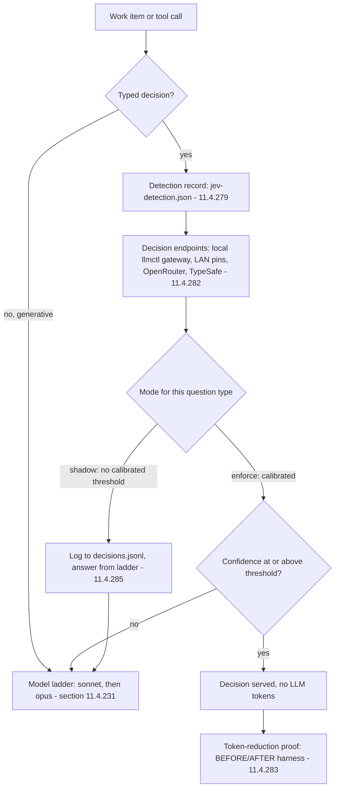
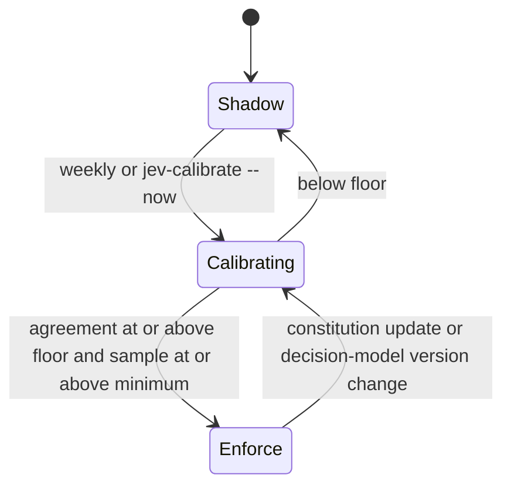

# Helix Constitution

        

| Field | Value |
|---|---|
| Revision | 9 |
| Created | 2026-05-14 |
| Last modified | 2026-10-23T00:00:00Z |
| Status | active |
| Status summary | R8 refresh (2026-10-23, unreleased — next tag `helixconstitution-v71`, tag and hash filled at tag time): the decision layer (Jev) added — anchors §11.4.279–§11.4.286, a dedicated README section with a flow diagram, and updated dependency/tooling tables; the badge row is NOT hand-edited and must be recomputed with `scripts/badges/compute_badges.sh`. Earlier: Universal engineering constitution shared by every project that includes this repository as a Git submodule. R7 refresh (2026-10-19, release `helixconstitution-v70`): every figure on this page is computed from the repository, not typed — see "Facts at a glance" and `scripts/badges/compute_badges.sh`. The canon (`Constitution.md`, revision 76) defines anchors through §11.4.278; this release adds the progressive-disclosure layer (`progressive/`), the independent audit + remediation of the optimization packs, the §11.4.141 M2–M9 token-efficiency measures, §11.4.277 / §11.4.278 with the vendored `llmctl`, the SIGPIPE-class gate hardening and the README quality-badge computer (§11.4.259 applied to this repository). The authoritative per-round history stays in `Constitution.md`'s own header and in `CHANGELOG.md`; this page is a point-in-time pointer and the badge row says honestly when it is stale. The rendered twins of the governance files (`.html` / `.pdf` / `.docx`) are NOT regenerated in this release and are declared PENDING upstream regeneration (amber `Twins` badge). |
| Issues | none |
| Issues summary | — |
| Fixed | initial creation (R1, 2026-05-14); README overhaul + recent-additions refresh (R2, 2026-05-20); revision-header + recent-anchor-coverage refresh (R3, 2026-07-23); (R4, 2026-07-23 — §11.4.226/§11.4.227 harvest round); (R5, 2026-10-05 — closing the §11.4.227→§11.4.276 staleness gap); (R6, 2026-10-13 — §11.4.277 / §11.4.278, llmctl vendored); (R7, 2026-10-19 — exhaustive rewrite against the live repository state, badge row, progressive-disclosure layer, dependency table, release process); (R8, 2026-10-21 — §11.4.31 dependency-manifest section, engine, gate and documentation links) |
| Fixed summary | — |
| Continuation | — |

> The universal engineering constitution shared by every project that
> includes this repository as a Git submodule.

## What this is

This repository contains the **universal, project-agnostic** rules,
constraints, conventions and tooling that every Helix project (and any
other project that opts in) inherits automatically. Project-specific
rules live in the consuming project's own `Constitution.md` /
`CLAUDE.md` / `AGENTS.md` / `QWEN.md` / `GEMINI.md` and **extend** what
is in here.

The model is three-layer (top-to-bottom evaluation, project overrides
universal when conflicts are explicit):

1. **Base layer (this submodule)** — universal rules: the anti-bluff
   covenant (§11.4), data safety (§9), host safety (§12), test
   coverage, commit/push discipline, credentials handling (§11.4.10),
   documentation discipline (§11.4.65), submodule-catalogue-first
   discovery (§11.4.74), containers-submodule mandate (§11.4.76),
   release/QA gates, and the machinery (gates, validators, engines)
   that makes those rules mechanically checkable.
2. **Project layer** — the project root `Constitution.md` / `CLAUDE.md`
   / `AGENTS.md` / `QWEN.md` / `GEMINI.md`: domain-specific rules,
   hardware-specific constraints, service-specific configuration.
3. **Subdirectory layer (optional)** — `<subdir>/CLAUDE.md` for
   module-local overrides. CLI agents (Claude Code, Codex, Cursor,
   OpenCode, Qwen Code, Kimi CLI, Crush) merge these by walking up from
   the working directory.

## Facts at a glance

Every number below is computed from this repository at the commit this
README ships in. Re-derive the machine-derived ones with
`bash scripts/badges/compute_badges.sh --facts`.

| Fact | Value | Source of truth |
|---|---|---|
| Latest release tag | `helixconstitution-v70` (previous: `helixconstitution-v69`, 2026-10-05; `helixconstitution-v68`, 2026-08-18) | `git tag`, `CHANGELOG.md` |
| Canon | `Constitution.md`, revision 76, 12,149 lines, 2,062,810 bytes | `wc`, document header |
| Indexed anchors | **288**, in **12** groups | `constitution_index.yaml` |
| Highest anchor number | §11.4.286 (§11.4.279–§11.4.286 decision layer (Jev); §11.4.277 llmctl model validation gate; §11.4.278 HelixQA UI QA with Vision eyes — PROPOSED, evidence pending) | `Constitution.md` |
| Progressive rules | **289** rule files generated from the canon (the 288-vs-289 difference is a recorded discrepancy, see `progressive/EVIDENCE/DISCREPANCIES.md`) | `progressive/catalog.json` |
| Governance mirrors | `CLAUDE.md` rev 82, `AGENTS.md` rev 79, `QWEN.md` rev 76, `GEMINI.md` rev 50 (kept in lockstep per §11.4.157) | document headers |
| Mechanism gates | **141** `cm_*` gates in `scripts/gates/`, **141** with a paired mutation test or outside self-test; **144** mutation tests in total | `compute_badges.sh --facts` |
| Propagation gates | **89** `cm_covenant_114_*_propagation.sh` gates | `ls scripts/gates` |
| Shell scripts | 749 `*.sh` under `scripts/` | `find` |
| Submodules | **23** declared, **23** recorded gitlinks (8 own-org, 15 third-party) | `.gitmodules`, `git ls-files -s` |
| Remotes | 6 upstreams (GitHub ×2, GitLab ×2, GitFlic, GitVerse) | `git remote -v` |
| Index freshness | index and progressive catalog both carry the canon's SHA-256 (`1667ded1…`) | `cm_constitution_index_fresh.sh` |

## Anchor catalogue by group

The canon is large (about 516,000 tokens), so it is also published as
12 topical groups — one Markdown file per group under `groups/`, listed
in `constitution_index.yaml` with an anchor count each. The counts below
are the index's own.

| Group | Anchors | File |
|---|---:|---|
| anti-bluff-and-evidence | 34 | `groups/anti-bluff-and-evidence.md` |
| code-review-and-quality | 12 | `groups/code-review-and-quality.md` |
| design-system-and-ui | 11 | `groups/design-system-and-ui.md` |
| documentation-and-export | 27 | `groups/documentation-and-export.md` |
| git-and-data-safety | 24 | `groups/git-and-data-safety.md` |
| governance-and-constitution-meta | 37 | `groups/governance-and-constitution-meta.md` |
| host-and-resource-safety | 21 | `groups/host-and-resource-safety.md` |
| multi-track-and-parallelism | 13 | `groups/multi-track-and-parallelism.md` |
| project-lifecycle-and-release | 46 | `groups/project-lifecycle-and-release.md` |
| testing-and-tdd | 41 | `groups/testing-and-tdd.md` |
| translation-and-localization | 3 | `groups/translation-and-localization.md` |
| workable-items-and-tracking | 19 | `groups/workable-items-and-tracking.md` |
| **Total** | **288** | `constitution_index.yaml` |

Foundational clauses a reader meets first (each carries its verbatim
operator mandate in a forensic-anchor block inside `Constitution.md`):

| Clause | Topic |
|---|---|
| §11.4 / §11.4.1–§11.4.16 | Anti-bluff covenant: positive captured evidence, FAIL-bluffs equally forbidden, no-guessing (§11.4.6), credentials (§11.4.10), item status/type tracking |
| §9 / §9.2 | Absolute data safety: hardlinked backup before any destructive operation, rollback never forward |
| §11.4.73 | Main-specification versioning: primary V<N> axis plus Revision secondary axis |
| §11.4.74 | Submodule-catalogue-first discovery, extend-don't-reimplement (`submodules-catalogue.md`) |
| §11.4.75 | Mechanical enforcement without exception (five-layer git-hook discipline) |
| §11.4.76 / §11.4.161 | Containers-submodule mandate, rootless container runtime |
| §11.4.78–§11.4.80, §11.4.275 | CodeGraph and Lumen code-index mandates, indexing-efficiency gate, agent/subagent accessibility |
| §11.4.141 | Token-efficiency mandate (extended in place with measures M2–M9 in this release) |
| §11.4.187 / §11.4.196 / §11.4.198 | Automatic multi-track ruler orchestration, native-alias-first priority, always-on default mechanisms |
| §11.4.209 / §11.4.211 / §11.4.231 | Review and merge-conflict substrate pins (Opus `xhigh`, sanctioned Sonnet fallback), nano-precision model-tier selection |
| §11.4.224 | Test-first for all work, with the coverage floor as necessary-never-sufficient |
| §11.4.259 | README quality-badge row — applied to this very page (see the top of it) |
| §11.4.276 | Review-round budget: at most 7 rounds, with a binding structural round at round 3 |
| §11.4.277 / §11.4.278 | llmctl model validation gate; HelixQA UI QA with Vision eyes (PROPOSED) |
| §11.4.279–§11.4.286 | Decision layer (Jev): detection-first, per-agent installation, bootstrap wizard, instance utilization, token-reduction proof, pre-ladder routing (amends §11.4.231), shadow-first auto-tuning, `llmctl` / `claude_toolkit` dependency submodules — see "Decision layer (Jev)" below |
| §12 / §12.6 / §12.12 | Host-session safety: 60 % memory ceiling, thread-limit headroom |

## Progressive-disclosure layer (`progressive/`)

Loading the whole canon into every agent turn is the measured root cause
of repeated token exhaustion in consuming projects. The `progressive/`
tree splits the canon deterministically so an agent loads a lean core
and pulls individual rules on demand. `Constitution.md` itself is
untouched: every existing reader keeps working.

| Piece | Path | Measured |
|---|---|---|
| Lean core | `progressive/core.md` | 999 tokens (budget 3,000) |
| Catalog (id, title, one-line description, tags, path) | `progressive/catalog.json` | 21,052 tokens, 4.1 % of the 516,424-token monolith |
| Rule files, one per anchor | `progressive/rules/<id>.md` | 289 files; largest is §11.4.230 at 20,442 tokens |
| Digests and line ranges | `progressive/rules_manifest.json` | read only by `verify` and the validators |
| Splitter | `progressive/generate_split.py` | byte-reproducible |
| MCP server (stdio, local, offline) | `progressive/mcp_server.py` | tools `search_constitution`, `load_rule`, `list_anchors`, `verify_anchor`, with per-call accounting |
| Surfaces | `progressive/surfaces/` | skill and plugin `helix-constitution`, `mcp.json.template`, double-load guard |
| Validators | `progressive/validate_{structure,behavior,tokens,submodule,evidence}.py` | see "Verification" below |
| Mutation matrix | `progressive/mutation_matrix.py` | 20 of 20 mutations killed (`EVIDENCE/MUTATIONS.json`) |
| Token harness | `progressive/token_harness.py` | real provider measurement, below |
| Evidence | `progressive/EVIDENCE/` | structure, behavior, tokens, mutations, anchors, risk register, discrepancies |

Real provider measurement (Claude Code 2.1.303, model `sonnet`, 24
frozen prompts, corpus SHA-256 `5566abcc…`): the progressive arm used
1,274,168 tokens against 7,168,066 for the monolithic arm — a ratio of
**0.178** — at a measured cost of 0.6981 USD against 2.2808 USD, with
24 of 24 answers correct on the progressive arm against 22 of 24 on the
monolith (`progressive/EVIDENCE/TOKENS_AFTER.json`,
`TOKENS_BEFORE.json`). One host, one model, one corpus: these are
measurements, not guarantees.

`HELIX_CONSTITUTION_MODE` selects the behaviour: `progressive` (default:
core plus on-demand rules), `dual` (core plus full text available) or
`monolith` (the exact pre-optimization behaviour — emergency rollback,
no file needs reverting). `HELIX_CONSTITUTION_PLUGIN=1` makes the skill
defer to the plugin so the tools are never registered twice.

Open items, recorded in `progressive/HANDOFF.md` and
`progressive/EVIDENCE/DISCREPANCIES.md` rather than glossed over: the
literal "catalog at most 5,000 tokens" target is not met (the ids plus
one-line descriptions alone measure 6,034 tokens); an AOSP sandbox
comparison needs a real build; an independent fresh-clone sign-off is
not yet committed; twin governance files reference 20 anchors the canon
only cites, never defines (`progressive/twin_exceptions.txt`).

## Decision layer (Jev)

Anchors §11.4.279–§11.4.286 add a typed-decision routing stage in front
of the model ladder. A judgment that fits a typed decision (yes/no,
choice, score) is answered by a small decision model ("Jev": hosted via
TypeSafe/OpenRouter, or the local `llmctl` decide gateway; Kev, Laya,
Verdict and Strands profiles are the other decision profiles) instead
of a chat model, so only generative work spends traditional-LLM tokens.
The §11.4.231 ladder itself is unchanged. The text lives in
`Constitution.md`; the operator documents are under `docs/jev/`.





| Concern | Anchor | Where it is implemented |
|---|---|---|
| Detect decision models before the first LLM call | §11.4.279 | `jev-detection.json`, gate `CM-JEV-DETECTION` |
| Install per agent (hook, MCP, skill, aliases) | §11.4.280 | `jev-setup.sh`, `skills/jev-decision-layer/`, `mcp/templates/jev-decisions.json.tmpl`, gate `CM-JEV-WIRING` |
| Bootstrap wizard, rerun on every constitution update | §11.4.281 | `scripts/jev/bootstrap.sh`, `scripts/post_update_hook.sh`, gate `CM-JEV-BOOTSTRAP-IDEMPOTENT` |
| Use all decision instances | §11.4.282 | capacity in `jev-detection.json` |
| Prove token reduction | §11.4.283 | BEFORE/AFTER harness extension, gate `CM-JEV-TOKEN-REDUCTION` |
| Pre-ladder routing stage (amends §11.4.231) | §11.4.284 | `CM-JEV-WIRING` (no decision endpoint in a chat config) |
| Shadow-first auto-tuning | §11.4.285 | `jev-calibrate.sh`, `jev-thresholds.json` |
| `llmctl` and `claude_toolkit` as submodules | §11.4.286 | `helix-deps.yaml`, `submodules/` |

Each anchor also has a `CM-COVENANT-114-<N>-PROPAGATION` gate. Whether
each of these files and gates exists in a given checkout is verified
with `ls scripts/jev scripts/gates | grep -i jev`, not by this table.

## Token and speed machinery

| Piece | Path | Purpose |
|---|---|---|
| Token-efficiency library | `scripts/token_efficiency/` | context compactor, scoped reads, shared library (tests in `tests/token_efficiency/`) |
| Action registry | `actions/registry.yaml` | the 19 registered prefix actions (`BACKGROUND`, `REMINDER`, `CRITICAL`, `IMPORTANT`, `NOTE`, `BUG`, `TASK`, `ISSUE`, `FEATURE` and ten sub-system shortcuts) |
| Subagent tiering | `actions/subagent_tiering.yaml`, `scripts/subagent_tier.sh` | lightest-capable model tier per task (§11.4.231) |
| Terse output guidance | `actions/terse_output_guidance.md` | short-form agent output |
| Accounting | `scripts/token_accounting.sh` | per-call token accounting |
| Prompt caching | `scripts/enable_prompt_caching_check.sh` | cache-warm check for the core |
| Fast-cycle machinery | `scripts/fastcycle/` | review-record gates, sampling boundary matrix, timing and golden evidence |

## Credential scanning

The scanner library lives here: `scripts/hooks/credential_scan_lib.sh`
(with its carrier-strip rules, the latest being #36 and #37 — the
synthetic-PEM and reserved-documentation-TLD false positives) and the
suites `test_credential_scan_lib.sh`,
`test_credential_scan_lib_akia_literal_free.sh` and
`test_credential_scan_lib_subsuite_mutation_test.sh`. Whether a consumer
runs the scan on every commit is the consumer's decision: the reference
consumer (ATMOSphere) made it **opt-in** by operator mandate (2026-10-17)
through a shared switch, `ATMOSPHERE_CREDSCAN=1`, which is a consumer
mechanism and not part of this repository. The rule itself is unchanged
and universal: §11.4.10 forbids committing secrets, and a skipped scan
is always announced, never silent.

## Dependency submodules

The constitution is a hub (the §11.4.28(C) depth-1 carve-out): it hosts
27 submodules under `submodules/`. Ten are own-org and are declared in
`helix-deps.yaml` (§11.4.31); seventeen are third-party skill, tool and
reference repositories pinned read-only. Pins below are the recorded
gitlinks.

Own-org (declared in `helix-deps.yaml`):

| Submodule | Remote | Pin | Role |
|---|---|---|---|
| `docs_chain` | `vasic-digital/docs_chain` | `8e0abe0` (tag `helixcode-v1.1.0` + 12) | §11.4.106 documentation-and-database sync/verify engine |
| `continuum` | `vasic-digital/continuum` | `4639347` | §11.4.207 instant multi-stream resume engine |
| `anti_bluff` | `vasic-digital/anti_bluff` | `d060d08` | shared anti-bluff verification primitives (§11.4) |
| `session_orchestrator` | `vasic-digital/session_orchestrator` | `78b77bb` | §11.4.187 multi-track ruler substrate |
| `token_optimizer` | `vasic-digital/token_optimizer` | `2002db5` | §11.4.141 token-optimization engine |
| `helix_perf_cache` | `HelixDevelopment/helix_perf_cache` | `6adcfb2` | shared build/test result cache with fingerprint invalidation |
| `llmctl` | `vasic-digital/llmctl` | `f42bad6` (main, describe `helixconstitution-v70-68-gf42bad6`) | §11.4.277 model manager and validation gate; §11.4.286 decision-layer dependency — nests no own-org repository (resolves the canon, `containers` and `superspec` via `lib/resolve_deps.sh`); depth-1 only, **never** initialised recursively because it nests third-party `llama.cpp` and `colibri` (`recursive_init: false`, checked by `CM-LLMCTL-SUBMODULE-NONRECURSIVE` and `CM-HUB-ENGINE-NO-OWNORG-NESTING`) |
| `containers` | `vasic-digital/Containers` | `919ad1e` (main, describe `helixcode-v1.1.0-159-g919ad1e`) | §11.4.76 / §11.4.161 rootless container orchestration layer, provided flat so engines resolve it instead of nesting it |
| `claude_toolkit` | `vasic-digital/claude_toolkit` | `adae02d` (tag `claude_toolkit-1.32.0`) | multi-alias / provider toolkit (§11.4.196 / §11.4.198); §11.4.286 decision-layer dependency — nests no own-org repository (resolves the canon, `containers`, `challenges`, `LLMsVerifier` and `claude-code-router` flat via `scripts/resolve_deps.sh`) and ships its own `helix-deps.yaml`; depth-1 only, **never** initialised recursively because it nests the third-party Go toolchain (`submodules/go`) (`recursive_init: false`, checked by `CM-HUB-ENGINE-NO-OWNORG-NESTING`) |
| `design-toolkit` | `vasic-digital/design-toolkit` | `4ddc964` (tag `v0.2.2` + 14) | §11.4.162 OpenDesign design-token and brand-contract engine |

Third-party (pinned, not modified here): `agentic-validation`
(Tyler-R-Kendrick/agentic_validation), `claude-video`
(bradautomates/claude-video, `v0.3.2`), `donespec` (xryv/DoneSpec,
`v1.0.0` + 1), `mcp-audio-tweaker` (DeveloperZo/mcp-audio-tweaker),
`MVT` (rdkcentral/MVT, `v2.9.0` + 177, with its own nested
`js_mse_eme`), `polyscreen-mcp` (Zyzto/polyscreen-mcp, `v0.9.0` + 1),
`repo-proof` (Gary06868/repo-proof), `repo-qa`
(okwinds/skills-runtime-sdk, `v0.1.12` + 9), `skill-doctor`
(KalarisLabs/Skill-Doctor, `v0.1.0` + 16), `verfix`
(verfix-dev/verfix, `v0.2.1` + 78), `verification`
(ArcBlock/agent-skills), `verify` (KeyValueSoftwareSystems/maestro),
`video-quality-mcp` (hlpsxc/video-quality-mcp), `watch-skill`
(oxbshw/watch-skill, `deepwatch-v0.1.4`) and `wave-dpctf`
(cta-wave/device-observation-framework, `v2.1.0` + 9), plus `superspec`
(WangX0111/superspec, `v1.0.2`, MIT) and `open_design` (nexu-io/open-design,
Apache-2.0, the §11.4.162 reference checkout), both declared in
`helix-deps.yaml` with `third_party: true`.

`submodules-catalogue.md` is the separate inventory of every
owned-by-us repository under `vasic-digital` and `HelixDevelopment`
(§11.4.74), categorised into capability groups.

### Dependency manifests (§11.4.31)

Every own-org repository — your project root, every repository under
`<root>/submodules/`, the `constitution` hub and every repository under
`<root>/constitution/submodules/` — carries a tracked `helix-deps.yaml`.
One engine checks and generates them, by reference from this submodule:

```bash
bash constitution/scripts/deps_manifest/verify_helix_deps_manifests.sh --root .            # check the whole tree
bash constitution/scripts/deps_manifest/verify_helix_deps_manifests.sh --scaffold . --write # first manifest for a new project
```

The gate `CM-HELIX-DEPS-MANIFEST-PRESENT`
(`scripts/gates/cm_helix_deps_manifest_present.sh`) runs it on every pull.
Documentation:
[user guide](docs/guides/dependency_manifest_user_guide.md) ·
[manual](docs/manuals/dependency_manifest_manual.md) ·
[FAQ](docs/faq/dependency_manifest_faq.md).

## Tooling map

| Path | Contents |
|---|---|
| `scripts/gates/` | 141 mechanism gates, 89 of them anchor-propagation gates, each with a paired mutation test or an outside self-test; the gate ledger, deferral and ratchet data files; `lib_badge_row.sh`, `lib_doc_manifest.sh` and other shared libraries |
| `scripts/anchors/` | anchor library, `constitution_generate.py` (regenerates `constitution_index.yaml` and the groups), link check, wiring audit |
| `scripts/hooks/` | PreToolUse guards (forbidden commands, branch consistency, track labels, work-track binding, evidence-store writes) and the credential scanner |
| `scripts/multitrack/` | the §11.4.187 ruler: up/down, claim registry, device lock, fallback monitor, supervisor, host budget |
| `scripts/codegraph/`, `scripts/lumen/` | the single-writer CodeGraph entry, scope renderer and guard, index watchdog; Lumen scope generator and benchmark |
| `scripts/workable-items/`, `scripts/reporting/` | the workable-items engine and the `ISSUE` / `BUG` / `TASK` / `FEATURE` reporting engine |
| `scripts/fastcycle/` | fast-development-cycle gates, review records, timing, sampling |
| `scripts/skill_activation/` | on-demand skill activation (§11.4.272) |
| `scripts/translation/`, `scripts/render/` | the HelixTranslate pipeline wrappers and the governance-twin renderer (`render-governance-twins.sh`) |
| `scripts/jev/` | the decision-layer wizard and tools (§11.4.279–§11.4.286): `bootstrap.sh`, `jev-setup.sh`, `jev-gate.sh`, `jev-calibrate.sh`, `jev-stats.sh` |
| `scripts/badges/` | `compute_badges.sh` — the README badge computer (this page) |
| `scripts/doc_integrity/` | cross-document consistency validator (§11.4.186) |
| `skills/` | `action-prefix-system`, `media-validator`, `multitrack`, `reporting-workable-items`, `scheduled-work-queue`, `session-sync`, `skill-catalog`, `workable-item-lifecycle`, `jev-decision-layer` |
| `plugins/` | `helix` (prefix commands), `scheduled-work` |
| `mcp/` | MCP server definitions (`media-validator-mcp.json`, `scheduled-work-mcp.json`; `templates/jev-decisions.json.tmpl` is a render template, not a live config) |
| `templates/` | templates for project Constitution / CLAUDE / AGENTS / QWEN files and the starting `helix-deps.yaml` (§11.4.31) |
| `docs/` | guides (shell-instrument footguns, [dependency manifests](docs/guides/dependency_manifest_user_guide.md)), [manifest manual](docs/manuals/dependency_manifest_manual.md), [manifest FAQ](docs/faq/dependency_manifest_faq.md), agent guardrails, actions manual set, CodeGraph status, owed-gate register, research corpora |
| `scripts/deps_manifest/` | the §11.4.31 manifest verifier + skeleton generator (`verify_helix_deps_manifests.sh`) |

## How to consume

### 1. Add the submodule

```bash
git submodule add git@github.com:HelixDevelopment/HelixConstitution.git constitution

# Pin to a release tag for reproducibility (recommended)
cd constitution
git checkout helixconstitution-v70
cd ..
git add constitution
git commit -m "chore: add Helix Constitution submodule pinned to helixconstitution-v70"
```

When teammates clone your project:

```bash
git clone --recurse-submodules <your-project-url>
# or if already cloned:
git submodule update --init --recursive
```

`submodules/llmctl` and `submodules/claude_toolkit` are the exceptions
(`recursive_init: false` in `helix-deps.yaml`): initialise them one level
deep only (`git submodule update --init submodules/llmctl
submodules/claude_toolkit`), never with `--recursive`. llmctl no longer
vendors this constitution (it resolves it, `containers` and `superspec`
via `lib/resolve_deps.sh`), but it nests the third-party `llama.cpp` and
`colibri`, which are never initialised recursively. claude_toolkit (pin
`1f6dad3`) no longer nests any own-org repository either — it resolves this
constitution and its siblings flat via `scripts/resolve_deps.sh` and ships a
tracked `helix-deps.yaml` — but it nests the third-party Go toolchain
(`submodules/go`), which is never initialised recursively. Measured
2026-10-22: `CM-HUB-ENGINE-NO-OWNORG-NESTING` and
`CM-HELIX-DEPS-MANIFEST-PRESENT` both PASS for every engine.

### 2. Wire the inheritance

Add a clearly-marked pointer at the top of your project's root
`CLAUDE.md`:

```markdown
## INHERITED FROM constitution/CLAUDE.md

All rules in `constitution/CLAUDE.md` (and the `constitution/Constitution.md`
it references) apply unconditionally. Project-specific rules below
extend them.

@constitution/CLAUDE.md
```

Same for `AGENTS.md` (any AI-agent tooling), `QWEN.md` and `GEMINI.md`:

```markdown
> Base agent rules: `constitution/AGENTS.md` — READ IT FIRST.
> The base file is authoritative for any topic not covered here.
```

And for your project Constitution:

```markdown
This constitution **extends** the Helix Universal Constitution at
`constitution/Constitution.md`. All clauses there apply unless
explicitly overridden below with an explicit `Override §X.Y`
section.
```

### 3. Keep always-loaded context small

Do not paste the canon into the files your agents load every turn — the
measured cost of doing so is the reason the progressive layer exists.
Keep the always-loaded files small, point at the rules, and let agents
pull them on demand: `progressive/core.md` plus the MCP server
(`progressive/surfaces/mcp.json.template`), or the
`helix-constitution` skill and plugin. §11.4.141 (M2–M9) states the
budget rules; the consumer enforces its own byte budget.

### 4. Set up the multi-upstream push

From the **constitution submodule's** root directory:

```bash
cd constitution
bash install_upstreams.sh
```

This reads every `upstreams/*.sh` declaration and configures matching
git remotes locally, so a single `git push origin` reaches every
provider.

### 5. Verify inheritance with an automated test

Every consuming project should ship a test that verifies the
constitution submodule is present, at the expected pinned revision, and
that the project's `CLAUDE.md` / `AGENTS.md` / `QWEN.md` /
`Constitution.md` all reference it (the reference implementations are
the ATMOSphere project's `test_constitution_inheritance.sh` and the
Herald project's `tests/test_constitution_inheritance.sh`; this
repository's `meta_test_inheritance.sh` proves the gate catches a
deletion of the §11.4 anchor). A consumer that records the pinned
commit in a `.constitution-pin` file must re-record it after every bump
— `progressive/validate_submodule.py` compares that file with this
repository's `HEAD`.

## Multi-upstream topology

This repository is published to six remotes; `origin` is configured with
one fetch URL (GitHub) and six push URLs, so `git push origin <branch>`
fans out to all of them.

| Remote | URL |
|---|---|
| `github` (primary, `origin` fetch) | `git@github.com:HelixDevelopment/HelixConstitution.git` |
| `vasicdigitalgithub` | `git@github.com:vasic-digital/HelixConstitution.git` |
| `gitlab` | `git@gitlab.com:helixdevelopment1/helixconstitution.git` |
| `vasicdigitalgitlab` | `git@gitlab.com:vasic-digital/HelixConstitution.git` |
| `gitflic` (also `upstream`) | `git@gitflic.ru:helixdevelopment/helixconstitution.git` |
| `gitverse` | `git@gitverse.ru:helixdevelopment/HelixConstitution.git` |

Every commit and every tag MUST reach all six; never force-push (§11.4.113).

## Verification

```bash
# Machine-derived facts and badge row (this page)
bash scripts/badges/compute_badges.sh --facts
bash scripts/badges/compute_badges.sh --check      # README badge row == computed row
bash scripts/badges/compute_badges.sh --selftest   # golden-good / golden-bad / negative-control

# README quality-badge family (§11.4.259)
bash scripts/gates/cm_readme_badge_row_at_top.sh --root .
bash scripts/gates/cm_badge_closed_color_vocabulary.sh --root .
bash scripts/gates/cm_badge_machine_derived_source.sh --root .
bash scripts/gates/cm_badge_self_validated.sh --root .

# Index and progressive layer
bash scripts/gates/cm_constitution_index_fresh.sh --root .
python3 -I progressive/validate_structure.py
python3 -I progressive/validate_behavior.py
python3 -I progressive/validate_tokens.py      # UNCONFIRMED (exit 3) without a live provider measurement
python3 -I progressive/validate_submodule.py   # needs the consumer's .constitution-pin
python3 -I progressive/validate_evidence.py
```

Exit codes follow the gate convention: 0 pass, 1 fail, 2 blind (a source
of truth could not be read — never a pass), 3 unconfirmed. The
provenance of every badge is declared in `docs/BADGES.md`.

## Versioning and releases

Releases are tagged `helixconstitution-vNN` (annotated, project-prefixed
per §11.4.151) and published to all six remotes. The release notes live
in `CHANGELOG.md`, newest first; each tag also has a GitHub release on
both GitHub repositories and a GitLab release on both GitLab
repositories. Consuming projects pin a specific tag and upgrade
deliberately. The older `v1.0.0` (2026-07-24) and `helixcode-v1.1.0`
tags are kept for history.

| Tag | Date | Notes |
|---|---|---|
| `helixconstitution-v70` | 2026-10-19 | progressive-disclosure layer, optimization audit and remediation, §11.4.141 M2–M9, §11.4.277 / §11.4.278 and llmctl, gate hardening, README badge computer |
| `helixconstitution-v69` | 2026-10-05 | process-safety, release-engineering, anti-slop and review-round-budget round (14 anchors, 19 extensions) |
| `helixconstitution-v68` | 2026-08-18 | monolithic amendment round (22 anchors, 5 extensions) |

Per §11.4.73, consuming projects that maintain a main specification
document follow the two-axis rule: primary `V<N>` for major rewrites,
secondary `Revision N` (in the metadata table) for additive changes
within a primary version.

## Contents

| File or directory | Purpose |
|---|---|
| `Constitution.md` | **The canonical universal constitution.** All clauses are project-agnostic. |
| `CLAUDE.md`, `AGENTS.md`, `QWEN.md`, `GEMINI.md` | Per-agent views of the constitution, kept in lockstep (§11.4.157). |
| `CLAUDE_ANCHORS_FULL.md` | Full anchor text for Claude Code. |
| `constitution_index.yaml`, `groups/` | Generated anchor index and the 12 topical group files. |
| `progressive/` | The progressive-disclosure layer (see above). |
| `CHANGELOG.md` | Release notes and version log. |
| `helix-deps.yaml` | Own-org dependency manifest (§11.4.31); every own-org repository carries one, checked by `scripts/deps_manifest/verify_helix_deps_manifests.sh`. |
| `submodules/`, `submodules-catalogue.md` | Dependency submodules and the owned-repository inventory. |
| `scripts/`, `tests/`, `skills/`, `plugins/`, `mcp/`, `actions/`, `config/` | Tooling, tests, skills, plugins, MCP definitions, prefix-action registry, gate configuration. |
| `docs/` | Guides (incl. the [dependency-manifest guide](docs/guides/dependency_manifest_user_guide.md)), manuals ([dependency manifest](docs/manuals/dependency_manifest_manual.md)), FAQs ([dependency manifest](docs/faq/dependency_manifest_faq.md)), research, actions manual set, CodeGraph status, owed-gate register, `BADGES.md`. |
| `templates/` | Templates for project-specific Constitution / CLAUDE / AGENTS / QWEN files and `helix-deps.yaml.template` (§11.4.31). |
| `upstreams/`, `install_upstreams.sh` | One `.sh` declaration per upstream remote and the installer. |
| `find_constitution.sh`, `meta_test_inheritance.sh` | Locate this submodule from any nesting depth; sentinel test for the inheritance gate. |
| `docs/jev/` | The decision-layer (Jev) operator documents. |
| `LICENSE` | Apache License 2.0, governing the constitution text itself. |

The `.html` / `.pdf` / `.docx` siblings of the Markdown files are
generated twins; they are never hand-edited and are regenerated upstream
(`scripts/render/render-governance-twins.sh`). Until that runs, the
`Twins` badge is amber.

## Contributing

Universal status has to be **earned**, not assumed. Project-specific
content does NOT belong here. When in doubt, classify a rule as
project-specific and keep it in the consuming project's own
Constitution.

A rule is **universal** only if ALL are true:

1. It would be true for at least 3 unrelated projects across different
   domains.
2. It does not reference a specific service / schema / port / topic /
   table / vendor / hardware unique to one project.
3. It encodes a *policy* or *principle*, not a *configuration value*.
4. Removing it from any consuming project would be just as wrong as
   removing it from any other.

A rule is **project-specific** if any are true:

- Mentions a specific service, package, topic, table, ML model,
  protocol version, hardware, or vendor.
- Encodes a numeric threshold tuned for one codebase (coverage %,
  latency SLOs, retry counts).
- Describes a workaround for a bug or quirk in a dependency this
  project uses.

A rule that lands without its enforcing seam is, by §11.4.227, a rule
only in words: gate code is a separate work item, and the gate ledger
(`scripts/gates/gate_ledger_baseline.txt`, deferrals in
`gate_ledger_deferrals.tsv`) counts the debt and may only shrink.

## License

Apache License 2.0 — see `LICENSE`.
