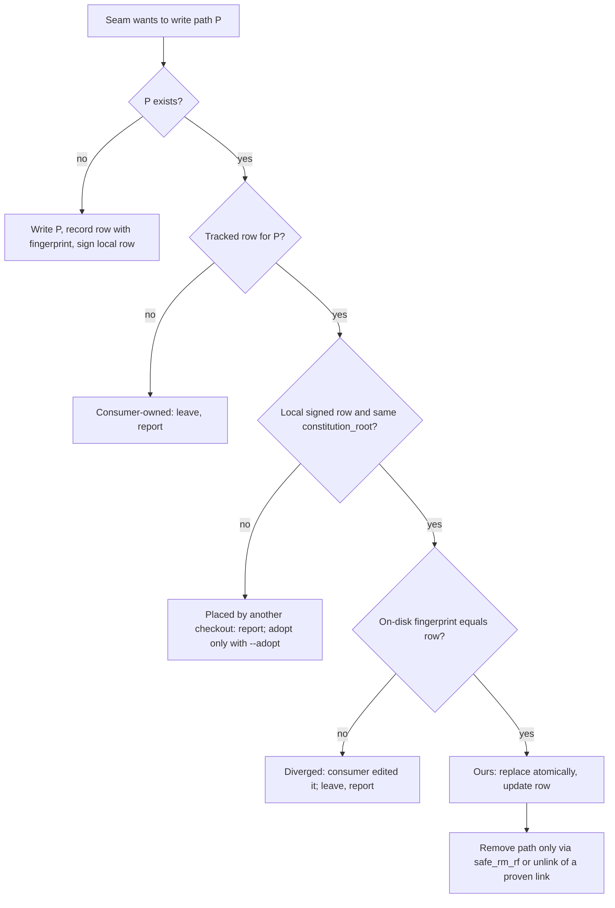

# Extension engine and agent wiring: ownership redesign

| Field | Value |
|---|---|
| Revision | 4 |
| Created | 2026-11-02 |
| Last modified | 2026-11-05 |
| Status | design proposal; wave 1 (`wiring_ledger.py`, on main) and wave 2 (E01 installed-by-this-checkout fact, L03 `wiring --inventory/--check`, rollback preflight hardening, E01 `adopt-install`, C02 hermetic-suite work, which stays open) are implemented on `vehicle/ownership-wave2`, not yet on main; the rest is not implemented. Read-only investigation of `main` at `ca88eda` plus the dirty working tree present at that time |
| Status summary | Records how the CLI-agent installer and the `/constitution extensions` engine decide what they own today, the defects found, a proposed ownership model, verified wiring for opencode, kimi and pi, a compatibility matrix, a migration and rollback plan, a test plan and phased work items. Operator decisions are listed in section 11 |
| Authority | §11.4.228 (extension lifecycle), §11.4.272 (on-demand activation), §11.4.122 (no silent removal), §11.4.287 (destructive paths), §11.4.10 (secrets), §11.4.111 (relocation-proof links), §11.4.201 / §11.4.273 (real condition, control needles), §11.4.289 (live evidence), §11.4.288 (all work on `main`) |
| Inputs | `docs/design/constitution_extensions_plan.md` (rounds 6 to 12), `scripts/install_cli_agent_plugins.sh`, `scripts/install_action_prefix.sh`, `scripts/generate_agent_prefix_commands.sh`, `scripts/post_update_hook.sh`, `scripts/constitution_ext/ext_engine.py`, `tests/constitution_cmd/*`, `CHANGELOG.md` v73 and v73.1, `docs/design/known_failures_v73.md` |
| Issues | see sections 4 and 12 |

## Table of contents

1. [Scope and method](#1-scope-and-method)
2. [Two ownership problems, not one](#2-two-ownership-problems-not-one)
3. [Current behaviour with evidence](#3-current-behaviour-with-evidence)
4. [Problems found](#4-problems-found)
5. [Proposed ownership model](#5-proposed-ownership-model)
6. [Per-platform wiring (verified)](#6-per-platform-wiring-verified)
7. [Compatibility matrix](#7-compatibility-matrix)
8. [Risks and controls](#8-risks-and-controls)
9. [Migration and rollback](#9-migration-and-rollback)
10. [Test plan](#10-test-plan)
11. [Decisions that need the operator](#11-decisions-that-need-the-operator)
12. [Phased work items](#12-phased-work-items)
13. [UNCONFIRMED list](#13-unconfirmed-list)
14. [Sources](#14-sources)

## 1. Scope and method

Everything below was read from source or measured on this host on 2026-11-02. No file in the repository was changed except this document. No installer, generator or test that writes into the constitution tree was run, because they write tracked files (see P8).

Host tools measured (`command -v`, negative control `zz_no_such_cli_qq` returned ABSENT):

| CLI | Present | Version |
|---|---|---|
| claude | yes | 2.1.316 |
| opencode | yes | v2.2.0 |
| kimi (kimi-code) | yes | 2.3.1 |
| pi (`@earendil-works/pi-coding-agent`) | yes | 1.3.0 |
| gemini, qwen, codex | no | n/a |

Evidence classes used in this document: **LIVE** (the CLI was run against a scratch project and its output showed the result), **SOURCE** (read from the installed binary or package code, not run), **DOCS** (vendor documentation, cited), **CODE** (read from this repository).

## 2. Two ownership problems, not one

The open item "ownership model redesign" covers two separate mechanisms that share a vocabulary and should share one model:

- **A. The CLI-agent installer** (`install_cli_agent_plugins.sh` + `install_action_prefix.sh` + `post_update_hook.sh`): which links, files and JSON entries inside a consumer project's agent configuration (`.claude/`, `.gemini/`, `.qwen/`, `prompts/`, `skills/`) belong to the constitution and may be replaced or deleted.
- **B. The extension engine** (`scripts/constitution_ext/`): which installed extension tree under the shared `extensions/_installed/` belongs to which project, and which shims in agent directories belong to which extension.

Today A proves ownership by "where a link points" and B by "lock entry + signed local record". Both have holes (section 4). Section 5 proposes one model for both.

## 3. Current behaviour with evidence

### 3.1 Installer (A)

| Behaviour | Evidence |
|---|---|
| A link is "ours" when its fully resolved target lies under THIS checkout's `skills/` or `actions/generated/` | `scripts/install_cli_agent_plugins.sh:136-141` (`ic_link_owned`) |
| Skills are linked into `<project>/.claude/skills/<name>` with relative targets | `:168-235`, `hc_ln_relative` at `:217`, `:224` |
| Gemini, Qwen and Codex commands are linked into `.gemini/commands`, `.qwen/commands` and `<project>/prompts` | `:246` |
| Our dangling links are reaped; user dangling links are kept | `:192-196`, `:269-273` |
| The plugin is installed with `claude plugin marketplace add "$const_root"` and `claude plugin install helix@helix-constitution`, default scope | `:356-357` |
| `--check` counts every symlink in `.claude/skills` as wired | `:384-385` |
| `--check` treats any `settings.json` containing the substring `action_prefix_expand` as wired | `:391` |
| `--check` treats any `claude plugin list` line containing `helix` as installed | `:398` |
| The prompt hook is identified only by an exact command string | `scripts/install_action_prefix.sh:169-171` (jq), `:228-233` (python) |
| The generator deletes every generated file first, then writes them again | `scripts/generate_agent_prefix_commands.sh:80-89` |
| The post-update hook links changed skills into `<project>/skills/<name>`, replacing ANY symlink there, with an absolute target | `scripts/post_update_hook.sh:386`, `:404-406` |
| There is no uninstall or unwire command for the installer | whole of `install_cli_agent_plugins.sh` (options at `:82-97`) |

### 3.2 Engine (B)

| Behaviour | Evidence |
|---|---|
| Wire targets: claude, opencode, gemini, qwen, pi; kimi is a known platform but not a wire target | `scripts/constitution_ext/ext_engine.py:123`, `:129` |
| Shim paths: `.claude/skills/<n>` (symlink to a snapshot), `.opencode/commands/<n>.md`, `.gemini/commands/<n>.toml`, `.qwen/commands/<n>.toml`, `.pi/prompts/<n>.md` | `:1805-1811` |
| opencode and pi shims are Markdown with YAML front matter carrying `# managed-by: constitution_ext id=... command=...` | `:3186-3190`, marker `:138` |
| `remove` needs the id in the lock AND a valid HMAC-signed local record (rule F3) | `:2758-2765` |
| `enable` accepts a missing local record and then writes one through `commit` | `:2847`, `:2863` |
| The shared root keeps no registry of projects | plan, round 10 and 11 notes |

Consequence of the last two rows (already listed as F-1 in the plan): in a second clone with a copied lock, `enable` creates a valid record, after which `remove` accepts it as proof of ownership and may delete a tree another project uses.

## 4. Problems found

Severity: H high, M medium, L low. "New" means not recorded in the plan, CHANGELOG or known-failures file.

| ID | Sev | Problem | Evidence | New |
|---|---|---|---|---|
| P1 | H | Ownership by link target only. A link a user made on purpose into the constitution's `skills/` is treated as ours and can be reaped or replaced; a link left by an OLD layout (`constitution/` before `submodules/constitution/`) points at a different checkout, is "not ours", and is stranded forever | CODE `:136-141` | yes |
| P2 | H | Hook entry identity is the exact command string. When the constitution path changes (layout migration, moved checkout, a path that needs quoting after `:77-79`), the old entry stays and a new one is appended: two `UserPromptSubmit` entries, one dead or both expanding | CODE `install_action_prefix.sh:169-171`, `:77-79` | yes |
| P3 | H | `post_update_hook.sh` replaces any symlink at `<project>/skills/<name>` (`rm -f` then `ln -s`), including a user's own link, and writes an absolute target (breaks §11.4.111). It also uses a second seam (`<project>/skills`) that no agent verified here reads | CODE `post_update_hook.sh:404-406` | partly (the two seams are in the plan; the user-link clobber and absolute target are new) |
| P4 | M | `--check` is a proxy (§11.4.201): user links count toward the skill total, any string `action_prefix_expand` (a comment, a disabled copy, another path) passes, any plugin name containing `helix` passes | CODE `:384`, `:391`, `:398` | yes |
| P5 | M | The plugin and marketplace are written at USER scope from a project install, keyed by the fixed name `helix-constitution`. Two projects with different constitution checkouts fight over one user-level marketplace entry, and nothing removes it | CODE `:356-357`; LIVE `claude plugin marketplace add --help` shows `--scope user (default), project, or local` | yes |
| P6 | M | Codex wiring writes `<project>/prompts/*.md`. Codex reads custom prompts only from `~/.codex/prompts/`, says they are not shared through the repository, and marks them deprecated in favour of skills. The project-level files are therefore inert for Codex (codex is not installed here, so not run) | CODE `:246`; DOCS [OpenAI custom prompts] | yes |
| P7 | M | No uninstall path. Rollback is only the original-preserving `settings.json.bak`; links and generated shims have no reverse operation | CODE | yes |
| P8 | M | The generator prunes every generated file before writing (non-atomic). The current working tree shows the tracked generated sets incomplete: `plugins/helix/commands` 0 of 24, `actions/generated/gemini` 0 of 24, `qwen` 7 of 24, `codex` 24 of 24 (`ls` vs `git ls-files`). Consumers whose links point into this tree now hold dangling links, which the next installer run REAPS as "ours". Cause of the current state UNKNOWN; one candidate is a test that runs the real installer (`tests/constitution_cmd/test_install_cli_agent_plugins_ownership.sh` calls it without `HELIX_ACTION_OUT_ROOT`, and the installer runs the generator with that variable unset by design) | CODE `generate_agent_prefix_commands.sh:80-89`; measured 2026-11-02 | yes |
| P9 | M | `claude plugin validate plugins/helix` PASSES while `plugins/helix/commands/` is empty in the working tree, so validation is not evidence that commands exist | LIVE: `Validation passed`, rc 0, with 0 command files on disk | yes |
| P10 | H | Engine F-1: `enable` mints the ownership record that `remove` trusts | CODE `ext_engine.py:2847`, `:2863` | no (plan F-1) |
| P11 | M | Engine F-2: records and add journals are not bound to the constitution root realpath | plan | no |
| P12 | M | Engine: no reference count on shared trees | plan | no |
| P13 | L | Engine wire paths for opencode and pi are correct for the current CLIs (section 6) but kimi has no target; `.claude/skills` is NOT read by pi or kimi | LIVE and SOURCE, section 6 | yes |

## 5. Proposed ownership model

### 5.1 Principle

The constitution owns an item in a consumer project **only** when both hold:

1. **Recorded**: the item has a row in the project's ownership ledger, written by the seam that created it.
2. **Unchanged**: the item on disk still matches the fingerprint recorded in that row (link text for a symlink; sha256 for a file; a canonical-JSON digest of the single entry for a JSON fragment).

Everything else is consumer-owned and is never modified, replaced or deleted. A recorded item that no longer matches its fingerprint is reported as `diverged` and left alone (the consumer edited it). Where-it-points and what-it-is-called stop being proof.

### 5.2 Ledger

| Item | Proposal |
|---|---|
| Path | `<project>/.constitution/wiring.json` (one file for installer and engine) |
| Tracked in git | yes, so a clone knows what the constitution placed. Ownership by a CLONE is then proved by the second key below |
| Local key | the engine's existing per-checkout state key (`.constitution/extensions.state/key`, 0600, never committed) signs a local `wiring.local.json` that records which rows THIS checkout created. Delete and replace need both the tracked row and a valid local signature. This closes the "copied lock" class (P10) for the installer as well |
| Row ids | free-form tokens matching `[A-Za-z0-9][A-Za-z0-9._-]{0,127}`; adopted rows get deterministic ids (`adopted-` plus 12 hex of a hash of path and JSON path) |
| Row fields | `id`, `producer` (`installer`, `post-update`, `engine:<ext-id>`, and a fourth value `adopt` for rows recorded by an explicit adoption run, section 9), `agent`, `scope` (`project` or `user`), `path` (project-relative), `kind` (`symlink`, `file`, `json-entry`), `fingerprint`, `constitution_root` (realpath at creation), `created` (UTC), `constitution_version` |
| JSON entries | a hook entry in `.claude/settings.json` is identified by the row's canonical digest of that entry object, not by the command string. A path change rewrites OUR entry in place (old digest matched) instead of appending (fixes P2) |
| Root binding | `constitution_root` is compared with the current root realpath; a mismatch means "placed by another checkout": eligible for adoption only through an explicit `--adopt` run that shows each row (fixes P1 for layout migration, P11) |

### 5.3 Engine-specific rule (closes F-1)

The "installed by this checkout" fact is written **only by `add`**, bound to the root realpath and the tree identity (device, inode, digest). `enable` may refresh consent but never creates that fact. `remove` requires it. A per-root reference file `extensions/_installed/<id>.refs` (append-only list of project realpaths with their record digests, written by `add`, pruned by `remove` and by `verify --gc`) gives a reference count; the tree is deleted only when the count reaches zero (fixes P12). This is a design proposal; whether the refs file needs locking across projects is an open point (section 13).

Wave 1 (implemented in `scripts/constitution_ext/wiring_ledger.py`, not yet wired): the refs file is a plain text file, one line per project, `<project realpath>\t<record digest>`, sorted, written atomically under an exclusive `flock` on the `_installed/` directory (the 24-way concurrency test covers it). The realpath is stored as raw bytes with `surrogateescape`, so a non-UTF8 path round-trips; a path with a tab or newline is refused. The digest is a plain token (`[0-9A-Za-z._:-]{1,128}`). A corrupt line makes the whole file refuse (nothing changes). The file is removed when its last line is removed. Versioning: the format has no header line in version 1; if wave 4 adds fields it must add a first line `#refs-v2` (a line starting with `#` is reserved and rejected by v1 readers, so an old engine fails closed instead of misreading). Prune rule: `remove` drops only the calling project's line; lines for projects that were deleted from disk are NOT pruned by wave 1 (wave 4's `verify --gc` must drop a line whose project path no longer exists and report it, never the tree while any live line remains).

### 5.4 Scope rule

All writes are project scope by default. User-scope writes (`~/.claude` plugin and marketplace, `~/.codex/prompts`, `~/.pi/agent/trust.json`) happen only with an explicit flag, are recorded with `scope: user`, and are shown before they are made. The installer never grants an agent's project trust on the user's behalf.

### 5.5 Flow

## 6. Per-platform wiring (verified)

Scratch projects under the session scratchpad; needles named `zzneedle-*`; each probe had a positive control in the same run.

### 6.1 Claude Code 2.1.316

- Skills: `.claude/skills/<name>/SKILL.md` (current mechanism; not re-probed live here).
- Plugin: `claude plugin marketplace add <path> --scope project` and `claude plugin install helix@helix-constitution -s project` both exist (LIVE `--help`). Proposal: use project scope (P5).
- `claude plugin validate` alone is not proof (P9); the live check must list the plugin's commands.

### 6.2 opencode v2.2.0

| Item | Path | Evidence |
|---|---|---|
| Config directories | project `.opencode/` (and parents up to the repo), `~/.config/opencode`, `~/.opencode` | LIVE `opencode debug config` listed the scratch `.opencode` directory |
| Commands | `<configdir>/{command,commands}/**/*.md`, symlinks followed (`symlink:!0`); placeholders `$ARGUMENTS`, `$1`..; inline shell `` !`cmd` `` | SOURCE (binary string `scan("{command,commands}/**/*.md",{...symlink:!0})` and the `\$(?:ARGUMENTS|([1-9]\d*))`, ``!`([^`]+)` `` patterns) |
| Skills | `<configdir>/{skill,skills}/` scanned for `SKILL.md`, plus a compatibility source that reads `.claude/skills` and `.agents/skills` in the project, its ancestors and home, unless config `claude: false` | SOURCE (`ConfigCompatibilityPlugin`), LIVE: debug log `watcher started path=<scratch>/.claude/skills` |
| Skill listing | `opencode api --standalone GET /api/skill` returned `"data":[]` even for the user's own skills (positive control failed), so the instrument is BLIND: whether the scratch skill was loaded is UNCONFIRMED |

Wiring: commands as files in `.opencode/commands/<name>.md` (the engine's current path is correct); skills need no extra link when `.claude/skills` or `.agents/skills` is wired. Risk: the same skill reachable through both `.claude/skills` and `.agents/skills`; the compatibility source keys skills by id in a map, so one copy wins (SOURCE; which one is UNCONFIRMED).

### 6.3 kimi-code 2.3.1

| Item | Path | Evidence |
|---|---|---|
| Skills, project | `.kimi-code/skills/` and `.agents/skills/` | SOURCE: `PROJECT_BRAND_DIRS = [".kimi-code/skills"]`, `PROJECT_GENERIC_DIRS = [".agents/skills"]` |
| Skills, user | `$KIMI_CODE_HOME/skills` (default `~/.kimi-code/skills`), `~/.agents/skills` | SOURCE |
| `.claude/skills` | read only by the opt-in importer skill `/import-from-cc-codex`, not discovered automatically | SOURCE (importer text) |
| Commands | no custom-command directory found (`.kimi-code/commands`, `.kimi-code/prompts`: 0 hits); a skill is invoked as `/<name>` or `/skill:<name>` | SOURCE |
| MCP | `<git root>/.mcp.json` (Claude-compatible) and `<cwd>/.kimi-code/mcp.json` (read-only project layer) | SOURCE (`loadMcpServers` paths) |
| Override | `--skills-dir <dir>` replaces auto-discovery | LIVE `kimi --help` |

Wiring: link skills into `.agents/skills/<name>` (or `.kimi-code/skills/<name>`); no command shim. Live discovery by kimi was NOT run (UNCONFIRMED).

### 6.4 pi 1.3.0

| Item | Path | Evidence |
|---|---|---|
| Prompt templates (slash commands) | `.pi/prompts/*.md`, direct children only; symlinked files followed; `$ARGUMENTS`, `$@`, `$1`, `${1:-d}` | LIVE: `get_commands` over `--mode rpc --approve` listed `zzneedle-plain` and the symlinked `zzneedle-linked`; DOCS `prompt-templates.md` |
| Skills | `.pi/skills/`, `.agents/skills/` (cwd up to repo root), `~/.pi/agent/skills`, `~/.agents/skills`; invoked `/skill:<name>` | LIVE: `zzneedle-agents` listed; DOCS `skills.md` |
| `.claude/skills` | NOT read | LIVE: `zzneedle-claudepi` absent in the same run that listed the controls |
| Project trust | all project resources load only after trust (`--approve`, `/trust`, `~/.pi/agent/trust.json`, or `defaultProjectTrust`) | LIVE: `--no-approve` listed no needle; DOCS `security.md` |
| MCP | `.pi/mcp.json` (trust-gated), `~/.pi/agent/mcp.json` | DOCS `mcp.md` |

Wiring: commands as files in `.pi/prompts/<name>.md` (engine path correct); skills via `.agents/skills`. The installer must report "pi will load these only after you trust this project" and must not write `trust.json`.

### 6.5 Gemini, Qwen, Codex (not installed here)

- Gemini: `<project>/.gemini/commands/*.toml`, `{{args}}`, `!{...}` (DOCS, geminicli.com). Current mechanism matches; not run.
- Qwen: assumed same format as Gemini (UNCONFIRMED; not installed, no doc read).
- Codex: custom prompts are user-level (`~/.codex/prompts/`) and deprecated; skills are read from `.agents/skills` in each directory from cwd to the repo root (DOCS, OpenAI). The current `<project>/prompts` wiring is inert (P6).

### 6.6 Consequence: one shared skill seam

`.agents/skills/<name>` is read by pi (LIVE), kimi (SOURCE), opencode (SOURCE) and Codex (DOCS). Claude Code reads `.claude/skills`. Proposal: link every constitution skill into BOTH `.agents/skills/` and `.claude/skills/` and retire `<project>/skills/` from the post-update hook (decision D3).

## 7. Compatibility matrix

Status vocabulary from §11.4.228: SUPPORTED requires LIVE evidence; UNTESTED = mechanism known, not run; UNSUPPORTED; CONFIG-ONLY.

| Platform (version) | Constitution skills | Generated `/name` commands | Extension shims (engine) | MCP | Hook (prompt prefix) | Status now | Evidence |
|---|---|---|---|---|---|---|---|
| Claude Code 2.1.316 | `.claude/skills` | plugin `helix` | `.claude/skills` snapshot link | `.mcp.json` | `UserPromptSubmit` | UNTESTED (no live run of the wired result in this pass) | CODE, LIVE `--help` |
| opencode 2.2.0 | via `.claude/skills` or `.agents/skills` compatibility | not wired (proposed `.opencode/commands`) | `.opencode/commands/*.md` | not wired | none | UNTESTED | SOURCE, LIVE config/log |
| kimi 2.3.1 | via `.agents/skills` (proposed) | none (skills act as commands) | not a wire target (proposed `.agents/skills`) | `.mcp.json`, `.kimi-code/mcp.json` | none found | UNSUPPORTED today | SOURCE, LIVE `--help` |
| pi 1.3.0 | via `.agents/skills` (proposed), trust-gated | not wired (proposed `.pi/prompts`) | `.pi/prompts/*.md` | `.pi/mcp.json` | extensions only | UNTESTED; mechanism LIVE-proven in scratch | LIVE rpc probe |
| Gemini CLI | none | `.gemini/commands` | `.gemini/commands` | not wired | none | UNTESTED (not installed) | DOCS |
| Qwen Code | none | `.qwen/commands` | `.qwen/commands` | not wired | none | UNTESTED (not installed) | none |
| Codex CLI | none (proposed `.agents/skills`) | `<project>/prompts` (inert) | none | not wired | none | UNSUPPORTED as wired | DOCS |

## 8. Risks and controls

| Risk | Control |
|---|---|
| §11.4.287 destructive paths: removing shims or trees | Deletes only of paths with a matching ledger row and fingerprint; directories only through `safe_rm_rf`; links only by `unlink` after `lstat` shows a link; every path built from a validated project-relative row and checked to resolve inside the project; never a glob delete; destructive tests run in `mktemp -d` sandboxes without reassigning `HOME` |
| §11.4.10 secrets | The ledger holds paths and digests only; MCP rows record env var NAMES; JSON entries are fingerprinted, not copied into logs; tests grep the ledger and logs for secret-shaped values (control: a seeded fake token must be found by the scanner) |
| Idempotency | A second run with no change writes nothing (byte-identical ledger and tree checksums); fingerprints make "already ours and current" decidable |
| Non-atomic generator (P8) | Generate into a sibling temp directory and swap by rename per agent; never prune before the new set exists |
| Concurrent runs | One project lock (the engine's existing lock) held by installer and engine |
| User-scope side effects | Off by default (5.4) |
| Agent trust bypass | Never write pi `trust.json`, kimi workspace trust, or opencode permissions |
| TOCTOU | Remains narrowed, not closed, in shell (already documented); the ledger work moves file operations into the Python engine where `O_NOFOLLOW` reads already exist |

## 9. Migration and rollback

1. **Inventory (read-only).** `constitution_cmd.sh wiring --inventory` lists every candidate item: links into any constitution checkout under the project (old and new layout), `UserPromptSubmit` entries whose command ends in `scripts/hooks/action_prefix_expand.sh`, files carrying the generator or engine marker, user-scope plugin and marketplace entries. Output only.
2. **Adopt.** `--adopt` shows each candidate and records a row only for items that match a known constitution shape; anything else stays consumer-owned. Non-interactive runs adopt nothing unless `--adopt=all-matching` is given.
3. **Backup.** Before the first ledger-driven change, copy every file to be touched into `.constitution-install-backup/<UTC>-wiring/` (existing installer convention) with a manifest of sha256s. The manifest is HMAC-signed with the per-checkout state key (domain string distinct from the local-ledger signature); a backup made by another checkout or with another key, or an edited manifest, is refused by rollback. The `.constitution-install-backup/` base directory carries its own `.gitignore` containing `*`, so copies of consumer files (which may hold secrets) are never committable. Rollback is atomic in the sense that all checks run before the first change: a refusal in the preflight (symlink leaf or directory at a restore target, unwritable directory, bad backup) changes nothing. A row created after the backup is unlinked only when it classifies as ours (local signature, same root, matching fingerprint); any other row, and any row whose state cannot be read (oversize, reserved path), is left in place and reported.
4. **Apply.** Rewrite stale hook entries in place, re-point adopted links, link `.agents/skills`, write new shims.
5. **Rollback.** `--rollback <backup-dir>` restores files byte-for-byte from the backup after checking the manifest, and removes only rows created after the backup; links created by the run are unlinked only when they still match their row.
6. **Unwire.** `--unwire [--agent X]` removes every row-matched item of this checkout and leaves diverged and consumer-owned items with a report.

## 10. Test plan

All tests run in `mktemp -d` sandboxes; `HELIX_ACTION_OUT_ROOT` set for anything that runs the generator; a meta-test asserts the constitution tree checksum is unchanged after every suite (closes the P8 candidate cause).

| Type | What it proves |
|---|---|
| Unit | Ledger read/write, fingerprint functions, canonical JSON digest, row validation, root binding, signature check |
| Integration | Real git repos, real `submodules/constitution` and legacy layouts, layout migration rewrites the old hook entry and re-points old links instead of duplicating |
| End-to-end | `install_constitution.sh` then `constitution_cmd.sh wiring` in a throwaway project; second run is a no-op |
| Security | User link into constitution `skills/` is not touched; symlinked `.agents`, `.opencode`, `.pi` resolving outside are refused; copied ledger without local signature cannot delete; hostile row paths (`..`, absolute) refused; secret scan of ledger and logs |
| Chaos | Kill between write and ledger update, then re-run converges; kill during generator swap leaves the old set complete |
| Stress / performance | 500 skills, 100 commands; time budget recorded (value is consumer data) |
| Determinism | Three runs give identical ledger hashes |
| Mutation (§1.1) | Each rule has a paired mutant: drop fingerprint check, drop root binding, revert to link-target ownership, revert hook match to string equality, let `enable` write the add-only fact, prune-before-write in generator |
| Live (§11.4.289) | claude: `claude plugin list --json` shows `helix` at project scope and its commands; opencode: needle command and skill visible (instrument still to be found, since `/api/skill` was blind); pi: `get_commands` over `--mode rpc --approve` lists needle prompt and `.agents` skill (proven in this pass); kimi: needle skill visible through a non-interactive listing (instrument UNCONFIRMED). No LLM call is needed for any of these. Absent CLI = SKIP with reason `hardware_not_present`-class code, never a stand-in |
| Regression for P4 | `--check` must FAIL when only user links exist, when the hook string is in a comment, and when a plugin named `helix-other` is installed |

## 11. Decisions that need the operator

| ID | Question | Recommendation |
|---|---|---|
| D1 | Track the ownership ledger in git (`.constitution/wiring.json`) plus an untracked signed local file, or keep both untracked? | Tracked plus local signature |
| D2 | Default the Claude plugin and marketplace to project scope? This changes shipped behaviour for existing users (§11.4.122) | Yes, with a one-time notice and an `--scope user` option |
| D3 | Retire the post-update hook's `<project>/skills/` seam and the Codex `<project>/prompts` wiring (both shipped components, §11.4.122) in favour of `.agents/skills` + `.claude/skills` | Retire both after the migration step reports what it found |
| D4 | Adopt `.agents/skills` as the shared seam for pi, kimi, opencode and Codex | Yes |
| D5 | Engine: per-root reference file for shared trees, or forbid sharing `_installed/` across projects altogether | Reference file; forbidding sharing is simpler but breaks the documented layout |
| D6 | Adoption of pre-existing items in non-interactive runs: adopt nothing, or adopt all matching shapes | Adopt nothing unless asked |
| D7 | The current incomplete generated tree (P8) is in the working tree of `main`: restore from git or regenerate? Not touched by this pass | Investigate the cause first (§11.4.102), then restore with `git checkout` |

## 12. Phased work items

| Phase | Item | Acceptance criteria |
|---|---|---|
| 0 | P8 root cause and hermetic tests | The cause of the incomplete generated tree is shown with a reproduction; every test that runs the installer sets `HELIX_ACTION_OUT_ROOT`; meta-test proves the constitution tree is unchanged after each suite |
| 1 | Atomic generator | Kill at any point leaves a complete old or new set; mutant "prune first" is killed |
| 2 | Ledger library (in the Python engine, called from shell) | Unit, security and determinism suites green; mutation set killed |
| 3 | Installer on the ledger | B1 to B4, R1, R4, F1 cases of the existing ownership suite still pass; new P1, P2, P4 cases pass; `--unwire` and `--rollback` exist with tests |
| 4 | Engine F-1/F-2/refcount | `enable` cannot create the add-only fact (test and mutant); root-binding test; two-project shared-tree test keeps the tree until the last remove |
| 5 | Shared skill seam and per-agent wiring | `.agents/skills` + `.claude/skills` linked; opencode `.opencode/commands`, pi `.pi/prompts`, kimi via skills; kimi added to the engine's wire targets; post-update hook reuses the installer (one seam) |
| 6 | Migration | Inventory, adopt, backup, apply, rollback tested on both layouts and on a project with a stale hook entry |
| 7 | Live verification and matrix | Live rows in section 10 recorded per platform with evidence paths; matrix in `docs/extensions/EXTENSIONS_CATALOG.md` updated from that evidence only |
| 8 | Independent review and docs | Opus xhigh review to GO within the §11.4.276 budget; guide, manual, FAQ and CHANGELOG updated |

Note: the grouping of this work into waves (wave 1 = ledger library with inventory, adopt, backup, rollback and the refs file) is an implementation grouping of the phases above and is not itself part of the design; phases 2 and 6 are partly delivered by wave 1.

## 13. UNCONFIRMED list

- Cause of the incomplete generated tree in the working tree (P8). UNKNOWN.
- Whether opencode 2.2.0 actually LOADS skills from project `.claude/skills` / `.agents/skills` (the directory is watched per the live log; the listing instrument was blind) and which copy wins on a duplicate id.
- kimi 2.3.1 discovery of `.agents/skills` and `.kimi-code/skills`, and whether a kimi workspace-trust step gates project skills (source mentions a trust disclosure service; behaviour not run).
- Qwen Code command format and directory.
- Codex behaviour on this host (not installed); Codex user-level skill paths beyond the official repository rule.
- Whether Claude Code reads `.agents/skills` (not probed).
- Exact file Claude Code writes for `--scope project` plugin installs.
- Locking needs for a shared `_installed/<id>.refs` across concurrently running projects.
- Whether the existing ownership suite currently passes: not run in this pass because it writes into the tracked tree (P8).

## 14. Sources

- OpenAI, "Custom prompts" (redirected to [learn.chatgpt.com/docs/custom-prompts](https://learn.chatgpt.com/docs/custom-prompts)): prompts in `~/.codex/prompts/`, not shared through the repository, deprecated in favour of skills.
- OpenAI, [Codex Agent Skills](https://developers.openai.com/codex/skills): `.agents/skills` from cwd to repository root (via search summary of the official page; the page itself was not fetched).
- Gemini CLI, [Custom commands](https://www.geminicli.com/docs/cli/custom-commands): `.gemini/commands/*.toml`, `{{args}}`, `!{...}` (via search summary).
- pi 1.3.0 package docs on this host: `docs/prompt-templates.md`, `docs/skills.md`, `docs/security.md`, `docs/mcp.md`, `docs/configuration.md` under `~/.pi/agent/install/releases/1.3.0/node_modules/@earendil-works/pi-coding-agent/`.
- opencode v2.2.0 and kimi-code 2.3.1 installed binaries (string reads, with the absent needle `zzqq_absent_needle_77` returning 0 hits in both).

## 15. Wave 2 status (rev 4, 2026-11-05)

- **Rollback preflight (re-review M1/M4).** A refusal changes nothing: the preflight now checks, without creating anything, that the nearest existing ancestor of every ledger file to restore or unlink is a writable directory (`Ledger._need_writable_dir`, rule `W-ledger-dir-writable`), that the target is not a symlink, and that the leaf is not a directory. Apply creates missing parents itself.
- **E01 (finding F-1 / P10).** `<state>/<id>.added.json` is a signed fact written only by `add` (and by the add-journal roll-forward). It binds `{id, root realpath, sha256, dev, ino}` under the per-checkout key with the domain string `added-fact\0`. `remove` refuses without a valid fact (rc 3) and deletes the tree only when the recorded dev/ino still match; `enable` never writes it. **Installs made before this change** have no fact, so `remove` refuses. Operator decision 2026-11-05 (relayed): nothing is adopted implicitly (D6); the explicit, operator-attested command `adopt-install <id> --waiver-id <ref>` writes a fact with `via=adopt` and `attest=<ref>` after checking that the id is an installed entry of the lock, its state record verifies, its tree is a real directory whose digest equals the lock's, and no fact exists yet (an existing fact is never replaced; an invalid one is a rc 3 refusal). Confirmation is typed at a terminal (the dispatcher passes no `--yes`); `--dry-run` writes nothing; each adoption is an audit line with the attestation and the digest. The `remove` refusal names `adopt-install` as the next step. **What the fact proves (F1, honest wording):** that a checkout holding this state directory and key installed (or adopted) the tree on this constitution root. It does not bind the project path, so a byte copy of the checkout carries the same fact and `remove` there deletes the tree the original still uses. That is pre-existing and NOT fixed; it is tracked as CON-047 (E03 refcount or a project-path binding).
- **L03.** `constitution_cmd.sh wiring --inventory|--check` (read-only; `check` exits 1 unless every row classifies as ours; read commands take a shared flock on the project dir).
- **C01 to C04.** C03/C04 (atomic generator, registry-count validation) landed earlier in `1afdfc6`. C01: `docs/qa/ownership_wave2/repro_p8.sh` is a constructed-precondition reproduction (§11.4.115(G)) of the generator mechanism. On the pre-fix generator (prune, then write) an invalid registry leaves 0 of 24 files per agent, and a SIGKILL leaves a timing-dependent partial set (the committed run: plugin=16 at 150 ms, plugin=0 and gemini=17 at 400 ms, plugin=4 at 800 ms); the current generator keeps all 24 in every case. 24 = 2 files (NAME and default-NAME) for each of the 12 `actions:` entries. **C02 stays open** (operator decision 2026-11-05: the round-1 reinterpretation is rejected). Round 2: (a) the full-suite runner fingerprints the tracked generated sets (`plugins/helix/commands`, `plugins/helix/README.md`, `actions/generated`, also under a vendored `constitution/`) by path, type, inode, mtime, size and content, and checks it after every unit, so an identical-content rewrite ends the run FAIL naming the unit (`gen_fingerprint`, `quick_ident`); (b) `tests/layout/hermetic_lint.py` replaces the substring lint: it reads the command word (bash, sh, env, wrappers, keywords, a direct path, a continuation, a path held in a variable), accepts only a non-empty `HELIX_ACTION_OUT_ROOT` on the same command, flags every installer run from the real tree, and is checked against the reviewer's six violators, golden-FALSE carriers and its own paired mutations; (c) the suites measured rewriting the real tree (`tests/action_prefix/test_hook_e2e.sh`, `tests/constitution_cmd/test_install_cli_agent_plugins_ownership.sh`) run their installers from throw-away constitution copies. `tests/constitution_cmd/test_register.sh` runs the real installer's skill path and was measured not to change the fingerprint. Closing C02 waits for an independent review and a full-suite run (CON-048).
- **Wave 2 review round 2 fixes.** F3: `wiring --check` reports a local signature whose tracked row is missing as `tracked-row-missing` (exit 1), so "ledger lost" is no longer read as "never wired". F4: an invalid `SOURCE_DATE_EPOCH` (not digits, or out of range) is refused with exit 3 instead of a traceback. F6: a symlink at the fact path (or any `*.json` of the state directory) fails the upfront regular-file check cleanly. F7: commit-journal and remove-journal recovery that delete a state record also delete its fact. N1: `tests/extensions/test_integration.sh` no longer depends on the checkout's local `main`.
- **L02** (signing) was delivered in wave 1.
