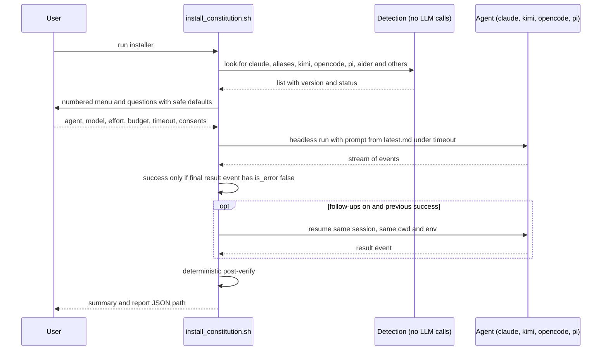

# Agent selection and headless run

| Field | Value |
|---|---|
| Revision | 2 |
| Created | 2026-10-29 |
| Last modified | 2026-10-29T18:00:00Z |
| Status | draft |
| Status summary | Sequence of agent detection, questions and the headless run. Reconciled with the final scripts on 2026-10-29; not checked against a live installer run. |
| Authority | Documentation only; no new anchor. §11.4.258 (diagrams) governs. |
| Scope | The one-command installer and updater. |
| Issues | none |

Only the Claude family (native and provider aliases), kimi, opencode and pi are the headlessly drivable agents (only unit-class tested; provider aliases, kimi, opencode and pi are UNCONFIRMED against a live run); other detected agents are listed detect-only and refused as `--agent`.
