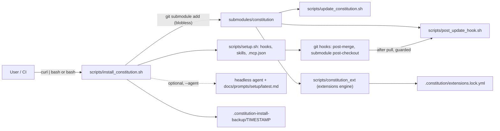

# Architecture overview

| Field | Value |
|---|---|
| Revision | 3 |
| Created | 2026-10-29 |
| Last modified | 2026-10-31T11:30:00Z |
| Status | draft |
| Status summary | Components and how they connect. Reconciled with the scripts on 2026-10-29; not checked against a live run. |
| Authority | Documentation only; no new anchor. §11.4.258 (diagrams) governs. |
| Scope | Helix Constitution installer, updater and extensions. |
| Issues | none |

The installer never pushes. The extensions engine is not yet wired into the installer or hooks (pending). See [installer flow](installer_flow.md), [update flow](update_flow.md), [trust model](trust_model.md).
