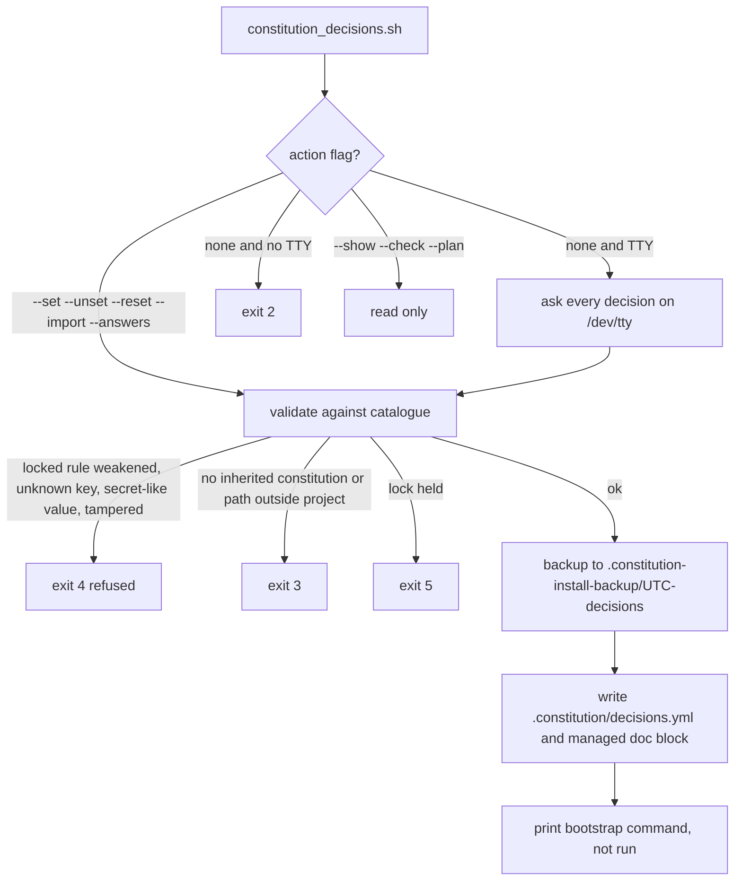
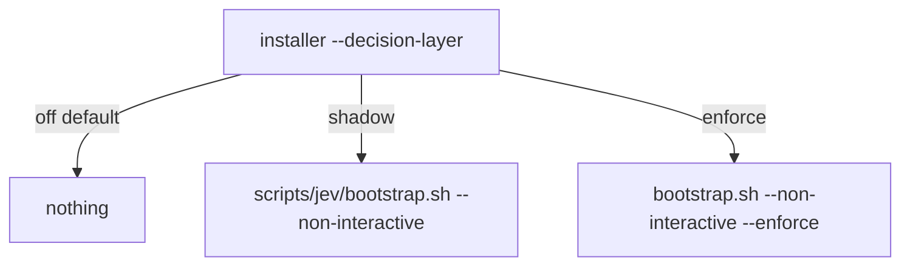

# Decision flow

| Field | Value |
|---|---|
| Revision | 2 |
| Created | 2026-10-29 |
| Last modified | 2026-10-30T09:00:00Z |
| Status | draft |
| Status summary | Wizard flow from `constitution_decisions.sh --help` (exit codes, refusals, backups) plus the installer's `--decision-layer` choice. |
| Authority | Documentation only; no new anchor. §11.4.258 (diagrams) governs. |
| Scope | Decisions wizard and installer decision-layer option. |
| Issues | none |

See [guide](../guides/decisions_wizard_guide.md).
