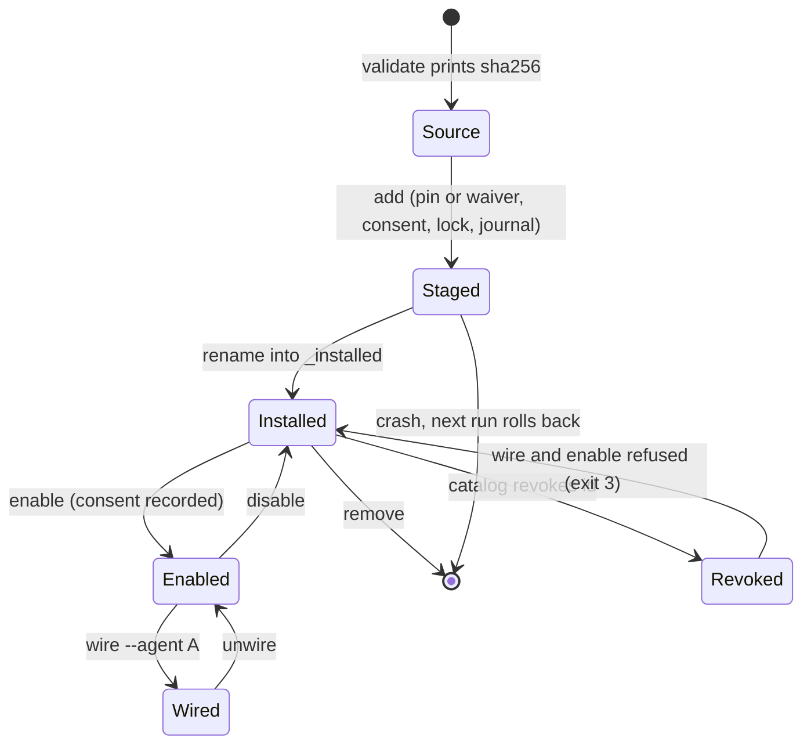

# Extension lifecycle

| Field | Value |
|---|---|
| Revision | 1 |
| Created | 2026-10-29 |
| Last modified | 2026-10-29T20:00:00Z |
| Status | draft |
| Status summary | States of an extension in the engine. From the engine README, 2026-10-29; UNCONFIRMED against a live agent. |
| Authority | Documentation only; no new anchor. §11.4.258 (diagrams) governs. |
| Scope | Helix Constitution installer, updater and extensions. |
| Issues | none |

Bundled extensions cannot be removed, only disabled. `verify` exits 5 on any problem.
