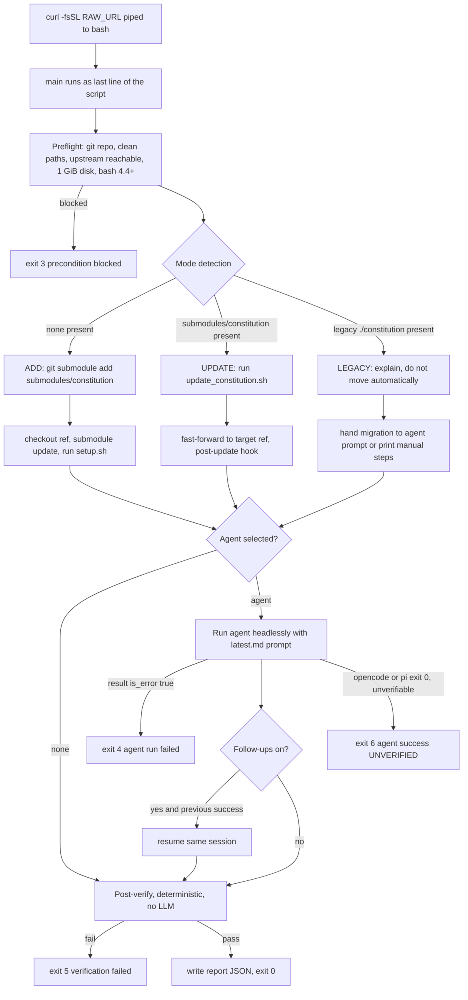

# Installer flow

| Field | Value |
|---|---|
| Revision | 3 |
| Created | 2026-10-29 |
| Last modified | 2026-10-29T18:00:00Z |
| Status | draft |
| Status summary | End-to-end flow of the curl-installer. Reconciled with the final scripts on 2026-10-29; not checked against a live installer run. |
| Authority | Documentation only; no new anchor. §11.4.258 (diagrams) governs. |
| Scope | The one-command installer and updater. |
| Issues | none |

Reading notes: the installer never pushes; every file it modifies is first copied
into `.constitution-install-backup/<timestamp>/` (see [safety model](safety_backup_model.md)).
