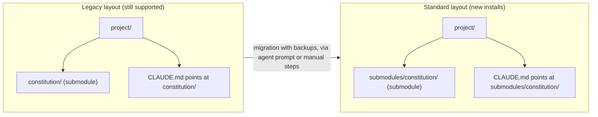

# Layout before and after

| Field | Value |
|---|---|
| Revision | 2 |
| Created | 2026-10-29 |
| Last modified | 2026-10-29T18:00:00Z |
| Status | draft |
| Status summary | Legacy and standard consumer layouts. Reconciled with the final scripts on 2026-10-29; not checked against a live installer run. |
| Authority | Documentation only; no new anchor. §11.4.258 (diagrams) governs. |
| Scope | The one-command installer and updater. |
| Issues | none |

The installer does not move a legacy submodule by itself; it prints the plan and hands the migration to the setup prompt.
