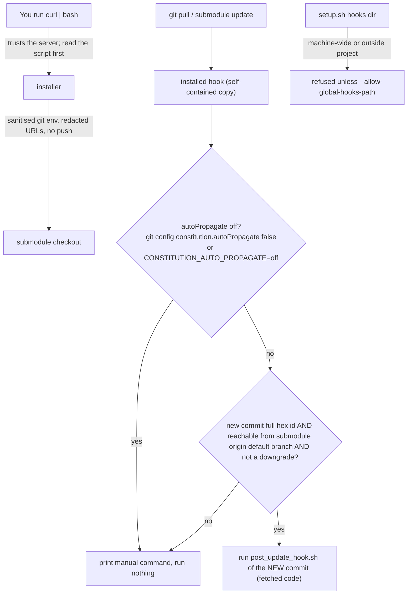

# Trust model

| Field | Value |
|---|---|
| Revision | 1 |
| Created | 2026-10-29 |
| Last modified | 2026-10-29T20:00:00Z |
| Status | draft |
| Status summary | Who is trusted for what, and the opt-outs. Derived from the headers of setup.sh and the hooks on 2026-10-29. |
| Authority | Documentation only; no new anchor. §11.4.258 (diagrams) governs. |
| Scope | Helix Constitution installer, updater and extensions. |
| Issues | none |

The hooks execute code that was just fetched, on purpose (§11.4.164 auto-propagation); the checks above bound it. `setup.sh` itself runs the checkout's hook without those checks (you are running it by hand). A branch switch through git's own submodule recursion runs no hook at all.
