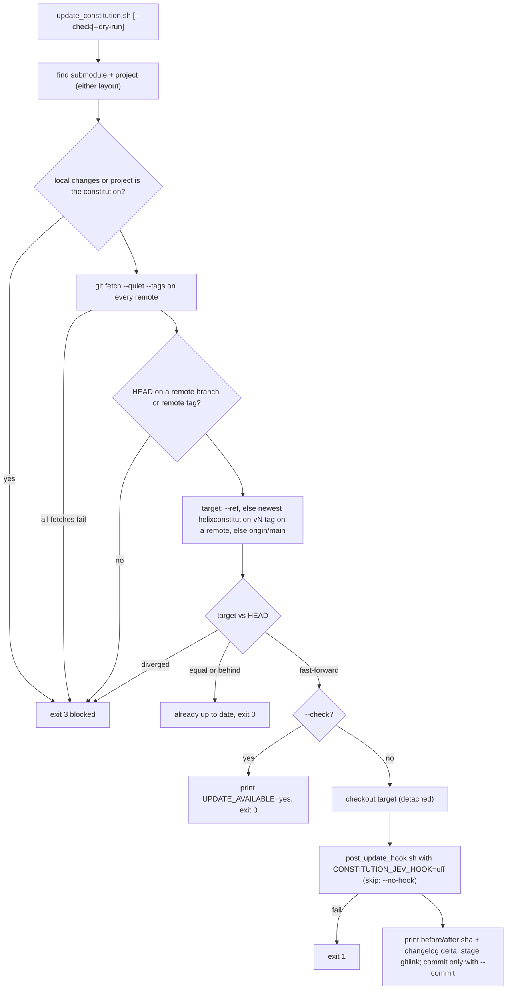

# Update flow

| Field | Value |
|---|---|
| Revision | 1 |
| Created | 2026-10-29 |
| Last modified | 2026-10-29T20:00:00Z |
| Status | draft |
| Status summary | How `update_constitution.sh` decides. Reconciled with its --help on 2026-10-29. |
| Authority | Documentation only; no new anchor. §11.4.258 (diagrams) governs. |
| Scope | Helix Constitution installer, updater and extensions. |
| Issues | none |

`--check` and `--dry-run` still fetch; they never move HEAD or touch the project.
