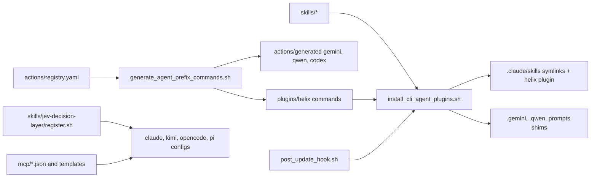

# Extensions Catalog - governed extensions of the constitution repository

| Field | Value |
|---|---|
| Revision | 1 |
| Created | 2026-11-02 |
| Last modified | 2026-11-02 |
| Status | draft |
| Status summary | First catalogue enumerated from the real tree (skills, plugin, MCP, hooks, adapters, jev, extension engine); LSP none. Compatibility cells are derived only from installer code, tests and docs present in the repo; tests were NOT executed while writing this document, so SUPPORTED means "installer code plus a test file exist", not "re-verified today". |
| Authority | §11.4.228 (B) provenance and (C) catalogue with per-platform matrix; §11.4.6 no guessing; §11.4.212 README reachability. |
| Scope | Every extension (skill, MCP, plugin, hook, adapter, LSP) shipped in this repository. Not the extensions of consuming projects. |
| Issues | none |

## Table of contents

- [How to read this catalogue](#how-to-read-this-catalogue)
- [Extension flow](#extension-flow)
- [Catalogue](#catalogue)
- [Per-platform compatibility matrix](#per-platform-compatibility-matrix)
- [Liveness evidence](#liveness-evidence)
- [Unconfirmed](#unconfirmed)

## How to read this catalogue

Commit column re-measured 2026-11-02 with `git log -1 --format=%h -- <exact path>`; for MCP rows with an `a -> b` path the commit is that of the MCP config file `a` (the extension's own file), not the script it points to. Source for every row: repository `git@github.com:HelixDevelopment/constitution.git`. The commit shown is the last commit touching that path (`git log -1 -- <path>`), measured 2026-11-02 at HEAD `ca88eda`. Closed vocabulary for compatibility: `SUPPORTED` (installer code that wires it for that platform plus a test file that exercises it), `CONFIG-ONLY` (a config or shim is written for that platform, no liveness test of the platform itself found), `UNSUPPORTED` (the repo states it is not supported), `UNTESTED` (no evidence either way; never read as supported). The platforms are Claude Code, OpenCode, Gemini CLI, Qwen Code, Kimi and pi. Codex CLI also receives generated command shims (`scripts/install_cli_agent_plugins.sh`) and is listed in the notes only.

## Extension flow

## Catalogue

| Extension | Type | Path | Source repo | Commit | Liveness evidence |
|---|---|---|---|---|---|
| action-prefix-system | skill | `skills/action-prefix-system` | git@github.com:HelixDevelopment/constitution.git | a24b762 | `tests/action_prefix/test_hook_e2e.sh`, `tests/test_cli_agent_plugins.sh`, `tests/constitution_cmd/test_register.sh` |
| constitution | skill | `skills/constitution` | git@github.com:HelixDevelopment/constitution.git | e7b897c | `tests/constitution_cmd/test_constitution_cmd.sh`, `tests/constitution_cmd/test_register.sh` |
| jev-decision-layer | skill + per-agent installer | `skills/jev-decision-layer` | git@github.com:HelixDevelopment/constitution.git | 9ebbf98 | `tests/jev/test_skill_and_action_registration.sh`, `tests/jev/test_mcp_register_hardening.sh` |
| label-sync | skill | `skills/label-sync` | git@github.com:HelixDevelopment/constitution.git | c2f6b3c | `tests/test_cli_agent_plugins.sh`, `tests/constitution_cmd/test_register.sh` |
| media-validator | skill | `skills/media-validator` | git@github.com:HelixDevelopment/constitution.git | a24b762 | `tests/test_cli_agent_plugins.sh`, `tests/constitution_cmd/test_register.sh` |
| multitrack | skill | `skills/multitrack` | git@github.com:HelixDevelopment/constitution.git | a24b762 | `tests/test_cli_agent_plugins.sh`, `tests/constitution_cmd/test_register.sh` |
| reporting-workable-items | skill | `skills/reporting-workable-items` | git@github.com:HelixDevelopment/constitution.git | a24b762 | `tests/test_cli_agent_plugins.sh`, `tests/constitution_cmd/test_register.sh` |
| scheduled-work-queue | skill | `skills/scheduled-work-queue` | git@github.com:HelixDevelopment/constitution.git | bb0d4cd | `tests/test_cli_agent_plugins.sh`, `tests/constitution_cmd/test_register.sh` |
| session-sync | skill | `skills/session-sync` | git@github.com:HelixDevelopment/constitution.git | a24b762 | `tests/test_cli_agent_plugins.sh`, `tests/constitution_cmd/test_register.sh` |
| skill-catalog | skill | `skills/skill-catalog` | git@github.com:HelixDevelopment/constitution.git | a24b762 | `tests/test_cli_agent_plugins.sh`, `tests/constitution_cmd/test_register.sh` |
| workable-item-lifecycle | skill | `skills/workable-item-lifecycle` | git@github.com:HelixDevelopment/constitution.git | 09dacd6 | `tests/test_cli_agent_plugins.sh`, `tests/constitution_cmd/test_register.sh` |
| helix (plugin) | plugin (generated slash commands) | `plugins/helix + actions/registry.yaml + actions/generated/` | git@github.com:HelixDevelopment/constitution.git | e7b897c | `tests/test_cli_agent_plugins.sh`, `tests/action_prefix/test_hook_e2e.sh`; Gemini/Qwen shims: none |
| label-sync (MCP) | MCP server | `mcp/label-sync-mcp.json -> scripts/label-sync/mcp/label-mcp.sh` | git@github.com:HelixDevelopment/constitution.git | 47353b6 | `scripts/label-sync/mcp/prove_mcp_mutations.sh` |
| media-validator (MCP) | MCP server | `mcp/media-validator-mcp.json -> skills/media-validator/media-validator.sh` | git@github.com:HelixDevelopment/constitution.git | 0a6aea9 | none |
| scheduled-work (MCP) | MCP server | `mcp/scheduled-work-mcp.json -> scripts/scheduled-work-engine/bin/scheduled-work` | git@github.com:HelixDevelopment/constitution.git | 2c338a4 | `scripts/scheduled-work-engine/test/integration_test.go`, `scripts/scheduled-work-engine/test/live_smoke.sh` |
| jev-decisions (MCP template) | MCP template | `mcp/templates/jev-decisions.json.tmpl` | git@github.com:HelixDevelopment/constitution.git | 62047d9 | `tests/jev/test_mcp_register_hardening.sh` |
| action-prefix hook | hook (UserPromptSubmit) | `scripts/hooks/action_prefix_expand.sh` | git@github.com:HelixDevelopment/constitution.git | 67c5063 | `tests/action_prefix/test_hook_e2e.sh` |
| guard hooks (branch, destructive-paths, forbidden-commands, track-label, work-track-binding, evidence-store-write) | hooks (PreToolUse) | `scripts/hooks/guard-*.sh, guard-destructive-paths.py` | git@github.com:HelixDevelopment/constitution.git | ee581e3 | `scripts/hooks/test_guard_*.sh`, `scripts/hooks/test_guard_bypasses.py` |
| label-sync hooks | hooks (session/prompt/stop) | `scripts/label-sync/hooks/` | git@github.com:HelixDevelopment/constitution.git | 53bdf52 | `scripts/label-sync/adapters/tests/test_adapters.sh` |
| label-sync adapters | per-agent adapters | `scripts/label-sync/adapters/{kimi,opencode,gemini,qwen,codex,crush,aider,generic}` | git@github.com:HelixDevelopment/constitution.git | 09dacd6 | `scripts/label-sync/adapters/tests/test_adapters.sh`, `scripts/label-sync/adapters/tests/test_real_agents.sh` |
| jev decision layer scripts | tooling (bootstrap, probe, calibrate, status) | `scripts/jev/` | git@github.com:HelixDevelopment/constitution.git | a0609ec | `tests/jev/run_all.sh` (e.g. `test_bootstrap_idempotent.sh`) |
| constitution_ext engine | extension manager (experimental, dormant) | `scripts/constitution_ext/` | git@github.com:HelixDevelopment/constitution.git | c252eed | `tests/extensions/run_all.sh` |
| LSP servers | LSP | `none present in this repository` | n/a | n/a | none |

Reading of SUPPORTED: it means only that installer code wiring the extension for that platform and a test file naming it exist; the tests were not executed for this catalogue, so it is weaker than the §11.4.228(C) liveness evidence (a captured per-platform load test) and must not be read as that.

Provenance files: `skills/constitution/EXTENSION_SOURCE.yaml` and `skills/jev-decision-layer/EXTENSION_SOURCE.yaml` exist; the other skills carry no `EXTENSION_SOURCE.yaml` (a tracked gap under §11.4.228(B), the commit column above stands in for it).

## Per-platform compatibility matrix

| Extension | Claude Code | OpenCode | Gemini CLI | Qwen Code | Kimi | pi |
|---|---|---|---|---|---|---|
| action-prefix-system | SUPPORTED | UNTESTED | UNTESTED | UNTESTED | UNTESTED | UNTESTED |
| constitution | SUPPORTED | UNTESTED | UNTESTED | UNTESTED | UNTESTED | UNTESTED |
| jev-decision-layer | SUPPORTED | CONFIG-ONLY | UNTESTED | UNTESTED | CONFIG-ONLY | CONFIG-ONLY |
| label-sync | SUPPORTED | UNTESTED | UNTESTED | UNTESTED | UNTESTED | UNTESTED |
| media-validator | SUPPORTED | UNTESTED | UNTESTED | UNTESTED | UNTESTED | UNTESTED |
| multitrack | SUPPORTED | UNTESTED | UNTESTED | UNTESTED | UNTESTED | UNTESTED |
| reporting-workable-items | SUPPORTED | UNTESTED | UNTESTED | UNTESTED | UNTESTED | UNTESTED |
| scheduled-work-queue | SUPPORTED | UNTESTED | UNTESTED | UNTESTED | UNTESTED | UNTESTED |
| session-sync | SUPPORTED | UNTESTED | UNTESTED | UNTESTED | UNTESTED | UNTESTED |
| skill-catalog | SUPPORTED | UNTESTED | UNTESTED | UNTESTED | UNTESTED | UNTESTED |
| workable-item-lifecycle | SUPPORTED | UNTESTED | UNTESTED | UNTESTED | UNTESTED | UNTESTED |
| helix (plugin) | SUPPORTED | UNTESTED | CONFIG-ONLY | CONFIG-ONLY | UNTESTED | UNTESTED |
| label-sync (MCP) | UNTESTED | UNTESTED | UNTESTED | UNTESTED | UNTESTED | UNTESTED |
| media-validator (MCP) | UNTESTED | UNTESTED | UNTESTED | UNTESTED | UNTESTED | UNTESTED |
| scheduled-work (MCP) | UNTESTED | UNTESTED | UNTESTED | UNTESTED | UNTESTED | UNTESTED |
| jev-decisions (MCP template) | SUPPORTED | CONFIG-ONLY | UNTESTED | UNTESTED | CONFIG-ONLY | CONFIG-ONLY |
| action-prefix hook | SUPPORTED | UNTESTED | UNTESTED | UNTESTED | UNTESTED | UNTESTED |
| guard hooks (branch, destructive-paths, forbidden-commands, track-label, work-track-binding, evidence-store-write) | SUPPORTED | UNTESTED | UNTESTED | UNTESTED | UNTESTED | UNTESTED |
| label-sync hooks | SUPPORTED | UNTESTED | UNTESTED | UNTESTED | UNTESTED | UNTESTED |
| label-sync adapters | UNTESTED | CONFIG-ONLY | CONFIG-ONLY | CONFIG-ONLY | CONFIG-ONLY | UNTESTED |
| jev decision layer scripts | SUPPORTED | CONFIG-ONLY | UNTESTED | UNTESTED | CONFIG-ONLY | CONFIG-ONLY |
| constitution_ext engine | UNTESTED | UNTESTED | UNTESTED | UNTESTED | UNTESTED | UNTESTED |
| LSP servers | UNTESTED | UNTESTED | UNTESTED | UNTESTED | UNTESTED | UNTESTED |

Evidence behind the non-UNTESTED cells:

- Skills, SUPPORTED on Claude Code: `scripts/install_cli_agent_plugins.sh` step 2 symlinks each skill into `<project>/.claude/skills/<name>`; `tests/test_cli_agent_plugins.sh` and `tests/constitution_cmd/test_register.sh` exist.
- helix plugin: Claude Code via the `claude plugin` CLI path in the same installer; Gemini and Qwen get generated TOML shims (`actions/generated/gemini`, `actions/generated/qwen`), which `skills/constitution/EXTENSION_SOURCE.yaml` itself records as "liveness UNTESTED", hence CONFIG-ONLY.
- Jev: `skills/jev-decision-layer/register.sh` header lists claude, kimi, opencode and pi as installed targets (opencode and pi with a coverage-gap note / documented fallback), so those are CONFIG-ONLY; the test file `tests/jev/test_mcp_register_hardening.sh` references kimi and opencode.
- label-sync adapters: adapter files exist for kimi, opencode, gemini, qwen; `install_label_sync.sh` states opencode/gemini/qwen hooks are UNSUPPORTED by that installer (hooks), the adapters are a separate path, so CONFIG-ONLY.
- MCP servers: no platform registration code was traced for the three first-party MCP JSON files in this task, so every cell is UNTESTED.

Notes: Codex CLI receives generated prompts (`codex:prompts:md` in the installer) - CONFIG-ONLY, not a requested column. `/constitution` is wired only for claude, gemini, qwen and codex; opencode, kimi and pi are not wired (README, extensions line).

## Liveness evidence

The liveness column of the catalogue names the test file or command per extension. None was executed in producing this revision. A cell of `none` means no test referencing the extension was found.

## Unconfirmed

- UNCONFIRMED: that any listed test currently passes (not run here).
- UNCONFIRMED: whether Gemini/Qwen/Codex/OpenCode/Kimi/pi load the generated shims or configs at runtime.
- UNCONFIRMED: registration of the first-party MCP servers on any platform (no installer traced).
- UNCONFIRMED: LSP - none found; absence from this tree is not proof none is planned.
- The `scripts/constitution_ext` engine is experimental and dormant per `docs/guides/extensions_guide.md`; bundled `extensions/` directory does not exist in this tree.
