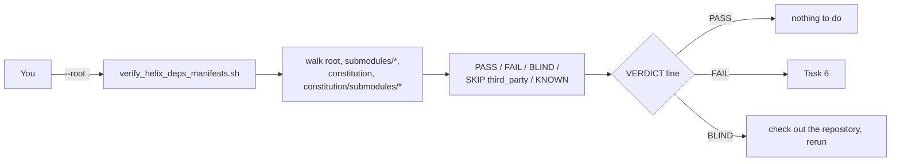

# Dependency Manifest User Guide — `helix-deps.yaml` in every own-org repository

| Field | Value |
|---|---|
| Revision | 2 |
| Created | 2026-10-21 |
| Last modified | 2026-10-22T00:34:17Z |
| Status | active |
| Status summary | Task-oriented guide for the §11.4.31 dependency manifest: bootstrap a project, add a dependency, add a submodule, scaffold, validate, fix every failure the verifier reports. |
| Authority | Constitution §11.4.31 (EXTENSION of 2026-10-21) — the canonical text wins where this guide and the constitution disagree. |
| Scope | Universal (§11.4.17) — used by reference from every project that vendors the constitution. |
| Issues | none |
| Issues summary | — |
| Fixed | initial creation |
| Fixed summary | — |
| Continuation | — |

## Table of contents

- [What this is for](#what-this-is-for)
- [The one command you need](#the-one-command-you-need)
- [Task 1 — bootstrap a new project](#task-1--bootstrap-a-new-project)
- [Task 2 — add a dependency to an existing repository](#task-2--add-a-dependency-to-an-existing-repository)
- [Task 3 — add an own-org submodule to a project](#task-3--add-an-own-org-submodule-to-a-project)
- [Task 4 — scaffold a manifest for a repository that has none](#task-4--scaffold-a-manifest-for-a-repository-that-has-none)
- [Task 5 — validate one file or a whole tree](#task-5--validate-one-file-or-a-whole-tree)
- [Task 6 — fix every failure the verifier reports](#task-6--fix-every-failure-the-verifier-reports)
- [Task 7 — use your own organisation list](#task-7--use-your-own-organisation-list)
- [Where to go next](#where-to-go-next)

## What this is for

Every repository you own (organisation `vasic-digital` or `HelixDevelopment` by default) carries a file
called `helix-deps.yaml` at its root. The file lists the own-org repositories that repository depends on,
so a project that pulls it in can add the same dependencies at its own root instead of nesting them.
Third-party repositories do not need the file.

The rule is §11.4.31 of the constitution. It is checked on every constitution pull by the gate
`CM-HELIX-DEPS-MANIFEST-PRESENT`.

## The one command you need

From your project root:

```bash
bash constitution/scripts/deps_manifest/verify_helix_deps_manifests.sh --root .
```

Read the last line. `VERDICT: PASS` means every own-org repository has a tracked, well-formed manifest.
Exit code 0 PASS, 1 FAIL, 2 BLIND (something could not be checked), 64 wrong usage.



## Task 1 — bootstrap a new project

1. Add the constitution submodule (see the constitution `README.md`, "How to consume").
2. Generate a skeleton at the project root:

   ```bash
   bash constitution/scripts/deps_manifest/verify_helix_deps_manifests.sh --scaffold . --write
   ```

   The skeleton lists every own-org submodule found in `.gitmodules`, every own-org GitHub module in
   `go.mod`, and every own-org GitHub dependency in `package.json`.
3. Open `helix-deps.yaml`. Replace every `why: "UNKNOWN: …"` with the real reason, and every
   `ref: UNKNOWN-pin-me` with a tag or a commit. The verifier rejects placeholders on purpose.
4. Check the file:

   ```bash
   bash constitution/scripts/deps_manifest/verify_helix_deps_manifests.sh --validate-file helix-deps.yaml
   ```

5. `git add helix-deps.yaml` (an untracked manifest does not count).
6. Run the whole-tree check from "The one command you need".

New projects created from `templates/` already get a pointer to this step.

## Task 2 — add a dependency to an existing repository

Add one entry under `deps:`:

```yaml
deps:
  - name: cache                                   # plain identifier, snake_case preferred
    ssh_url: git@github.com:vasic-digital/Cache.git
    ref: 6a9a3e5                                  # tag or commit; never a placeholder
    why: "In-memory/Redis cache primitives used by the API"
    layout: grouped                               # grouped = <root>/submodules/<name>/
```

If the dependency belongs to another organisation, mark it and name the licence:

```yaml
  - name: superspec
    ssh_url: git@github.com:WangX0111/superspec.git
    ref: v1.0.2
    why: "Spec-Kit bridge for the superpowers skills"
    layout: grouped
    third_party: true
    licence: MIT
```

Validate the file (Task 5) and commit it together with the change that needs the dependency.

## Task 3 — add an own-org submodule to a project

```bash
git submodule add git@github.com:vasic-digital/Cache.git submodules/cache
```

In the SAME commit, add the matching `deps` entry to the project's `helix-deps.yaml` (Task 2). The verifier
fails the root with `undeclared own-org submodule submodules/cache` until you do.

If the new submodule has no manifest of its own, add one in ITS repository (Task 4 run inside that
repository, commit and push there, then bump the pointer in the project). Never keep a copy in the parent.

## Task 4 — scaffold a manifest for a repository that has none

```bash
# print to the terminal (nothing is written)
bash constitution/scripts/deps_manifest/verify_helix_deps_manifests.sh --scaffold path/to/repo
# write path/to/repo/helix-deps.yaml (refused if the file already exists)
bash constitution/scripts/deps_manifest/verify_helix_deps_manifests.sh --scaffold path/to/repo --write
```

Scaffold never overwrites. If the file exists it prints `REFUSED` and exits 1; edit the existing file
instead.

## Task 5 — validate one file or a whole tree

| Goal | Command |
|---|---|
| One file | `verify_helix_deps_manifests.sh --validate-file helix-deps.yaml` |
| Whole project | `verify_helix_deps_manifests.sh --root .` |
| The gate (what the pull hook runs) | `bash constitution/scripts/gates/cm_helix_deps_manifest_present.sh --root .` |
| The tool's own control needles | `verify_helix_deps_manifests.sh --selftest` |

## Task 6 — fix every failure the verifier reports

| Message (part) | What it means | Fix |
|---|---|---|
| `helix-deps.yaml missing at the repository root` | An own-org repository has no manifest | Task 4 in that repository |
| `present but not tracked by git` | The file exists but was never added | `git add helix-deps.yaml` and commit |
| `undeclared own-org submodule <path>` | The root or the hub carries an own-org submodule its manifest does not list | Add a `deps` entry (Task 2) |
| `nests own-org/hub submodule(s)` | A leaf repository nests an own-org repository or the constitution | Remove the nested submodule in that repository and resolve it through the hub (§11.4.28(C)) |
| `ssh_url must be git@host:org/repo.git` | HTTPS or malformed URL | Use the SSH form ending in `.git` |
| `is not own-org; mark the entry third_party: true` | Foreign dependency without the marker | Add `third_party: true` and `licence:` |
| `third_party: true requires a licence` | Marker without licence | Add `licence: <SPDX id>` |
| `placeholder why` / `placeholder ref` | A scaffold value was never filled in | Write the real reason / pin a real ref |
| `unknown key` / `duplicate key` | Typo or a key written twice | Remove or rename it (see the manual for the closed key set) |
| `schema_version must be 1` | Wrong version | `schema_version: 1` |
| `BLIND … not checked out` | An own-org submodule is declared but not initialised | `git submodule update --init -- <path>` (one level, never `--recursive` for entries marked `recursive_init: false`) |
| `KNOWN … recursive_init: false` | A hub engine nests own-org repositories (none does on the constitution hub as of 2026-10-22); tracked by `CM-HUB-ENGINE-NO-OWNORG-NESTING` | Bump that engine's pin once its upstream stops nesting |

## Task 7 — use your own organisation list

```bash
HELIX_OWN_ORGS="my-org,my-other-org" bash constitution/scripts/deps_manifest/verify_helix_deps_manifests.sh --root .
# or
bash constitution/scripts/deps_manifest/verify_helix_deps_manifests.sh --root . --own-orgs my-org,my-other-org
```

## Where to go next

- Full schema, layouts, exit codes and troubleshooting: [`../manuals/dependency_manifest_manual.md`](../manuals/dependency_manifest_manual.md)
- Questions people actually ask: [`../faq/dependency_manifest_faq.md`](../faq/dependency_manifest_faq.md)
- The rule itself: [`../../Constitution.md`](../../Constitution.md), §11.4.31
