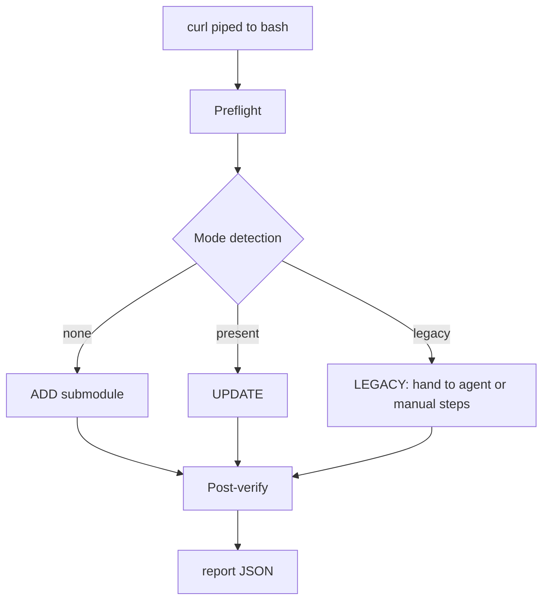
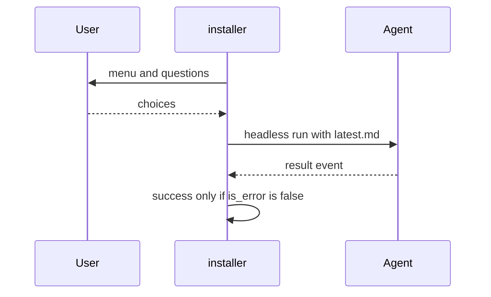

# Installer User Guide - one-command install and update

| Field | Value |
|---|---|
| Revision | 9 |
| Created | 2026-10-29 |
| Last modified | 2026-10-31T12:00:00Z |
| Status | draft |
| Status summary | How to install or update the Helix Constitution in a project with one command. Reconciled with the scripts (--help and source) on 2026-10-30 (round 11: update-pending marker records target and staged-before, symlinked markers refused on both sides, fingerprint tool order and fail-closed rule; round 12: no-push source gate documented as a best-effort tripwire with listed known limits, `--project-root` and `--detect-layout` documented); not verified by a live end-to-end install. |
| Authority | Tool documentation for `scripts/install_constitution.sh` and `scripts/update_constitution.sh`; no new anchor. §11.4.18, §11.4.257, §11.4.212 govern. |
| Scope | Any git project that wants to inherit the Helix Constitution. |
| Issues | none |
| Generated twins | .html / .pdf / .docx not generated (Markdown-only policy). |

## Requirements and refusals

bash 4.4 or newer and git (exit 3 otherwise). The installer refuses to run as root unless `--yes`, refuses to install into the constitution repository itself (exit 3; a project that only uses the constitution and has its own `Constitution.md` passes `--not-constitution-repo`), and never pushes. The clone is blobless (full history and tags, file contents on demand; a server without partial-clone support gets a full clone). Network access to at least one upstream is needed for ADD (`--upstream-url` accepts a local path or `file://` URL).

## What it does

`scripts/install_constitution.sh` adds the Helix Constitution to your project as a git submodule at `submodules/constitution`, runs the constitution's own `scripts/setup.sh`, and can optionally run an AI coding agent headlessly with the versioned setup prompt (`docs/prompts/setup/latest.md`) to wire your project files. It never pushes. The behavior below was reconciled with the script (`install_constitution.sh 1.0.0`) from its `--help` output and source; it was not verified by a live end-to-end install here, so start with `--dry-run`. `--help` of the script you downloaded has the final word.

## Quick start

```bash
cd your-project            # must be a git repository
curl -fsSL https://raw.githubusercontent.com/HelixDevelopment/HelixConstitution/main/scripts/install_constitution.sh | bash
```

Interactive runs ask questions with safe defaults (agent `none`, a dry-run preview first, no commit). Non-interactive (the default `--agent` is already `none`):

```bash
curl -fsSL https://raw.githubusercontent.com/HelixDevelopment/HelixConstitution/main/scripts/install_constitution.sh | bash -s -- --upstream gitlab --non-interactive --agent none
```

Other upstreams (`--upstream gitlab`, `gitlab-vasic`, `gitflic`, `gitverse`, `github-vasic`; unreachable ones fall back to the next; the private `m3w` Gitea is SSH-only, has no anonymous curl snippet and is not an installer upstream) and their snippets are in the [README](../../README.md#install--update-with-one-command); `bash install_constitution.sh --print-snippets` prints them. If the directory is not a git repository the installer asks (or needs `--git-init`) before running `git init`.

## Inspect before you run

```bash
curl -fsSL https://raw.githubusercontent.com/HelixDevelopment/HelixConstitution/main/scripts/install_constitution.sh -o install_constitution.sh
less install_constitution.sh
bash install_constitution.sh --dry-run
bash install_constitution.sh
```

The script wraps everything in `main()` invoked as its last line, so a truncated download executes nothing. `--dry-run` performs zero writes and prints the full plan (a `--report-json` file is still written if requested).

## The flow



Full diagram: [installer_flow](../diagrams/installer_flow.md). Mode logic: [mode_detection](../diagrams/mode_detection.md).

## Modes

| Mode | When | What happens |
|---|---|---|
| ADD | no constitution in the project (or an interrupted earlier ADD, whose leftovers are moved into the backup) | `git submodule add <url> submodules/constitution`, checkout the ref detached, flat init (nested engines stay uninitialised), write the inheritance blocks, run `setup.sh` |
| UPDATE | `submodules/constitution` exists (also when both layouts exist; only the standard one is updated) | delegates to `submodules/constitution/scripts/update_constitution.sh`, or a built-in fast-forward updater when the installed version lacks it |
| LEGACY | `./constitution` exists | detected and explained; not moved automatically; the exact manual steps are printed, or with `--agent` the setup prompt can migrate with backups; no inheritance block is written and verification is skipped without an agent |

## Choosing an agent

The installer lists detected agents without calling any LLM (`bash install_constitution.sh --detect-agents [--json]`): `claude` and its native accounts (`claude1..N`, from `claude-list-accounts`), provider aliases from `claude-providers list`, `kimi`, `opencode`, `pi`, plus detect-only entries (aider, codex, gemini, qwen, cursor-agent, amp, goose) that cannot be chosen as `--agent`. The default is `--agent none`, which skips the agent step entirely. Agent driving is only unit-class tested; provider aliases, `kimi`, `opencode` and `pi` are UNCONFIRMED against a live run. `claude`, `claudeN` and provider aliases run with `--permission-mode acceptEdits` and a deny list of web tools and `git push` forms. `kimi`, `opencode` and `pi` run with their own default permissions (they can run shell commands, edit files and reach the network); the installer refuses them in `--non-interactive` mode (exit 3) unless you pass `--allow-unrestricted-agent`, and asks a separate question (default no) interactively. Whether the deny list is enforced by `claude` for every form is UNCONFIRMED (not checked by a live run); a push during the run is also detected afterwards and fails the run (exit 5). That check fails closed: a remote (or one of its urls) that answered before the agent run and cannot be asked after it (removed, re-pointed with `insteadOf`, protocol denied, moved, unreadable) fails the run too; only a remote that could not be asked before the run either is skipped, and the installer names it on stderr. See the [manual](../manuals/installer_manual.md#agent-permissions-and-the-no-push-check), [tutorial 05](../tutorials/05_choosing_agents_and_aliases.md) and the agent sequence below.



Full diagram: [agent_selection_sequence](../diagrams/agent_selection_sequence.md).

## Cost and token controls

Defaults: model `sonnet`, effort `medium`, `--max-budget-usd 2` (a TOTAL cap, greater than 0 and at most 50: the setup run gets it, each follow-up gets what is left), `--timeout-sec 1800`. `--model` and `--effort` are enforced only for `claude`, `claudeN` and provider aliases; for `kimi`, `opencode` and `pi` they are refused (exit 2) rather than silently ignored. Follow-up prompts are off by default. The decision layer is off by default. `--agent none` spends no tokens.

## What it changes

The submodule (`.gitmodules`, gitlink); `setup.sh` outputs (git hooks, skills, `.mcp.json`; skip with `--run-setup off`); the inheritance block prepended to `CLAUDE.md` and `AGENTS.md` (and `GEMINI.md` / `QWEN.md` if present) unless `--edit-agent-docs off`; and hook registration in `.claude/settings.json` only with `--register-hooks on`, performed by the agent. `--commit on` makes one local commit. Every modified file is first copied to `.constitution-install-backup/<timestamp>/`. See [safety model](../diagrams/safety_backup_model.md).

## Updating

```bash
git submodule update --init submodules/constitution
bash submodules/constitution/scripts/update_constitution.sh --check
bash submodules/constitution/scripts/update_constitution.sh
```

Or re-run the curl command: it detects UPDATE mode. `--check` prints `UPDATE_AVAILABLE=yes|no`; it is NOT offline: it still runs `git fetch --quiet --tags` per remote (this updates remote-tracking refs and tags, never HEAD, a local branch or the project). Exit 3 means blocked (local changes, unpushed commits, no fast-forward, no network, the project is the constitution itself, the project records a NEWER, unknown or diverged constitution commit, or a gitlink you staged by hand that differs from both the committed one and the checkout). The default target is the newest release tag `helixconstitution-vN(.N)*`; pre-release tags are never chosen by default. The recorded gitlink is only ever replaced by a commit that contains it: if a teammate already recorded a NEWER constitution commit (you ran `git pull` but not `git submodule update`), or the recorded commit is unknown or on a diverged line, the updater (and the installer's re-run) refuses with exit 3, stages nothing, and tells you to run `git submodule update -- submodules/constitution` first; `--check` reports that too instead of `UPDATE_AVAILABLE=yes`. A gitlink you STAGED yourself that differs from both the committed gitlink and the checkout is never overwritten either: the updater (every mode, `--check` and `--dry-run` included), the installer's re-run and its built-in updater refuse with exit 3 and print the two ways out (`git add -- submodules/constitution` to keep the checkout, or `git restore --staged -- submodules/constitution` to drop the staged change). The updater's own update that was cut off after its checkout and before `git add` (for example a held `.git/index.lock`) is still finished on the next run: a marker file (`.git/helix-update-pending`, one line `<target sha> <staged-before>`, written before every checkout and removed once the gitlink is staged, or after the hook) tells the two apart. The marker is honoured only when it names the checkout AND its staged-before equals the gitlink staged now: a marker naming another commit, a stale one, an old-format one (target only) and a symlinked one (never read, never written through; this holds for the updater and for the installer's built-in updater alike) never license overwriting a gitlink you staged. See [tutorial 03](../tutorials/03_update_to_latest.md).

### helix-deps.yaml (dependency manifest)

`setup.sh` runs the post-update hook, whose `CM-HELIX-DEPS-MANIFEST-PRESENT` gate (§11.4.31) requires a TRACKED, valid `helix-deps.yaml` at the project root. On a fresh install with `setup.sh` on, the installer creates it first with the constitution's own tool (`scripts/deps_manifest/verify_helix_deps_manifests.sh --scaffold . --write`), with your umask, and records it in the backup folder as created. It never overwrites a file that exists. If the skeleton validates (no own-org dependency needs your answer), the installer stages it (and commits it with `--commit on`). If it has placeholders (for example an own-org submodule whose `ref` and `why` only you can fill), the file is left UNTRACKED, the installer prints the exact next steps (edit, `--validate-file helix-deps.yaml`, `git add helix-deps.yaml`, re-run `setup.sh`) and, when `setup.sh` then stops on that gate, the run ends with exit 1 and report status `manifest-needs-completion`. The updater only prints a NOTE when the manifest is missing; it does not create it.

## Project root and layout detection

`--project-root DIR` installs into (or updates) the project at DIR instead of the current directory. If the project directory is itself a submodule of a superproject, the installer refuses (exit 3) only when the directory came from the current directory; an explicit `--project-root` is allowed and prints a warning. `--detect-layout` is read-only: it prints one of `none`, `standard`, `legacy`, `both`, `partial`, `inconsistent` or `constitution-repo` for the project and exits, before anything is asked, locked, backed up or written.

## No-push source gate: a best-effort tripwire, not a proof

The promise "the installer and the updater never push, never force, never rewrite history" rests on a runtime allow-list (every git call goes through `hi_gx`, which refuses anything not on the list) and on the runtime no-push check after an agent run. The gate `CM-INSTALLER-NO-PUSH-NO-FORCE` additionally scans the two scripts' source for ways around that allow-list. Operator decision 2026-10-31: it is shipped as a documented BEST-EFFORT TRIPWIRE, like the destructive-path guard, not as a proof; further binding forms are not chased.

KNOWN LIMITS (the gate does not see these; each is also recorded in the gate header):

- The sanctioned file targets (the update-pending marker, the lock file, backups) are pinned by the lines that BIND their variables and by the exact command text that uses them. Function definitions nested inside another function body ARE now counted by the duplicate-definition check (round 12), but definitions that share a line with other code are not. A producer that computes the path inside a pinned helper by a command substitution or a `printf` of a different value (for example `hi_marker_path` printing `.gitmodules` instead of the git path) is NOT recognised: the line is not a binding of a pinned variable.
- A value that reaches a function as an argument (`"$1"`) is pinned where it is bound, not at the callers.
- Binding forms the lexer does not model (namerefs, `${!x}`, indirect expansions, `eval`-free tricks through `declare -n` in a sourced file) are only caught by the raw token count of the wrapper switches.
- What an agent does inside its own run, what `setup.sh`, the post-update hook and the Jev bootstrap do, and the user's own alias file are outside its scope.

The real protection is the runtime tests, the runtime no-push check after an agent run (exercised in `tests/install/test_round6.sh`: the pushes are real `git push` commands performed by a labelled FAKE `claude` (unit-class, §11.4.289) into bare repositories the test itself creates, and the check compares `ls-remote` fingerprints) and `tests/install/test_git_wrapper.sh` (every forbidden git form is refused by `hi_gx` and never reaches git). Treat a green gate as "no obvious bypass", never as "no bypass".

## No-push check: fingerprint tool

After an agent run the installer compares what each remote advertises before and after the run. The comparison fingerprints the `ls-remote` output with `sha256sum` (`cksum` is the fallback). When NEITHER `sha256sum` nor `cksum` is on PATH, the check cannot compare anything and fails closed: the run is refused with a message naming the missing tools.

## Trust model and opt-outs

- `curl | bash` trusts the server; read the script first (see above). The installer wraps everything in `main()` so a truncated download runs nothing.
- git runs with a sanitised environment: inherited `GIT_*` variables are dropped (so `GIT_SSH_COMMAND` is no longer inherited), ssh is always `ssh -o BatchMode=yes -o ConnectTimeout=10`; put keys and ports in `~/.ssh/config`.
- Credentials: URLs are printed with credentials removed and query values replaced by `REDACTED`; a URL carrying a password or token is never used. Use SSH keys for private mirrors. `http://` and `git://` upstream URLs are refused unless `--allow-insecure-url`.
- Auto-propagation: the hooks `setup.sh` installs run the new checkout's `post_update_hook.sh` after a pull, only if the commit is on the submodule's upstream default branch and is not a downgrade. Opt out with `git config constitution.autoPropagate false` or `CONSTITUTION_AUTO_PROPAGATE=off`. `setup.sh` refuses a machine-wide hooks directory unless `--allow-global-hooks-path`. Diagram: [trust_model](../diagrams/trust_model.md).

## Concurrency

A run takes `.git/helix-constitution-install.lock`; a second installer exits 3 while the first lives, and a stale lock (owner gone) is reclaimed with a warning.

## Where to go next

[Quick start](quick_start.md) | [Troubleshooting](troubleshooting_guide.md) | [Extensions](extensions_guide.md)

[Manual](../manuals/installer_manual.md) | [FAQ](../faq/installer_faq.md) | [Tutorials](../tutorials/01_new_project.md) | [Prompt versioning](setup_prompt_versioning_guide.md)
