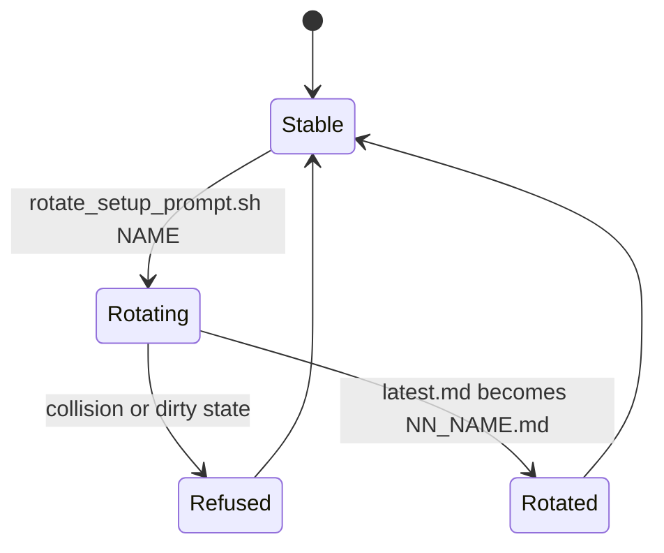

# Setup Prompt Versioning Guide

| Field | Value |
|---|---|
| Revision | 4 |
| Created | 2026-10-29 |
| Last modified | 2026-10-30T09:00:00Z |
| Status | draft |
| Status summary | How the setup prompt is versioned and rotated. Reconciled with `rotate_setup_prompt.sh --help` on 2026-10-30 (R4: dirty-tree refusal by default, `--allow-dirty`, `--dir`; the earlier text said git was never run); not verified by a live end-to-end install. |
| Authority | Tool documentation for `scripts/install_constitution.sh` and `scripts/update_constitution.sh`; no new anchor. §11.4.18, §11.4.257, §11.4.212 govern. |
| Scope | Maintainers of the constitution who change the setup prompt. |
| Issues | none |
| Generated twins | .html / .pdf / .docx not generated (Markdown-only policy). |

## Files

`docs/prompts/setup/` holds `01_old.md`, `02_middle.md` (history, never modified) and `latest.md` (the current prompt, always this name, no number prefix). Follow-up prompts live in `docs/prompts/setup/followups/NN_*.md` (currently `01_verify_incorporation.md`, `02_wire_decision_layer_optional.md`, `03_final_report.md`).

The installer reads the prompt from the first fenced block (three or more backticks or tildes) under the `## PROMPT` heading of `latest.md`. A follow-up file's whole body (after an optional `---` front matter) is its prompt, run in numeric order. The installer reads one front matter key, `requires_previous_success` (`false`, `False` or `no` means run regardless; anything else or absent means skip after a failed previous step); `title` is informational.

## Rotating a new prompt in

```bash
bash scripts/prompts/rotate_setup_prompt.sh NAME --source /path/to/new_prompt.md --dry-run
bash scripts/prompts/rotate_setup_prompt.sh NAME --source /path/to/new_prompt.md
```

Behavior: the current `latest.md` is archived as `NN_NAME.md`, where NN is the highest existing numeric prefix plus one, zero-padded to two digits (three digits after 99), and NAME is lowercase snake_case (`^[a-z][a-z0-9]*(_[a-z0-9]+)*$`, at most 64 characters, `latest` reserved). The new content (from `--source`, which must contain a `## PROMPT` heading followed by a closed, non-empty fenced block; without `--source`, a copy of the archived one) then becomes `latest.md`, which exists at every instant. It never overwrites and refuses (exit 3) on a name collision, a missing or symlinked `latest.md`, a gap or duplicate in the numbering, a bad `--source`, a directory that does not end in `/docs/prompts/setup`, or a live lock; by default a directory inside a git work tree with uncommitted or untracked changes (the lock directory aside) is refused with exit 3, so a rotation never silently archives unreviewed edits; `--allow-dirty` rotates anyway; `--require-clean-git` additionally refuses a directory that is not inside a git work tree; a directory outside any git work tree (or without git) is rotated without a git check. `--dir DIR` selects another setup directory (its real path must end in `/docs/prompts/setup`). `--dry-run` prints the plan and writes nothing, not even the lock. An interrupted rotation (lock directory `.rotate.lock`) is rolled forward or back by the next run. Exit codes: 0 rotated, dry-run printed or recovery completed; 1 internal failure (state recoverable); 2 usage error or bad NAME; 3 refused. With the current history (`01_old.md`, `02_middle.md`) the next number is 03.



Full diagram: [prompt_rotation_state](../diagrams/prompt_rotation_state.md).

## Rules

- Never edit `01_old.md` or `02_middle.md`.
- Commit the rotation as one change; review it like any other. The script does not commit, so commit your prompt edits first (a dirty `docs/prompts/setup` is refused by default).
- Related: [installer guide](installer_user_guide.md), [manual](../manuals/installer_manual.md).
