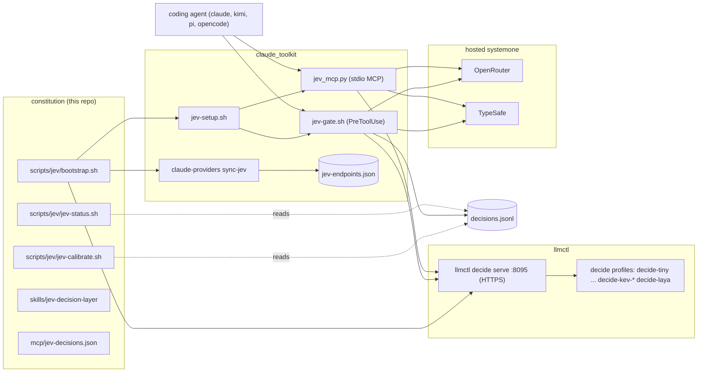
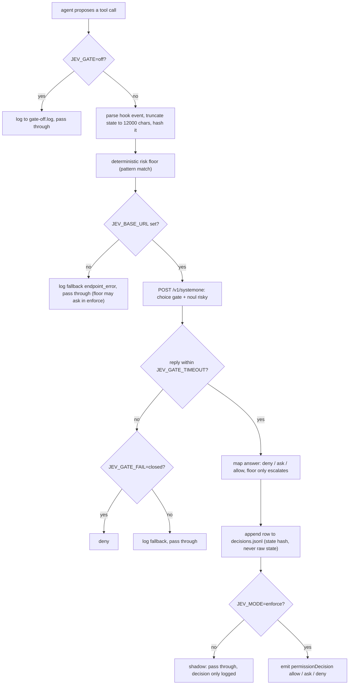
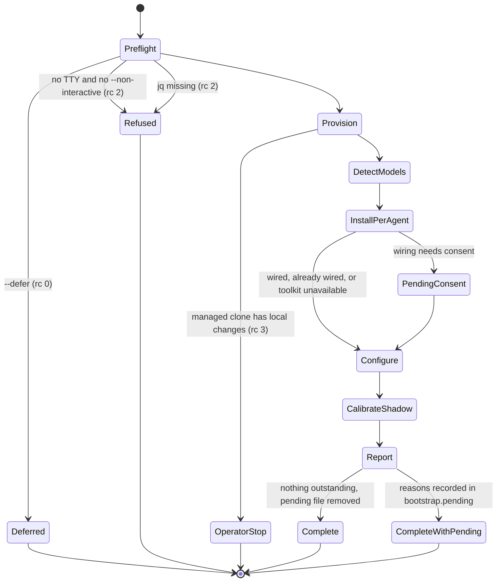
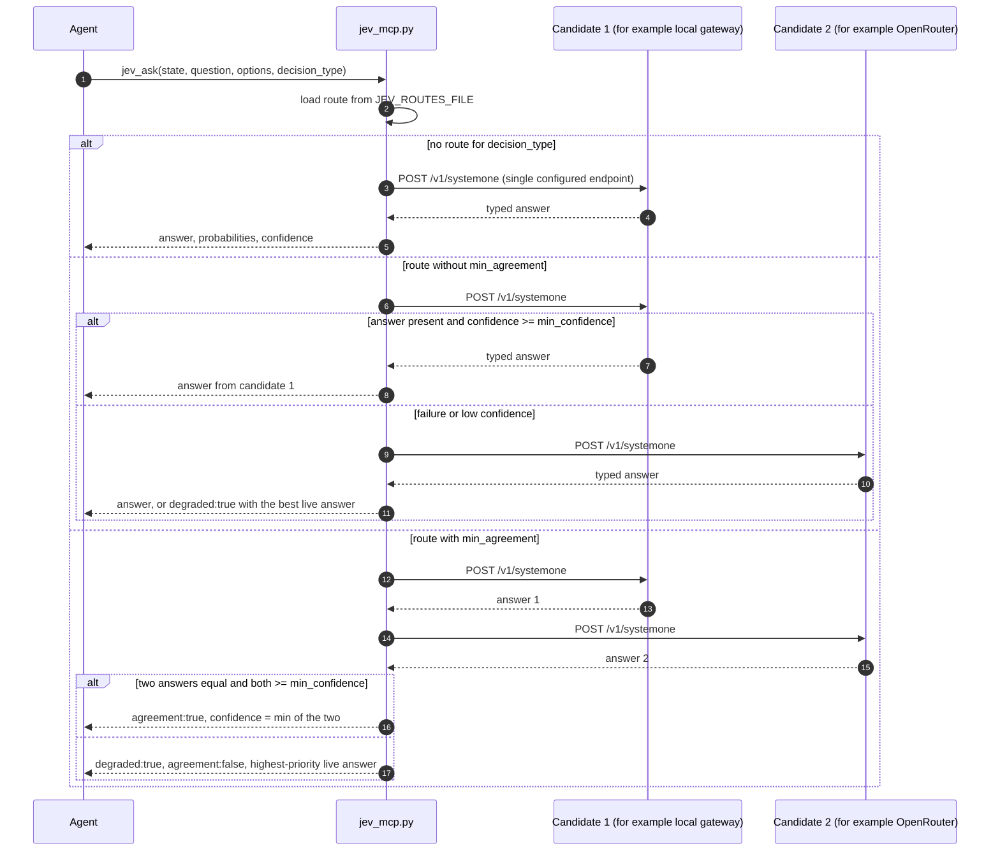

# Jev Decision Layer — Diagrams

| Field | Value |
|---|---|
| Revision | 1 |
| Created | 2026-10-23 |
| Last modified | 2026-10-23T00:00:00Z |
| Status | active |
| Status summary | Four Mermaid diagrams: architecture, data flow, bootstrap state machine, routing and consensus sequence. |
| Authority | Constitution §11.4.279–§11.4.286. The scripts and the claude_toolkit / llmctl sources govern wherever a diagram simplifies. |
| Scope | Universal (§11.4.17). |
| Issues | none |
| Issues summary | — |
| Fixed | initial creation |
| Fixed summary | — |
| Continuation | none |

Related: [governance guide](governance-guide.md) · [bootstrap reference](bootstrap-reference.md) · [user manual](user-manual.md)

## Table of contents

- [Architecture](#architecture)
- [Data flow of one gated tool call](#data-flow-of-one-gated-tool-call)
- [Bootstrap state machine](#bootstrap-state-machine)
- [Routing and consensus sequence](#routing-and-consensus-sequence)

## Architecture

Who owns what: the constitution owns policy, the bootstrap/status/calibration scripts and the declarations; claude_toolkit owns the per-agent gate, MCP server and endpoint cache; llmctl owns local models and the HTTPS decide gateway.

## Data flow of one gated tool call

Endpoint choice comes from the ranked cache at launch (local gateway first). The bearer key is resolved by variable NAME at call time and sent only over `https://`.

## Bootstrap state machine

States are the stage results of `bootstrap.sh`. `no-change` is a per-stage outcome when the input digest equals the stamp.

## Routing and consensus sequence

Applies to the MCP tool `jev_ask` when `decision_type` names a route in `JEV_ROUTES_FILE`. Without `min_agreement` a route is ordered failover; with it, two live candidates must agree.

In the code at claude_toolkit `bfa667f` the candidates are queried sequentially, and with `min_agreement` set every candidate is consulted before the agreement check. The numeric value of `min_agreement` is not compared against anything in that code; only whether it is set matters. When no candidate is reachable the tool returns an error result, never a hang.
