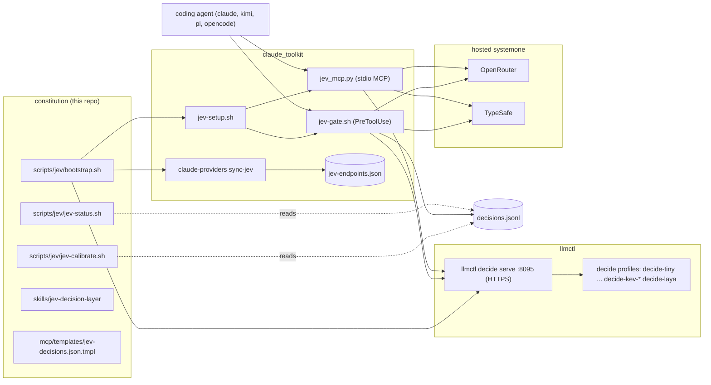
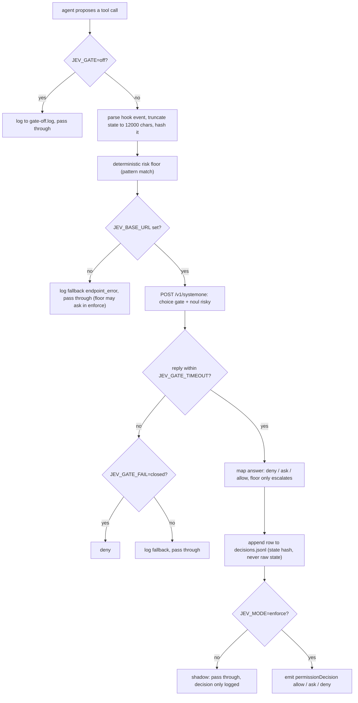
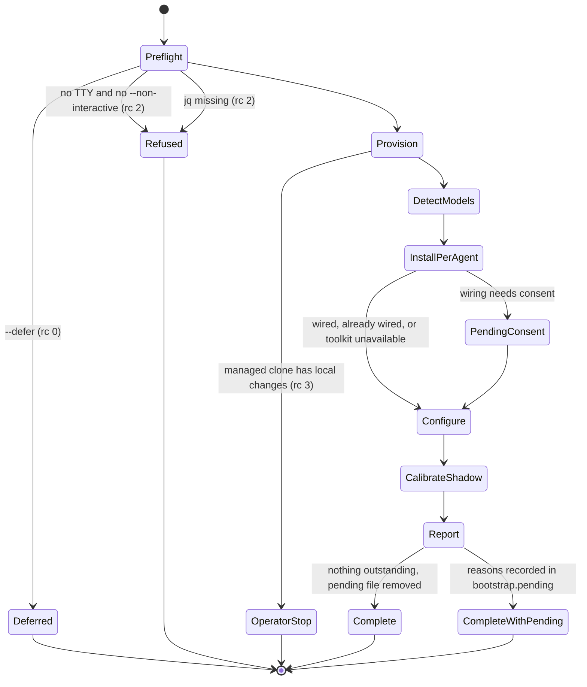
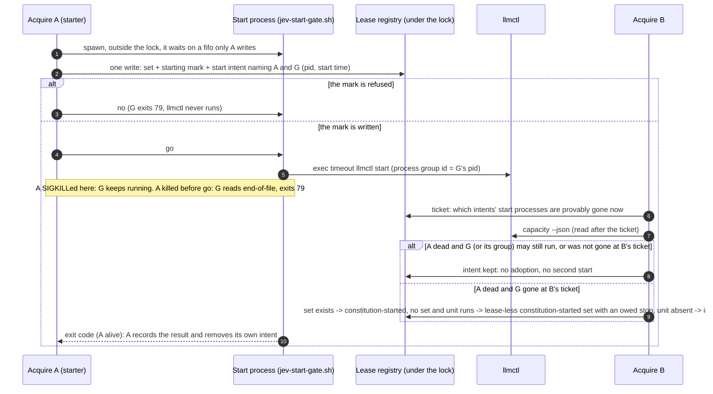
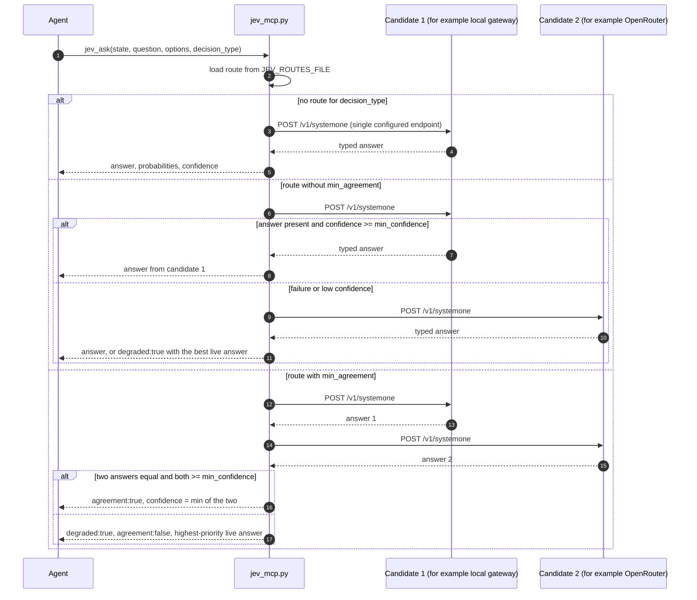

# Jev Decision Layer — Diagrams

| Field | Value |
|---|---|
| Revision | 5 |
| Created | 2026-10-23 |
| Last modified | 2026-11-17T03:25:18Z |
| Status | active |
| Status summary | Mermaid diagrams: architecture, data flow, bootstrap state machine, failover and placement sequence, the start and its start intent (round 14), routing and consensus sequence. |
| Authority | Constitution §11.4.279–§11.4.286. The scripts and the claude_toolkit / llmctl sources govern wherever a diagram simplifies. |
| Scope | Universal (§11.4.17). |
| Issues | none |
| Issues summary | — |
| Fixed | initial creation |
| Fixed summary | — |
| Continuation | none |

Related: [governance guide](governance-guide.md) · [bootstrap reference](bootstrap-reference.md) · [user manual](user-manual.md)

## Table of contents

- [Architecture](#architecture)
- [Data flow of one gated tool call](#data-flow-of-one-gated-tool-call)
- [Bootstrap state machine](#bootstrap-state-machine)
- [Failover and placement sequence (2026-11-12)](#failover-and-placement-sequence-2026-11-12)
- [The start and its start intent (2026-11-17)](#the-start-and-its-start-intent-2026-11-17)
- [Routing and consensus sequence](#routing-and-consensus-sequence)

## Architecture

Who owns what: the constitution owns policy, the bootstrap/status/calibration scripts and the declarations; claude_toolkit owns the per-agent gate, MCP server and endpoint cache; llmctl owns local models and the HTTPS decide gateway.



## Data flow of one gated tool call

Endpoint choice comes from the ranked cache at launch (local gateway first). The bearer key is resolved by variable NAME at call time and sent only over `https://`.



## Bootstrap state machine

States are the stage results of `bootstrap.sh`. `no-change` is a per-stage outcome when the input digest equals the stamp.



## Failover and placement sequence (2026-11-12)

How one decision reaches an endpoint after the S3/S4 changes. The ordered list is the endpoint cache (lower priority first): the local gateway at 10 when a lease is held, then the hosted entries (OpenRouter 30, TypeSafe 40 on the reference host). Whether a failed call moves on to the next entry is decided by the claude_toolkit gate and MCP server, which this repository does not ship; the constitution writes the cache entry, the placement record and the probe classes. Measured 2026-11-12 (T4): a session pinned to OpenRouter (`CMA_JEV_ENDPOINT_ID`) got 402, logged `fallback: endpoint_error` and allowed the call fail-open WITHOUT trying TypeSafe, so the failover branch below is the intended order, not a shown behaviour.

```mermaid
sequenceDiagram
  autonumber
  participant S as Session
  participant P as jev-place.sh
  participant L as llmctl
  participant K as Endpoint cache
  participant G as Toolkit gate / MCP
  participant E1 as llmctl-local (priority 10)
  participant E2 as OpenRouter (30)
  participant E3 as TypeSafe (40)
  S->>P: acquire <holder> --pid <pid>
  P->>L: capacity --json (bounded)
  opt an existing set whose holders were all reaped, constitution-started, and whose own unit is degraded or gone
    P->>L: stop <that profile> (bounded; rc 0 drops the set and its cache entry, a failure keeps stop_owed and is retried)
  end
  alt verdict fits / fits_with_reduced_threads
    P->>L: start <profile> (bounded)
    P->>L: capacity --json again (observation newer than the start)
    P->>K: llmctl-local at priority 10, derived from the lease registry once the unit is read ok
  else does_not_fit or undetermined
    P-->>S: rc 5, placement route cloud (key present) or none
  end
  S->>G: gated tool call
  G->>K: read ordered endpoints
  G->>E1: decision request
  alt 2xx
    E1-->>G: typed answer
  else non-2xx or unreachable (failover NOT shown live; T4 pinned session failed open)
    G->>E2: decision request
    alt 402 no_credit / 429 / error
      G->>E3: decision request
      E3-->>G: typed answer (2xx)
    end
  end
  G-->>S: allow / ask / deny (decisions.jsonl row)
  S->>P: release <holder> (last lease)
  P->>L: stop <profile> (only if the constitution started it; bounded by the start/stop timeout)
  alt stop rc 0
    P->>K: remove llmctl-local
  else stop failed or timed out
    P-->>S: rc 6, set kept (stop_failed); the next release retries
  end
```

## The start and its start intent (2026-11-17)

How `jev-place.sh` starts a model since round 14 (review R13-B1, §11.4.291). The start runs in a start process that exists before the registry write naming it, and that runs llmctl only after that write, so every `llmctl start` that runs is named by a durable start intent. A second acquire (B) judges a dead starter's intent only with an observation taken after the start process and its process group were gone. Gate-logic evidence only (`docs/qa/jev_s3s4_20261112/round14/`): what a real `llmctl start` leaves in another process group or session when its client is killed is UNCONFIRMED.



## Routing and consensus sequence

Applies to the MCP tool `jev_ask` when `decision_type` names a route in `JEV_ROUTES_FILE`. Without `min_agreement` a route is ordered failover; with it, two live candidates must agree.



In the code at claude_toolkit `bfa667f` the candidates are queried sequentially, and with `min_agreement` set every candidate is consulted before the agreement check. The numeric value of `min_agreement` is not compared against anything in that code; only whether it is set matters. When no candidate is reachable the tool returns an error result, never a hang.
