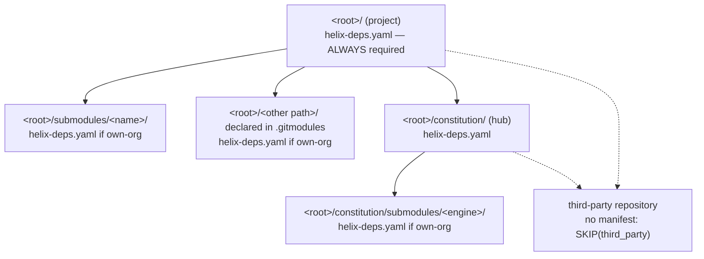
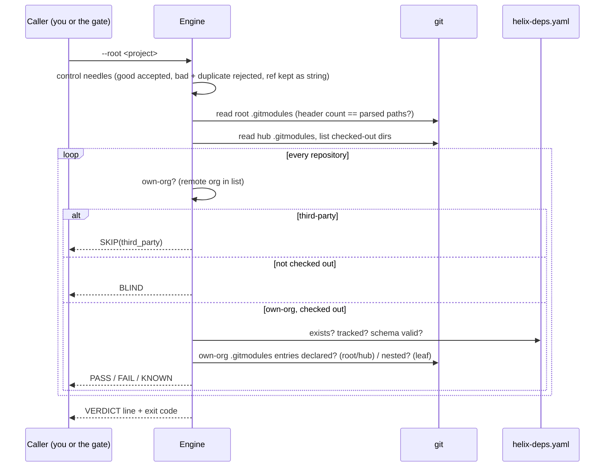
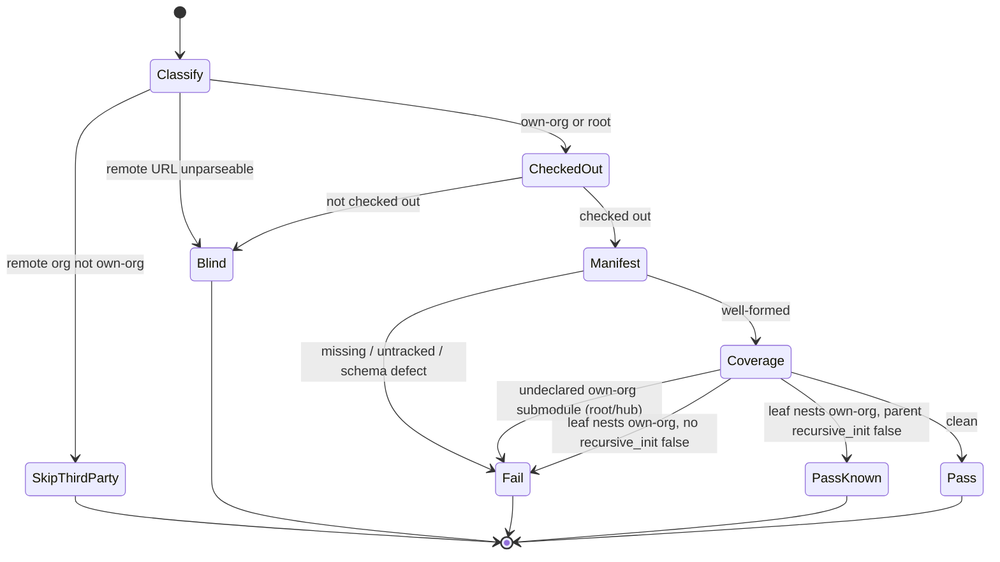

# Dependency Manifest Manual — `helix-deps.yaml` reference

| Field | Value |
|---|---|
| Revision | 5 |
| Created | 2026-10-21 |
| Last modified | 2026-10-23T00:00:00Z |
| Status | active |
| Status summary | Complete reference for the §11.4.31 manifest: schema, layouts, hub engines, transitive handling, the canonical engine (walk, verdicts, exit codes, control needles, scaffold), the gate, and troubleshooting. |
| Authority | Constitution §11.4.31 (EXTENSION of 2026-10-21). The canonical text wins where this manual and the constitution disagree. |
| Scope | Universal (§11.4.17). |
| Issues | none |
| Issues summary | — |
| Fixed | URL forms: https / ssh:// / scp-style parsed, third-party https submodules are SKIP(third_party) not BLIND; relative (./ ../) .gitmodules URLs resolved against the declaring repository (own-org, or BLIND when unresolvable) |
| Fixed summary | — |
| Continuation | — |

## Table of contents

1. [Purpose and the rule](#1-purpose-and-the-rule)
2. [Where the manifests live](#2-where-the-manifests-live)
3. [Schema reference](#3-schema-reference)
4. [Layouts and hub engines](#4-layouts-and-hub-engines)
5. [Transitive handling](#5-transitive-handling)
6. [The canonical engine](#6-the-canonical-engine)
7. [The gate and the pull hook](#7-the-gate-and-the-pull-hook)
8. [Exit codes](#8-exit-codes)
9. [Troubleshooting](#9-troubleshooting)
10. [Honest boundary](#10-honest-boundary)

## 1. Purpose and the rule

§11.4.31 makes every own-org repository declare its own-org dependencies in a machine-readable file, so
that a project can rebuild its dependency graph at its root without nesting own-org repositories inside
each other (§11.4.28(C)). The 2026-10-21 extension makes the file mandatory in EVERY own-org repository
the project carries, adds one canonical verifier and generator, and adds the gate
`CM-HELIX-DEPS-MANIFEST-PRESENT` that runs on every constitution pull.

## 2. Where the manifests live



The engine inspects, in this order:

| # | Repository | Role | Manifest required |
|---|---|---|---|
| 1 | The project root | `root` | Always |
| 2 | Every path the root's `.gitmodules` declares | `hub` for `constitution`, else `leaf` | If own-org |
| 3 | Every path the hub's `.gitmodules` declares | `leaf` | If own-org |
| 4 | Any checked-out repository under `submodules/*` or `constitution/submodules/*` not declared in `.gitmodules` | `leaf` | If own-org (origin remote decides) |

Own-org means the organisation of the remote URL is in the own-org list (`--own-orgs`, else
`HELIX_OWN_ORGS`, else `vasic-digital,HelixDevelopment`; case-insensitive). A repository whose remote is
named `constitution` or `HelixConstitution` under any owner is treated as a hub and therefore as own-org.

## 3. Schema reference

The file is parsed with every scalar kept as a string (a ref like `0123456` stays `"0123456"`; YAML's
octal/float conversions never apply) and duplicate keys are refused.

### 3.1 Top level

| Key | Required | Value |
|---|---|---|
| `schema_version` | yes | `1` |
| `deps` | yes | list of dependency entries; `deps: []` when there are none |
| `transitive_handling` | yes | mapping, see §5 |
| `language_specific_subtree` | yes | `true` or `false` (§11.4.29 exception for Android/Kotlin/Apple roots) |
| `name` | no | plain identifier `[A-Za-z0-9][A-Za-z0-9._-]*` |
| `ssh_url` | no | the repository's own `git@host:org/repo.git` |
| `mirrors`, `language`, `project_agnostic`, `carve_out`, `third_party_manifest` | no | descriptive identity keys used by engine repositories |

Any other top-level key is a defect (`unknown key`).

### 3.2 Dependency entry

| Key | Required | Value |
|---|---|---|
| `name` | yes | plain identifier, unique in the file (case-insensitive) |
| `ssh_url` | yes | `git@host:org/repo.git` — SSH only, `.git` suffix, unique in the file |
| `ref` | yes | tag, branch or commit, no whitespace, not a placeholder |
| `why` | yes | the real reason; not starting with `UNKNOWN`, `TODO`, `TBD`, `FIXME` |
| `layout` | yes | `flat`, `grouped` or `hub` (§4) |
| `path` | no | relative path inside the repository (no leading `/`, no `..`) |
| `recursive_init` | no | `true` / `false`; `false` = never initialise with `--recursive` |
| `third_party` | no | `true` / `false` |
| `licence` | when `third_party: true` | SPDX identifier, e.g. `MIT`, `Apache-2.0` |

Cross-field rules:

- A dependency whose URL organisation is not own-org MUST carry `third_party: true`.
- `third_party: true` on an own-org URL is a contradiction.
- `third_party: true` requires `licence`.

### 3.3 Coverage rules against `.gitmodules`

- The root and the hub MUST have a `deps` entry for every own-org submodule they declare (matched by the
  normalised `org/repo` of the URL). The root does not list the `constitution` hub; it is inherited by
  reference.
- A leaf MUST NOT declare an own-org or hub repository in its own `.gitmodules` (§11.4.28(C)). When the
  parent's entry for that leaf carries `recursive_init: false`, the nesting is reported `KNOWN` and is the
  debt of `CM-HUB-ENGINE-NO-OWNORG-NESTING`.
- The manifest must be tracked by git in its repository (staged counts).
- A relative `.gitmodules` URL (`./x` or `../x`, git's superproject-relative form) is resolved against the URL
  of the repository that declares it, exactly as git does: `../Containers.git` under
  `git@github.com:vasic-digital/llmctl.git` is `git@github.com:vasic-digital/Containers.git`, so it is
  own-org. A relative URL that cannot be resolved (the declaring repository has no parseable remote URL, or
  the path has more `../` than the base has segments) is BLIND, never a pass and never third-party.

### 3.4 Minimal valid file

```yaml
schema_version: 1
deps: []
transitive_handling:
  recursive: true
  conflict_resolution: operator-required
language_specific_subtree: false
```

## 4. Layouts and hub engines

| Layout | Location the dependency occupies at the consuming root |
|---|---|
| `grouped` | `<root>/submodules/<name>/` |
| `flat` | `<root>/<name>/` |
| `hub` | `<root>/constitution/submodules/<name>/` — a constitution hub engine, resolved through the hub |

The constitution is the one hub (§11.4.28(C) carve-out). It hosts depth-1 engines under its own
`submodules/`. Engines MUST be leaves: they resolve the canon and their siblings through the hub
(`find_constitution.sh` / the §11.4.28(C) resolver) and never nest them. An engine whose recorded pin nests any
repository (own-org or third-party) keeps `recursive_init: false` on its entry; an own-org nest is a defect
owned by `CM-HUB-ENGINE-NO-OWNORG-NESTING` until the engine stops nesting it upstream and its pin is bumped
to that commit. Measured 2026-10-22 on the constitution hub: no engine pin nests an own-org repository
(`llmctl` at `f42bad6` nests third-party `llama.cpp` and `colibri`; `claude_toolkit` at `1f6dad3` nests
the third-party Go toolchain), so `recursive_init: false` on both entries now guards third-party nests only.

These two hub engines are also the §11.4.286 decision-layer dependencies: the Jev bootstrap wizard reads their pins from this manifest and installs them (§11.4.281).

## 5. Transitive handling

```yaml
transitive_handling:
  recursive: true                       # tooling follows each dependency's own manifest
  conflict_resolution: operator-required # two refs for one dependency => stop and ask (§11.4.6)
```

`conflict_resolution` has exactly one legal value. Entries carrying `recursive_init: false` and entries
carrying `third_party: true` are never walked for own-org manifests.

## 6. The canonical engine

Location: `constitution/scripts/deps_manifest/verify_helix_deps_manifests.sh` (entry point) and
`helix_deps_manifest.py` (logic). It is consumed by reference; a project script may only wrap it.

### 6.1 Modes

| Mode | Purpose |
|---|---|
| `--root <dir>` | verify the whole tree (§2) |
| `--validate-file <file>` | validate one manifest in isolation |
| `--scaffold <dir> [--write]` | generate a skeleton from `.gitmodules`, `go.mod`, `package.json` |
| `--selftest` | run the control needles and golden fixtures |
| `--own-orgs a,b` | override the own-org list (any mode) |

### 6.2 Verification sequence



### 6.3 Verdict state machine (one repository)



`PassKnown` prints two lines: `PASS` (the manifest is fine) and `KNOWN` (the nesting debt and its owner).

### 6.4 Control needles

Before any verification the engine proves it can see: a golden-good manifest must validate, a golden-bad
(HTTPS URL) and a duplicate-key manifest must be rejected, and the ref `0123456` must survive as a string.
If any needle fails the run is `BLIND` (exit 2) — a blind instrument never reports PASS. The `.gitmodules`
reader compares the number of `[submodule "…"]` headers with the number of parsed paths; a mismatch is
`BLIND`. `--selftest` additionally builds three throwaway trees (golden-good, golden-bad, an uninitialised
own-org negative control) and checks the exact verdicts.

### 6.5 Scaffold

- Own-org `.gitmodules` entries become entries named after the path's last segment (snake_case), with the
  recorded gitlink (7 characters) as `ref` when the index has one, else `UNKNOWN-pin-me`; `layout` is
  `grouped` for paths under `submodules/`, else `flat`. The `constitution` hub is mentioned in a comment,
  never listed.
- `go.mod` `require` lines for `github.com/<own-org>/<repo>` become entries with the module version as ref;
  other modules whose path contains an own-org token (for example `digital.vasic.*`) become `# NOTE`
  comments, because their repository cannot be derived from the module path.
- `package.json` dependencies written as `github:org/repo`, `git+ssh://…`, `https://github.com/…` or
  `org/repo` become entries; scoped registry packages that look own-org become `# NOTE` comments.
- Every `why` is the placeholder `UNKNOWN: …`, which the verifier rejects until a human writes the reason.
- `--write` writes atomically and refuses (exit 1) when the file exists, even if it appears during the write.

## 7. The gate and the pull hook

`constitution/scripts/gates/cm_helix_deps_manifest_present.sh [--root <project>] [--own-orgs …]` runs the
engine and maps its exit code (0 PASS, 1 FAIL, 2 BLIND, 64 usage; a missing engine is BLIND). Without
`--root` it uses the superproject that vendors the constitution, else the constitution itself.

`constitution/scripts/post_update_hook.sh` (§11.4.164 / §11.4.32 pull seam) runs it on every pull in step
5b, pointed at `PROJECT_ROOT`: FAIL becomes an error (the hook exits non-zero), BLIND a warning, never a PASS.

The paired mutation test `cm_helix_deps_manifest_present_mutation_test.sh` classifies twenty fixture trees,
an engine-missing case and the third-party golden-FALSE, and must kill seventeen engine mutants (counted from
its own `ok   mutant … killed` lines on 2026-10-21; re-count rather than trusting this figure).

## 8. Exit codes

| Mode | 0 | 1 | 2 | 64 |
|---|---|---|---|---|
| `--root` | PASS | at least one FAIL | no FAIL, at least one BLIND, or failed needles | usage |
| `--validate-file` | well-formed | defects | unreadable file / failed needles | usage |
| `--scaffold` | printed / written | refused (file exists) | directory unreadable | usage |
| `--selftest` | all checks pass | a check failed | — | — |

Parse the `VERDICT:` line for the summary counts.

## 9. Troubleshooting

| Symptom | Cause | Action |
|---|---|---|
| `BLIND … PyYAML is not importable` | python3 lacks PyYAML | install it (`python3 -m pip install --user pyyaml`, or the distro package) |
| `BLIND … parser blind` | `.gitmodules` has a section git could not parse | fix the `.gitmodules` syntax |
| `BLIND … not checked out` | own-org submodule declared, directory empty | `git submodule update --init -- <path>` |
| Third-party repository reported FAIL | its organisation is in your own-org list | correct `--own-orgs` / `HELIX_OWN_ORGS` |
| `undeclared own-org submodule constitution` | never happens for the root; for another repository the hub must be referenced, not nested | resolve the hub via `find_constitution.sh` |
| The gate passes locally but fails on pull | an own-org submodule changed pin and its new commit lacks the manifest | add the manifest in that repository and bump again |
| `BLIND … remote URL unknown or unparseable` on a repository whose `.gitmodules` URL is an https URL | older engines parsed only `org/repo` paths, so a single-segment URL such as `https://go.googlesource.com/go` had no organisation | fixed: `https://`, `ssh://` and scp-style (`git@host:org/repo.git`) URLs are all parsed; the organisation is the first path segment (the host stands in for a single-segment path), and anything outside the own-org list is `SKIP(third_party)`. Only a URL with another scheme, no path, a `..` segment or whitespace stays BLIND: correct it in `.gitmodules` |
| A ref like `1e10` changed value | it cannot: scalars stay strings | — |
| `BLIND … relative submodule URL … cannot be resolved` | a `./x` or `../x` URL whose declaring repository has no remote URL (for the root: no `origin`) | add the `origin` remote, or write the absolute SSH URL in `.gitmodules` |

## 10. Honest boundary

The engine proves that each own-org repository carries a tracked manifest of the right form and that the
root and hub manifests cover their own-org submodules. It does not prove that a `ref` equals the recorded
gitlink (that drift belongs to `CM-DEPENDENCY-POINTER-PREFLIGHT-FAIL-CLOSED`, §11.4.233(G)), that the
`why` text is true, or that every repository can be bootstrapped from scratch.

Known limitation — the two gates read DIFFERENT commits of a leaf. This engine reads a leaf's nesting from
its CHECKED-OUT `.gitmodules`; `CM-HUB-ENGINE-NO-OWNORG-NESTING` reads it from the commit the hub RECORDS (the
staged gitlink when it differs from `HEAD`'s, else `HEAD`'s). When a leaf's checkout differs from the
recorded gitlink (a submodule moved forward locally and not yet staged, or a stale checkout after a pointer
bump), the two gates can disagree about the same leaf: one may PASS while the other FAILs. Neither verdict is
wrong for the commit it inspected; reconcile by checking the leaf out at the recorded gitlink
(`git submodule update -- <path>`) or by staging the new pointer, then re-run both. Making this engine read
the recorded commit is owed work, not done here.

See also: the [user guide](../guides/dependency_manifest_user_guide.md) and the
[FAQ](../faq/dependency_manifest_faq.md).
