# Destructive-Path Safeguard Manual — the PreToolUse guard and `safe_rm_rf`

| Field | Value |
|---|---|
| Revision | 5 |
| Created | 2026-10-24 |
| Last modified | 2026-10-27T09:00:00Z |
| Status | active |
| Status summary | Operator manual for the two layers of the destructive-path safeguard: the hook `scripts/hooks/guard-destructive-paths.py` and the runtime helper `scripts/lib/safe_rm.sh` with its list `scripts/lib/protected_paths.list`. Behaviour statements were checked by running the implementation on 2026-10-24 and re-checked on 2026-10-26 after review round 2 (unresolvable expansions fail closed; budget rule; git clean and raw block devices) and again after review round 3 (one degraded check on every exit where the full analysis cannot finish; deterministic work limit; internal errors fail closed). Probe commands and counts are in section 9. The hook is NOT registered anywhere by the constitution; section 2 shows the snippet only. |
| Authority | Constitution §11.4.287. The canonical text in `Constitution.md` wins where this manual and the constitution disagree. |
| Scope | Universal (§11.4.17). Paths are examples; the consumer supplies its own protected children and allowed roots. |
| Issues | none |
| Issues summary | — |
| Fixed | — |
| Fixed summary | — |
| Continuation | — |

Related: [guide](../guides/destructive_path_safeguard.md) · [FAQ](../faq/destructive_path_safeguard_faq.md)

## Table of contents

1. [What the two layers are](#1-what-the-two-layers-are)
2. [Install and registration of the hook](#2-install-and-registration-of-the-hook)
3. [Decision flow](#3-decision-flow)
4. [Classes P, X, H, V, U](#4-classes-p-x-h-v-u)
5. [The escape hatch `# guardrails:allow <reason>`](#5-the-escape-hatch--guardrailsallow-reason)
6. [`safe_rm_rf`: usage and configuration](#6-safe_rm_rf-usage-and-configuration)
7. [Test commands](#7-test-commands)
8. [Troubleshooting](#8-troubleshooting)
9. [Known limits and measured facts](#9-known-limits-and-measured-facts)

## 1. What the two layers are

| Layer | File | Runs when | Protects |
|---|---|---|---|
| Hook (static scan) | `scripts/hooks/guard-destructive-paths.py` | Before a Claude Code tool call, if the operator registered it | Bash commands, and shell-like files written with Write, Edit or MultiEdit |
| Runtime helper | `scripts/lib/safe_rm.sh` | When a script calls `safe_rm_rf` | Only the calls routed through it |

The hook reads the tool call, not the machine. It cannot know what a variable holds at run time; it tracks values in statement order and treats a value it cannot prove as unsafe. The helper sees the real values at run time but only guards calls that use it. Neither replaces file-system permissions, backups (§9.2) or the host-safety rules (§12).

The incident that created them (2026-10-23): a scratch script of the shape `W="$2"; export HOME="$W/home"; rm -rf "$HOME"` ran with no arguments, `HOME` became `/home`, and a recursive delete ran as the operator until a timeout stopped it.

## 2. Install and registration of the hook

The constitution does not register the hook in any settings file. Editing a user's or a project's `settings.json` needs that user's consent, so the operator does it. Add this to the chosen `settings.json` (user scope or project scope). The path is an example; point it at the constitution checkout the project vendors.

```json
{
  "hooks": {
    "PreToolUse": [
      {
        "matcher": "Bash|Write|Edit|MultiEdit",
        "hooks": [
          { "type": "command", "command": "python3 -I /path/to/constitution/scripts/hooks/guard-destructive-paths.py" }
        ]
      }
    ]
  }
}
```

Facts about the hook process (from the source header and `run()`):

- It needs only `python3` and the standard library; `-I` runs Python in isolated mode, so a planted module in the working directory is not imported.
- Exit 0 allows, exit 2 blocks and prints the reason on stderr. Any other exit status is treated by Claude Code as allow.
- Only a payload that is not JSON at all exits 0, with "WARNING — unparsable payload, allowing (cannot inspect)" on stderr: it carries no tool input to inspect. This fail-open choice is in tension with the conservative-safe default of §11.4.201(4) and §11.4.252: it is kept because Claude Code always sends JSON and blocking would stop all work (§11.4.201(1)), and whether any harness can emit a non-JSON payload is UNCONFIRMED. A non-string command or content is class X (exit 2). An internal exception during the analysis is class X and the degraded check still runs; one that escapes the analysis makes the hook exit 2 (fail closed, §11.4.201(4)). The cost, stated honestly: a guard defect can block harmless commands until it is fixed.
- Tools other than Bash, Write, Edit and MultiEdit are not inspected. For Write and friends, only content that a shell would execute is scanned: `.sh`, `.bash`, `.zsh`, `.ksh`, a shebang naming a shell (leading blank lines or spaces before `#!` are tolerated), `Makefile`, `GNUmakefile`, `*.mk`, `justfile`, `.gitlab-ci.yml`, `.github/workflows/*.yml`, and the `RUN` lines of a `Dockerfile` or `Containerfile` (also `Dockerfile.*`, `*.dockerfile`). For Edit and MultiEdit of a file whose name does not say it is a script, the first bytes of the file on disk (or, when it cannot be read, the `old_string`) are checked for a shell shebang, so an edit inside an extension-less script is scanned. One shared rule set decides this for Write/Edit/MultiEdit content and for heredoc destinations. A file without such a name or shebang is treated as data and allowed. `NotebookEdit` and MCP shell or file tools (for example desktop-commander `start_process` or `write_file`) are not inspected at all.

Check that it is live. The probe must print `rc=2`; build the delete-of-`/home` command from fragments so that this shell line does not itself trip any registered guard:

```bash
R=r; R="${R}m"; python3 -I -c '
import json,sys
print(json.dumps({"tool_name":"Bash","tool_input":{"command":sys.argv[1]}}))
' "$R -rf /home" | python3 -I /path/to/constitution/scripts/hooks/guard-destructive-paths.py; echo "rc=$?"
```

If it prints `rc=0`, the hook file path is wrong or the interpreter failed; read the stderr line, then run the test suites in section 7.

Registering the hook in a real settings file is a separate operator act and is not part of this manual's checks.

## 3. Decision flow

The diagram shows the hook decision path (top) and the `safe_rm_rf` validation order (bottom).

```mermaid
flowchart TD
  subgraph G["PreToolUse guard: guard-destructive-paths.py"]
    A["Hook JSON on stdin"] --> B{"Payload parses?"}
    B -- "no" --> W1["WARN on stderr, exit 0 (not inspected)"]
    B -- "yes" --> C{"tool_name"}
    C -- "Bash" --> D["Scan the command text"]
    C -- "Write / Edit / MultiEdit" --> E{"Content a script? (.sh, shebang, Makefile, justfile, CI yaml, Dockerfile RUN)"}
    E -- "no" --> OK["Allow, exit 0"]
    E -- "yes" --> D
    C -- "any other tool" --> OK
    D --> F["Segment, track variables, follow bash -c, eval, trap, substitutions, functions, heredocs"]
    F --> H{"Findings?"}
    H -- "none" --> OK
    H -- "yes" --> I{"Any class P or X?"}
    I -- "yes" --> BL["BLOCK, exit 2 (marker ignored)"]
    I -- "no: only H, V, U" --> J{"Top-level guardrails:allow marker with a reason anywhere in the payload?"}
    J -- "no" --> BL
    J -- "yes" --> WA["WARN on stderr, exit 0"]
    D -. "internal exception" .-> BL
  end
  subgraph S["Runtime helper: safe_rm_rf in safe_rm.sh"]
    S0["safe_rm_rf args"] --> S1{"At least one argument?"}
    S1 -- "no" --> R2["Refuse, return 2"]
    S1 -- "yes" --> S2{"protected_paths.list readable, valid, has an absolute entry?"}
    S2 -- "no" --> R2
    S2 -- "yes" --> S3{"Config valid? SAFE_RM_MIN_DEPTH, TMPDIR, HOME, EXTRA_HOMES, EXTRA_HOME_ROOTS, ALLOWED_ROOTS"}
    S3 -- "no" --> R2
    S3 -- "yes" --> S4{"Per argument: not empty, not option-like, no newline, last component not . or .."}
    S4 -- "no" --> R2
    S4 -- "yes" --> S5{"Lexical path (and resolved path if the argument ends in /) is not: root, listed system path, home root or user home, an ancestor of a home, protected home child, temp root"}
    S5 -- "no" --> R2
    S5 -- "yes" --> S6{"Deep enough (SAFE_RM_MIN_DEPTH) and inside SAFE_RM_ALLOWED_ROOTS if set?"}
    S6 -- "no" --> R2
    S6 -- "yes" --> S7["All arguments validated, then delete each lexical path, return 0"]
  end
```



## 4. Classes P, X, H, V, U

Source: the module docstring and `run()` in the guard. `hard = ("P", "X")` in `run()`: those two classes block even when a marker is present.

| Class | Meaning | Overridable | Example (reproduced 2026-10-24) |
|---|---|---|---|
| P | Protected target. The target, resolved from literals and the real `$HOME` only, is `/`, a system directory, `/home`, a user home, the home directory, a protected child of it, or a glob that can match one. Applies to a recursive delete, recursive permission change, `find -delete`/`-exec`, `rsync --delete` and `mv`. | No | recursive delete of `/home`: rc 2, "targets a system directory (/home)" |
| X | Unparsable, too deep, or not inspectable. The text cannot be parsed reliably (unterminated quote, `$(`, backtick or heredoc) and it contains a destructive command; or the degraded check (section 9, item 11) found a recursive or forced delete it cannot judge, or a hidden command word used with a recursive or force flag or a protected path; or the guard itself failed, or the command or content is not a string. Fails closed. | No | a recursive delete with an unterminated `"`: rc 2, "cannot be parsed reliably (unterminated quote)" |
| H | HOME reassigned from an expansion that can be empty or tainted, then a destructive command runs under it. This is the incident. | Yes | the incident script: rc 2, class H |
| V | Empty or tainted variable. The target derives from an unguarded positional parameter, input read at run time (`read`, `mapfile`), an indirect expansion, or an unknown or empty variable that composes a protected path once empty; a whole target that is the output of a command the guard cannot compute (`"$(cat f)"`, `$(ls ...)`); an unresolved command word (any expansion, parameter operator, `${X:?}`, brace or glob head, command substitution) used with recursive or force flags or a protected argument; `xargs` or `parallel` input the guard cannot inspect; and (review round 6) a RECURSIVE delete of a whole target that is a variable the analysed text never assigns (`rm -rf "$W"` with `W` set nowhere in the file, or `~-` with no earlier `cd`), including `"$W"/*` and `"$W"/.`, and an inline `python3 -c`/`node -e`/`perl -e`/`ruby -e` that removes a tree whose path it computes. | Yes | recursive delete of `"$1/build"`: rc 2, class V |
| U | Uninspectable code. Code is fed to a shell from a source the guard cannot read (a pipe from an unknown producer, an unknown variable), or the degraded check (section 9, item 11) found an uncertain delete that is neither recursive nor forced. | Yes (degraded case: only a marker on line 1, or line 2 after a shebang) | `cat foo` piped into `bash`: rc 2, class U |

What counts as guarded. A variable is treated as guarded when the text contains `${VAR:?...}` or `${VAR?...}`, a `[ -n "$VAR" ]`-style test whose failure branch leaves (`|| exit`, `&& exit` style), a `[ -z "$VAR" ]` test of the same kind, or when it was assigned from a literal or from `$(mktemp ...)`. A guard inside a comment or single quotes does not count. A temporary-directory variable followed by `..` is still reported, because `..` can leave the prefix.

Protected sets (from the source; the exact lists live in `SYSTEM_DIRS`, `HOME_CHILDREN`, `HOME_CHILD_PREFIXES`):

- System: `/`, `/bin`, `/boot`, `/dev`, `/etc`, `/lib*`, `/opt`, `/proc`, `/root`, `/run`, `/sbin`, `/srv`, `/sys`, `/usr`, `/var`, `/mnt`, `/media`, `/snap`, `/home`, `/Users`, `/tmp`, `/var/lib`, `/usr/lib`, `/usr/bin`, `/usr/local`, `/var/log`, and any direct child of `/home` or `/Users`.
- Home itself, its parent, and these direct children of the real home: `Projects`, `backups`, `Documents`, `Desktop`, `Downloads`, `Pictures`, `Music`, `Videos`, `Obsidian`, `scripts`, `bin`, `go`, `opt`, `Android`, `.ssh`, `.gnupg`, `.config`, `.local`, `.cache`, `.claude`, `.claude-shared`, `.git`, `.aws`, `.kube`, `.docker`, `.password-store`, and anything starting with `.claude-`.
- A deeper path under a protected child is not protected by this list: `~/Documents/old` was allowed in the 2026-10-24 probe.

Note the two lists are not identical. `protected_paths.list` (used by `safe_rm_rf`) names `~/scripts`, `~/Projects`, `~/.ssh`, `~/.gnupg`, `~/.claude*`, `~/.config`, `~/.local`, `~/vasic`, `~/ytdlp`, `~/backups`, `~/.cache`; the hook uses its built-in set above. The hook does not read `protected_paths.list` (the list's header calls the hook a later consumer; the hook source only defines a function named `protected_paths` that builds the set in code). Keep both in mind when you add a protected directory.

## 5. The escape hatch `# guardrails:allow <reason>`

Form: a real single-line shell comment, `# guardrails:allow` followed by whitespace and a non-empty reason. The matcher is `^#\s*guardrails:allow\s+(\S.*)$` applied to the comment text.

What it does: when the only findings are classes H, V and U, and a marker is present, the findings are printed as `WARNING (allowed by ...)` and the hook exits 0.

What it cannot do:

- It never downgrades class P or X. In the probe, a recursive delete of `/` with a marker still returned rc 2.
- A marker with an empty reason does not match (rc 2 in the probe).
- A marker inside quotes (`echo "# guardrails:allow x"`), a heredoc body, `bash -c`, a trap or `$(...)` does not count. Only top-level comments at nesting depth 0 are read.
- It does not exist for Write, Edit or MultiEdit unless the written script text itself carries the comment as a real top-level comment of that text.

Scope warning: the marker is payload-global. The first marker found anywhere in the tool call downgrades every H, V and U finding in that same call, not only the command next to it. In the 2026-10-24 probe, one marker on the first of two lines allowed a second line deleting `"$2/b"`. Use the marker on a call that contains one destructive command, and keep the reason specific (what makes the value safe).

Use it rarely. A block is usually a defect in the script (guide §5); a marker records an audited decision, it does not make the command safe.

## 6. `safe_rm_rf`: usage and configuration

```bash
. /path/to/constitution/scripts/lib/safe_rm.sh
safe_rm_rf "${WORKDIR:?}/build"            # refuses empty, relative-to-nothing, system, home, ancestor-of-HOME, shallow targets
SAFE_RM_ALLOWED_ROOTS="$TMP_ROOT" safe_rm_rf "$TMP_ROOT/case1"
```

Behaviour (source header and code, plus the sandbox run of 2026-10-24):

- Returns 0 on success, 2 on any refusal, prints `safe_rm_rf: REFUSED <arg> — <reason>` on stderr and deletes nothing for that call.
- Validates every argument before deleting the first (validation is atomic; the deletion is not: if `rm` fails on argument k, arguments 1 to k-1 are already deleted and the status of `rm` is returned): in the sandbox run, `safe_rm_rf "$S/w/x/y/z" "/etc"` refused and left `z` in place.
- Refuses: no arguments, an empty argument, an option-like argument (starts with `-`), a newline, a last component of `.` or `..`, a path `readlink -m` cannot resolve, the filesystem root, an exact absolute entry of `protected_paths.list`, a home root (`/home`, `/Users` and configured roots), a direct child of one (a user home), `$HOME` or any `SAFE_RM_EXTRA_HOMES` entry, an ancestor of one, a protected `~/` child of a home, the temp root, a target shallower than `SAFE_RM_MIN_DEPTH`, and a target outside `SAFE_RM_ALLOWED_ROOTS` when that is set.
- Fail closed: a missing, unreadable or malformed `protected_paths.list`, a list with no absolute entry, an unset or relative `HOME`, an invalid configuration value. Also when the file was sourced without a real file path (eval of its text) or under a name other than `safe_rm.sh`, the list cannot be located and every call is refused.
- Rules are applied to the lexical path (parents resolved, last component not followed). When the argument ends in `/` the resolved path is checked too, because `rm` then follows a trailing symlink. A plain symlink leaf pointing at a protected path is removable as a link; `link/` is refused. That refusal is deliberately conservative: the deletion itself always uses the stripped path and never follows the link, so it may refuse a call that would only have removed the link.
- Deletes the validated lexical path with `command rm -rf --`; a path that does not exist is skipped silently.

Environment variables:

| Variable | Format | Default | Effect |
|---|---|---|---|
| `SAFE_RM_EXTRA_HOMES` | colon-separated absolute directories | none | Treated exactly like `$HOME` (equal, ancestor and protected-child checks). Lets a test use a fake home without reassigning `HOME`. No glob expansion; a relative entry or a glob character is a config error. |
| `SAFE_RM_EXTRA_HOME_ROOTS` | colon-separated absolute directories | none | Directories whose direct children are user homes, like `/home` and `/Users` (always included, with their resolved forms). |
| `SAFE_RM_MIN_DEPTH` | non-negative integer, no leading zeros, at most 3 digits | 3 | Shallowest accepted path, counted in components. A path strictly below the temp root gets a depth bonus when the temp root is `/tmp`, `/var/tmp` or at least two components deep and not itself a listed path; the bonus is withheld when the temp root is, or is an ancestor of, a home or a home root. Empty value falls back to 3. |
| `SAFE_RM_ALLOWED_ROOTS` | colon-separated absolute directories | unset (no allow-list) | Opt-in second barrier. When the variable is SET it must yield at least one entry; set but empty fails closed. |
| `TMPDIR` | absolute path | `/tmp` | The temp root itself is never deletable. A relative `TMPDIR` is a config error. |

`protected_paths.list` format: blank lines and `#` lines are ignored; an entry starting with `/` is an absolute protected path matched exactly (not as a subtree); an entry starting with `~/` is a single path component, optionally a glob, matched against the first component below each home; any other line is a format error and fails every call. Edit this one list, not a consumer copy.

Honest limits of the helper (its own header): it protects only calls routed through it; the check-to-use race (a parent swapped for a symlink between validation and `rm`) is narrowed, not closed; absolute list entries match exactly, so deeper system paths such as `/usr/local/lib` are guarded only by the depth rule and the allow-list; unlisted direct children of a home (for example `~/Documents`) are not protected.

## 7. Test commands

Run from the constitution root. Counts are what the implementation reported on 2026-10-26.

```bash
bash scripts/hooks/test_guard_destructive_paths.sh        # 65 passed, 0 failed (paired mutations included)
python3 -I scripts/hooks/test_guard_bypasses.py           # 2429 passed, 0 failed (review-round bypass cases, 98 of them round 7, 55 of them fix round 6)
bash scripts/lib/test_safe_rm.sh                          # 267 passed, 0 failed
bash scripts/gates/cm_guard_class_p_not_overridable.sh
bash scripts/gates/cm_guard_class_p_not_overridable_mutation_test.sh
```

`SKIP_MUTATION=1` skips the mutation section of the guard test (it copies the guard and neuters one part with `sed`, then requires the unmutated guard to block and the mutated copy to allow). `GUARD=/path/to/guard.py` runs the same cases against another copy.

## 8. Troubleshooting

| Symptom | Cause | Fix |
|---|---|---|
| A command is blocked with class P | The target is, or can glob to, a protected path | Fix the path. No marker helps. |
| Blocked with class V and the variable looks set | The guard did not see a guard it accepts (`${VAR:?}` or a leave-on-fail test) before use, or the variable came from `$1`, `$@`, `read` or `mapfile` input, a `for` loop over unknown words, indirect expansion or `$(...)` | Write `"${VAR:?message}"` at the use. |
| Blocked with class H | `HOME` assigned from an expansion that can be empty, then a delete under it | Build the fake home with `mktemp -d`, check it, or use `SAFE_RM_EXTRA_HOMES` in tests. |
| Blocked with class X | Unterminated quote, `$(`, backtick or heredoc with a delete in the text; or, on the degraded path (strings re-parsed more than 5 levels deep, total nesting deeper than 40, budget or clock), a forced delete it cannot judge or a hidden command word with a force flag or protected path | Simplify the command or split it. |
| Blocked with class U or X, "analysis budget ran out" | The text needed more than 4,000,000 characters of analysis work, 3,000 function expansions or 25 s, or `GUARD_TIME_BUDGET` is set in the hook environment | Unset `GUARD_TIME_BUDGET`. Split the text. For class U only, a reasoned `# guardrails:allow` on line 1 (line 2 after a shebang) allows it; class X needs the delete rewritten with a guarded or `mktemp` path. |
| Blocked with class U | Text is piped into `bash`/`sh` from a source the guard cannot read | Write the script to a file first and let it be inspected, or accept the audited marker for a specific safe case. |
| A harmless command is blocked | The delete-shaped text is in a position the guard reads as a command (for example a `find ... -exec` with a variable path) | Rewrite with explicit guarded paths; if truly safe and class H, V or U, use the marker with a specific reason. |
| `safe_rm_rf` returns 2 with "protected list not readable" | `protected_paths.list` is not next to `safe_rm.sh`, or the library was eval-loaded or renamed | Source the real file by its path; keep the list beside it. |
| `safe_rm_rf: REFUSED (config) SAFE_RM_ALLOWED_ROOTS is set but yields no entries` | The variable is set but empty | Unset it, or give at least one absolute root. |
| `safe_rm_rf: REFUSED ... only N path components deep` | Target shallower than `SAFE_RM_MIN_DEPTH` | Delete a deeper target, or lower the value deliberately. |
| The hook seems to do nothing | Not registered, wrong path, or it printed "NOT inspected" (a payload that is not JSON, or a non-script Write; since review round 3 an internal error BLOCKS, and since review round 4 a non-string command or content blocks too) | Run the probe in section 2 and read stderr. |
| Test script blocked by another guard | A test file that contains delete-shaped text trips a registered hook | Assemble trigger tokens from fragments, as the shipped tests do. |

## 9. Known limits and measured facts

Stated as limits, not as bugs to be hidden (§11.4.6). The guard is a text scan at the tool-call boundary, not a security boundary.

1. Marker scope is payload-global: one marker anywhere at top level downgrades all H, V and U findings of that tool call (probe: a second delete on another line was allowed).
2. Constructs the guard does not model. An alias (`alias zap='<delete>'; zap /home` was allowed in the probe), `source` of a file that already exists on disk, namerefs (`declare -n`), and brace ranges of the form `{a..b}` are not followed (comma lists such as `{ho,}me` are expanded, up to 4 rounds and 64 variants; `declare -n` was allowed in the probe).
3. Guard position and reachability are not checked. The guard only has to exist in the text: a guard placed after the use (`<delete> "$1/x"; : "${1:?}"` was allowed in the probe), inside a dead branch, in a function that is never called, or in a subshell whose `exit` does not stop the parent can satisfy it.
4. Command substitution is evaluated only for a small closed set (`echo`, literal `printf`, `pwd` after a known `cd`, `dirname`, `basename`, `realpath`/`readlink -f`, `which`/`command -v`, `mktemp` trusted as safe); any other substitution is "unknown, may be empty". A relative computed result is not judged: `y=$(echo foo); <delete> "$y/b"` was allowed (2026-10-26). A whole target that is an unknown substitution is blocked as V, including legitimate `$(ls ...)` or `$(find ...)` lists; compute the list into a guarded variable instead.
5. It cannot see a command built at run time from a decoded string, a downloaded script, a binary, or a language runtime deleting through its own API.
6. Only Bash, Write, Edit and MultiEdit are inspected. `NotebookEdit` and MCP shell/file tools (for example desktop-commander `start_process`, `write_file`) bypass the hook entirely. A Write of a file with no shell-like name or shebang is not scanned, and an Edit of such a file is scanned only when its on-disk head (or `old_string`) shows a shell shebang.
7. The hook and `protected_paths.list` are separate lists (section 4).
8. The hook is not registered anywhere until the operator registers it. Until then neither Claude Code nor any other tool calls it; only `safe_rm_rf` callers are protected.
9. Fail-open only for a payload that is not JSON: it carries no tool input, so it is allowed and says so on stderr. A tool input whose command or content is not a string is class X (changed in review round 4). An internal error during analysis is the opposite case (changed in review round 3): it adds class X ("internal failure ... fail closed") and the degraded check below still runs over the whole text, and an exception that escapes `run()` makes `main()` return 2. An analysis bug can therefore never allow an uninspected command.
10. `safe_rm_rf` narrows but does not close the check-to-use race, and matches absolute list entries exactly.
11. Analysis budget and the degraded check (rewritten in review round 3). The PRIMARY limits are deterministic, so a verdict does not depend on how fast the host is: `MAX_WORK_CHARS` = 4,000,000 characters of CUMULATIVE text handed to the analysis (every nested re-analysis counts again) and 3,000 function-body expansions. A wall clock (`DEFAULT_CLOCK_SECS` = 25 s) is only a last-resort net. `GUARD_TIME_BUDGET` can SHORTEN that clock for tests and is clamped to the range 0 to 25 s (a larger, negative, `inf` or `nan` value means 25 s); operators MUST NOT set it in the live hook environment, because a short clock only makes ordinary scripts fall into the degraded check. Whichever limit is hit first, and also when a string is re-parsed as code more than 5 levels deep (eval, `sh -c`, a heredoc fed to a shell), the total nesting of substitutions, function calls and strings is deeper than 40 (`MAX_FRAMES`; since review round 4 `$(...)` and function calls no longer count towards the 5, because ordinary libraries chain `$(f)` calls deeper), or the analysis raises an internal error, the WHOLE text is re-checked by ONE degraded check, `fallback_scan()`, which cannot raise (an error inside it becomes class X). It splits statements with the same quote-aware tokenizer as the full analysis (since review round 4; a quoted awk `$0` is no longer a command word), adds the statements inside every `$(...)`, and the body of a heredoc that is fed to a shell or written to a file; text the tokenizer cannot parse is split on `;`, `&`, `|` and newlines and, when it contains a destructive command, is class X. Per statement it follows plain assignments, `mktemp`, `read` and `for` values, `cd`, array words, `eval`, `sh -c` / `bash -c` and `trap` strings (3 levels), and resolves the command word through variables, brace lists and quoting. Then: class P stays P (never overridable); a delete it cannot judge that is recursive or forced, a `git clean` or a `find` delete, becomes class X (not overridable); a command word it cannot resolve (an unknown variable, a function argument, a glob that can name a destructive program) used with a recursive or force flag or a protected path is class X, and used only next to a destructive word is class U (review round 4); any other uncertain delete is class U, which only a `# guardrails:allow` marker on line 1 (line 2 after a shebang) can allow, because a marker further down may not have been read. A delete of a literal scratch path or of a `mktemp` value is allowed. Measured 2026-10-26 with `GUARD_TIME_BUDGET=0` and a line-1 marker: `rm -rf /home` literal, via a variable, a split verb, an ANSI-C verb, an array, a function argument, `bash -c` and `cd ~ && git clean -fdx` are all blocked (P or X); `d=$(mktemp -d); rm -rf "$d"` is allowed. The same holds for a 4.1 MB pad in front (the work limit is hit deterministically) and when the full analysis is made to crash. The degraded check judges delete targets with the same rules as the full analysis (so, as there, a whole target that is just an unknown environment variable, such as `rm -rf "$X"`, is not a finding); what changes is the class: a finding that the full analysis would report as V or U in a recursive or forced delete is class X, which no marker allows. Consequence, stated honestly: a legitimate forced delete of a computed target (`rm -rf "$(cat list)"`) that a marker would allow in the full analysis is blocked in the degraded check; this path is only reached past 4 MB of work, 3,000 expansions, 25 s, string nesting deeper than 5, total nesting deeper than 40 or a guard bug. The word splitter is linear on long words (a long run of ordinary characters is swapped for a short placeholder before `shlex`, which builds tokens one character at a time and took minutes on a 4 MB word, long enough for the hook to time out): a 3.9 MB one-word line followed by `rm -rf /home` is analysed in full and blocked in about 3 s. Real repository scripts give the same verdict on every run with the clock unset (they finish far inside the limits; `migrate.sh` 0.5 s, `baseline_replay.sh` 0.5 s).
12. Quote and arithmetic scanning. `$'...'` strings (with `\'` escapes), `$((...))` that does not close with two adjacent `)` (bash then reads `$(` plus a subshell), arithmetic containing a command substitution, and backslash-escaped backticks inside backticks are handled by the same scanners as ordinary quotes. Arithmetic is not code (changed in review round 4): bash evaluates `$((...))` as an expression and never runs a word inside it, so operators and operands such as `*` and `/` are never treated as a command word or a target, and the whole span counts as the value `0`. Only a command substitution (`$(...)` or a backtick) inside the arithmetic is analysed as code: `x=$(( $(rm -rf /) + 1 ))` is class P. The arithmetic scanner has a cumulative limit, `ARITH_SCAN_LIMIT` = 2,000,000 characters per call; past it, `$((` is read as `$(` plus a subshell, which is analysed as code and can produce a class V false positive that a marker overrides (for example `$(($n*2))`). Inside double quotes, `$(...)`, `$((...))` and backticks are copied whole, so `x="$(echo "it's")"` parses as bash parses it (before review round 4 it was a class X "unterminated quote"). Quotes nested inside `${...}` are matched the same way, in or out of double quotes: `"${v//"'"/"''"}"` is one word (before the review-round-5 survey follow-up it was a class X "unterminated quote"); an unclosed `${` stays class X.

13. Not modelled (blocked by nothing, measured 2026-10-26): `mkfs*`, `wipefs`, a redirection onto a block device (`> /dev/sda`), a language runtime deleting through its API from a script FILE (an inline `-c`/`-e` string with a literal protected path is class P, a computed path class V since review round 6), an alias, `declare -n`, and a guard placed after its use. `dd of=` a raw block device and `shred` of one are class P; `git clean -f` is checked only when its directory is known (`-C`, `cd`), so `git clean -fdx` in an unknown working directory is allowed.
14. Indirection through a file the guard did not inspect: a heredoc written to a file whose name is not shell-like (`cat > /tmp/f.txt <<E ... E; bash /tmp/f.txt`) is not followed (a `.sh` name is). A comment that starts right after `)` with no space (`x=$(true)# <<E`) is read by bash as part of the word, and the guard reads the following heredoc differently from bash. Both are tracked review findings (U5 and the after-paren case), deferred.
15. The propagation gate `cm_covenant_114_287_propagation.sh` scans `--root` (default `$CONSUMER_ROOT` or `..`); run it with `--root .` for one checkout, because the default walks the parent directory and can take minutes. The default is not silent: it reports every carrier it finds under the parent directory, so in a scratch area that holds other copies of the repository it FAILs (exit 1) on their divergent or missing blocks, which is correct for that tree. If carrier discovery itself does not complete (a `find` error, such as a directory that vanishes or cannot be read during the walk), every propagation gate built on `scripts/gates/lib/covenant_propagation_engine.sh` reports BLIND and exits 2; before review round 5 that case ended with a silent exit 1.

16. Review round 6 (the last budgeted round) closed these classes; the limits that remain are listed so nothing is implied that is not done. Closed: the payload `cwd` is the start directory, so `rm -rf .`, `./*`, `..` and `../*` are judged against it; unquoted expansions are word-split (a value of two paths deletes both, and `${X:=v}` / `${X:-v}` assign or default); `sh -c 'cmd' name args` binds `$0` and the positional parameters; `echo -e`, `printf` with `%s`, `%b`, `%d`, octal and `\0` escapes are modelled when a literal pipe feeds `xargs` (`printf '%s\n' /home | xargs rm -rf` is class P); `D=/home bash -c '...'`, `env D=/home ...`, `OLDPWD`, `cd -` and `~-` are tracked; a recursive delete of a target that is provably unknown (a variable never assigned anywhere in the text) is overridable class V. M8/M9 decisions (deliberate): `rm -rf /tmp/*` is class P and no marker allows it (`/tmp` is a system directory; use `rm -rf /tmp/build-*` or a `mktemp -d` value), while `rm -rf ~/.cache/*` is class V, allowed with a reasoned `# guardrails:allow` marker. A variable that is assigned somewhere (`mktemp`, a `read` loop, a function argument) is NOT flagged by the unknown-target rule, because a measurement over this repository and one consumer repository showed it would block ordinary scratch cleanups. Still not modelled (a static command classifier cannot be exhaustive, and this is a text scan, not a security boundary): namerefs, array appends and extglob; scripts written with `echo >` and run later; environment inherited from the parent process (`XDG_*` and any variable the text does not set); a language runtime deleting through its API inside a script FILE the interpreter runs (only inline `-c`/`-e` code is read); a Unicode slash look-alike; `/HOME` on a case-sensitive filesystem; `IFS` tricks; non-recursive `rmdir` and `unlink`; the run-time working directory of a script that a Write or Edit only creates; the contents of a script file that an interpreter or `source` runs from disk.

Measured 2026-10-24 on the implementation under `guard-dev`: guard test 62 passed 0 failed; bypass tests 491 passed 0 failed; safe_rm tests 151 passed 0 failed. Re-measured 2026-10-26 after review round 2: guard test 62/0, bypass tests 593/0, safe_rm tests 151/0, class-P gate and its mutation test PASS. Re-measured 2026-10-26 after review round 4: guard test 62/0, bypass tests 686/0 (round-4 section 36/0), safe_rm tests 151/0, the five reviewer mutations and nine own mutations of the round-4 fixes all killed (15 mutants, including two variants of the internal-failure mutation), and a survey of the git-tracked `.sh` files (`git ls-files`, top level, submodules not entered) written without a marker gave no class P or X on a valid file: 45 of 916 blocked in this repository (U and V only) and 52 of 610 in one consumer repository (U and V only). Re-measured 2026-10-26 after review round 5: guard test 62/0, bypass tests 804/0 (round-5 section 93/0, round-5 survey section 25/0), safe_rm tests 151/0, the reviewer mutants D and E rebuilt from the fixed guard killed (D only through `find -delete`, which the force check already matches), propagation-engine mutants 7 of 7 killed. The marker-free survey was repeated on four corpora: this repository tracked (45 of 916 blocked, U and V only) and on disk (46 of 926, U and V only); the consumer repository tracked with `--recurse-submodules` (97 of 1,806, U and V only) and on disk with a filesystem walk (189 of 3,569). The walk is the only corpus with class P or X: two copies of three files of one toolkit. Two test scripts delete `$HOME/.claude-...` after a sourced file pointed `$HOME` at a temporary directory, which the guard cannot follow, so class P is the documented result; one 270 KB library exhausts the work budget (deterministic, 1.6 s) and is class X. A false class X on a valid seam script (a quote nested inside `${...}`) was found by the walk and fixed. Re-measured 2026-10-26 after review round 6 (the last round of the budget): guard test 65/0, bypass tests 921/0 (round-7 section 98/0), safe_rm tests 151/0; reviewer mutants RA, RB, RD, RE and RF killed, RC recorded equivalent. The marker-free survey: this repository tracked 45 of 916 blocked with the never-assigned-target rule off and on; the consumer repository tracked top level 52 off and 53 on (one true positive, a delete of a variable that is never assigned); the consumer filesystem walk 242 of 3,588 on versus 240 off (the walk was run before the interpreter and `~-` edits, and its higher count against round 5 comes from other round-6 changes, not from this rule). The probe commands for the behaviours quoted in sections 4, 5 and 9 were run through the hook with JSON built in Python; no real settings file was touched and no real directory was deleted (the `safe_rm_rf` run used a sandbox under a created temporary directory). Re-measured 2026-10-27 after fix round 6: guard test 65/0, bypass tests 2429/0, safe_rm tests 267/0.

## Working-directory model (fix round 4) and its limits

The cwd is tracked as known, none or lost (see the guide, "Fix round 4"). A lost cwd plus a relative target that can name a protected path (a `..` walk, `*` of a recursive delete, `home`, `Projects`, `usr`) is class V: use a literal `cd`, `${VAR:?}`, an absolute path, or a reasoned `# guardrails:allow`. Not modelled: ssh hosts, interpreter `-c` programs, unlisted wrappers (strace, ltrace, gdb, faketime, proot, firejail, bwrap, machinectl shell, container exec), inherited `CDPATH`, a failed `cd`, `shopt cdable_vars`, sourced scripts, Write/Edit cwd (none). Spelling battery: 75 committed spellings, replay with `scripts/hooks/spelling_battery_report.py`.

## Known limits after review round 7 (best-effort tripwire)

The guard is a best-effort tripwire, not a security boundary. Round 7 (the last permitted review round) found seven bypass classes that are documented and not fixed: bash bracket globs (`[^...]`, `[[:class:]]`); `$(...)` evaluation (printf/echo escapes, trailing newline, `cd .. && pwd`); exec wrappers not on the fixed list; interpreter shell-out (`python3 -c` os.system or subprocess, `perl -e`, `node -e`); `tar --remove-files`; `shred -u` of a single file inside a protected child; a deep `../` chain in a Write script or a payload without cwd; a symlinked cwd combined with a glob. A tracked new item (OWED-GATE-156 to OWED-GATE-160) owns the structural replacement. The former `GUARD_R7_UV_OFF` survey switch was removed: the never-assigned-target rule is unconditional and has no environment switch. `safe_rm_rf` reads `protected_paths.list`, which is smaller than the guard's built-in set (Documents, Desktop, Downloads, Pictures, Music, Videos, Obsidian, bin, go, opt, Android, .git, .aws, .kube, .docker, .password-store are not in it), so the two are not a single source. Class V findings for a never-assigned variable (`rm -rf "$BUILD_DIR"`) and for a function argument are by design overridable with the audited marker.

## Fix round 3: wrapper normalisation and malformed payloads

See the guide section "Fix round 3 (review round 2, F3 and F4)". Operator-visible behaviour: more spellings of a shell-string wrapper are blocked, a malformed payload that visibly contains a destructive command is blocked (exit 2), and a malformed payload with nothing destructive in it is allowed with a warning. A destructive string for another host or inside an interpreter program is not detected.

## Round 5 additions (option parsing, pipeline cd, eval, pushd, replace strings)

Wrapper options are parsed once, getopt-style, and shared by the wrapper stripper and the cwd model (clusters such as `sudo -Eu root`, `env -vC /`, attached `-C/`, long `--chdir=/`). A `cd` in a pipeline element does not move the outer shell; `eval 'cd /'` does; `pushd +N`/`-N` mark the cwd LOST. A custom replace string of `xargs`/`parallel` (`-I%`, `-J%`, `--replace=%`) stands for the piped item, so `echo /home | xargs -I% rm -rf %` blocks. Operator caveats: `${VAR:?}` guards only an empty or unset variable, not a wrong value; `cd "$(dirname "$0")" && rm -rf lib` is allowed (cwd LOST, but `lib` is not a protected tail) while `... && rm -rf *` blocks. Still not modelled: ssh and interpreter `-c`, unlisted wrappers (strace, gdb, faketime, firejail, bwrap, `machinectl shell`, container exec), inherited `CDPATH`, a failed `cd`, `cdable_vars`, sourced scripts, Write/Edit without cwd.
