# Destructive-Path Safeguard Manual — the PreToolUse guard and `safe_rm_rf`

| Field | Value |
|---|---|
| Revision | 1 |
| Created | 2026-10-24 |
| Last modified | 2026-10-24T14:30:00Z |
| Status | active |
| Status summary | Operator manual for the two layers of the destructive-path safeguard: the hook `scripts/hooks/guard-destructive-paths.py` and the runtime helper `scripts/lib/safe_rm.sh` with its list `scripts/lib/protected_paths.list`. Behaviour statements were checked by running the implementation on 2026-10-24 (probe commands and counts are in section 9). The hook is NOT registered anywhere by the constitution; section 2 shows the snippet only. |
| Authority | Constitution §11.4.287. The canonical text in `Constitution.md` wins where this manual and the constitution disagree. |
| Scope | Universal (§11.4.17). Paths are examples; the consumer supplies its own protected children and allowed roots. |
| Issues | none |
| Issues summary | — |
| Fixed | — |
| Fixed summary | — |
| Continuation | — |

Related: [guide](../guides/destructive_path_safeguard.md) · [FAQ](../faq/destructive_path_safeguard_faq.md)

## Table of contents

1. [What the two layers are](#1-what-the-two-layers-are)
2. [Install and registration of the hook](#2-install-and-registration-of-the-hook)
3. [Decision flow](#3-decision-flow)
4. [Classes P, X, H, V, U](#4-classes-p-x-h-v-u)
5. [The escape hatch `# guardrails:allow <reason>`](#5-the-escape-hatch--guardrailsallow-reason)
6. [`safe_rm_rf`: usage and configuration](#6-safe_rm_rf-usage-and-configuration)
7. [Test commands](#7-test-commands)
8. [Troubleshooting](#8-troubleshooting)
9. [Known limits and measured facts](#9-known-limits-and-measured-facts)

## 1. What the two layers are

| Layer | File | Runs when | Protects |
|---|---|---|---|
| Hook (static scan) | `scripts/hooks/guard-destructive-paths.py` | Before a Claude Code tool call, if the operator registered it | Bash commands, and shell-like files written with Write, Edit or MultiEdit |
| Runtime helper | `scripts/lib/safe_rm.sh` | When a script calls `safe_rm_rf` | Only the calls routed through it |

The hook reads the tool call, not the machine. It cannot know what a variable holds at run time; it tracks values in statement order and treats a value it cannot prove as unsafe. The helper sees the real values at run time but only guards calls that use it. Neither replaces file-system permissions, backups (§9.2) or the host-safety rules (§12).

The incident that created them (2026-10-23): a scratch script of the shape `W="$2"; export HOME="$W/home"; rm -rf "$HOME"` ran with no arguments, `HOME` became `/home`, and a recursive delete ran as the operator until a timeout stopped it.

## 2. Install and registration of the hook

The constitution does not register the hook in any settings file. Editing a user's or a project's `settings.json` needs that user's consent, so the operator does it. Add this to the chosen `settings.json` (user scope or project scope). The path is an example; point it at the constitution checkout the project vendors.

```json
{
  "hooks": {
    "PreToolUse": [
      {
        "matcher": "Bash|Write|Edit|MultiEdit",
        "hooks": [
          { "type": "command", "command": "python3 -I /path/to/constitution/scripts/hooks/guard-destructive-paths.py" }
        ]
      }
    ]
  }
}
```

Facts about the hook process (from the source header and `run()`):

- It needs only `python3` and the standard library; `-I` runs Python in isolated mode, so a planted module in the working directory is not imported.
- Exit 0 allows, exit 2 blocks and prints the reason on stderr. Any other exit status is treated by Claude Code as allow.
- An unparsable payload, a non-string command or content, and an internal exception all exit 0 with a loud stderr message ("WARNING" or "ERROR ... NOT inspected"). A guard that blocked on its own failure would block all work (§11.4.201(1)).
- Tools other than Bash, Write, Edit and MultiEdit are not inspected. For Write and friends, only content that a shell would execute is scanned: `.sh`, `.bash`, `.zsh`, `.ksh`, a shebang naming a shell, `Makefile`, `GNUmakefile`, `*.mk`, `justfile`, `.gitlab-ci.yml`, `.github/workflows/*.yml`, and the `RUN` lines of a `Dockerfile`. A file without such a name or shebang is treated as data and allowed.

Check that it is live. The probe must print `rc=2`; build the delete-of-`/home` command from fragments so that this shell line does not itself trip any registered guard:

```bash
R=r; R="${R}m"; python3 -I -c '
import json,sys
print(json.dumps({"tool_name":"Bash","tool_input":{"command":sys.argv[1]}}))
' "$R -rf /home" | python3 -I /path/to/constitution/scripts/hooks/guard-destructive-paths.py; echo "rc=$?"
```

If it prints `rc=0`, the hook file path is wrong or the interpreter failed; read the stderr line, then run the test suites in section 7.

Registering the hook in a real settings file is a separate operator act and is not part of this manual's checks.

## 3. Decision flow

The diagram shows the hook decision path (top) and the `safe_rm_rf` validation order (bottom).

```mermaid
flowchart TD
  subgraph G["PreToolUse guard: guard-destructive-paths.py"]
    A["Hook JSON on stdin"] --> B{"Payload parses?"}
    B -- "no" --> W1["WARN on stderr, exit 0 (not inspected)"]
    B -- "yes" --> C{"tool_name"}
    C -- "Bash" --> D["Scan the command text"]
    C -- "Write / Edit / MultiEdit" --> E{"Content a script? (.sh, shebang, Makefile, justfile, CI yaml, Dockerfile RUN)"}
    E -- "no" --> OK["Allow, exit 0"]
    E -- "yes" --> D
    C -- "any other tool" --> OK
    D --> F["Segment, track variables, follow bash -c, eval, trap, substitutions, functions, heredocs"]
    F --> H{"Findings?"}
    H -- "none" --> OK
    H -- "yes" --> I{"Any class P or X?"}
    I -- "yes" --> BL["BLOCK, exit 2 (marker ignored)"]
    I -- "no: only H, V, U" --> J{"Top-level guardrails:allow marker with a reason anywhere in the payload?"}
    J -- "no" --> BL
    J -- "yes" --> WA["WARN on stderr, exit 0"]
    D -. "internal exception" .-> W2["ERROR on stderr, exit 0 (not inspected)"]
  end
  subgraph S["Runtime helper: safe_rm_rf in safe_rm.sh"]
    S0["safe_rm_rf args"] --> S1{"At least one argument?"}
    S1 -- "no" --> R2["Refuse, return 2"]
    S1 -- "yes" --> S2{"protected_paths.list readable, valid, has an absolute entry?"}
    S2 -- "no" --> R2
    S2 -- "yes" --> S3{"Config valid? SAFE_RM_MIN_DEPTH, TMPDIR, HOME, EXTRA_HOMES, EXTRA_HOME_ROOTS, ALLOWED_ROOTS"}
    S3 -- "no" --> R2
    S3 -- "yes" --> S4{"Per argument: not empty, not option-like, no newline, last component not . or .."}
    S4 -- "no" --> R2
    S4 -- "yes" --> S5{"Lexical path (and resolved path if the argument ends in /) is not: root, listed system path, home root or user home, an ancestor of a home, protected home child, temp root"}
    S5 -- "no" --> R2
    S5 -- "yes" --> S6{"Deep enough (SAFE_RM_MIN_DEPTH) and inside SAFE_RM_ALLOWED_ROOTS if set?"}
    S6 -- "no" --> R2
    S6 -- "yes" --> S7["All arguments validated, then delete each lexical path, return 0"]
  end
```



## 4. Classes P, X, H, V, U

Source: the module docstring and `run()` in the guard. `hard = ("P", "X")` in `run()`: those two classes block even when a marker is present.

| Class | Meaning | Overridable | Example (reproduced 2026-10-24) |
|---|---|---|---|
| P | Protected target. The target, resolved from literals and the real `$HOME` only, is `/`, a system directory, `/home`, a user home, the home directory, a protected child of it, or a glob that can match one. Applies to a recursive delete, recursive permission change, `find -delete`/`-exec`, `rsync --delete` and `mv`. | No | recursive delete of `/home`: rc 2, "targets a system directory (/home)" |
| X | Unparsable or too deep. The text cannot be parsed reliably (unterminated quote, `$(`, backtick or heredoc, or nesting deeper than 5) and it contains a destructive command. Fails closed. | No | a recursive delete with an unterminated `"`: rc 2, "cannot be parsed reliably (unterminated quote)" |
| H | HOME reassigned from an expansion that can be empty or tainted, then a destructive command runs under it. This is the incident. | Yes | the incident script: rc 2, class H |
| V | Empty or tainted variable. The target derives from an unguarded positional parameter, an indirect expansion, or an unknown or empty variable that composes a protected path once empty; also an unresolved command word used with recursive or force flags, and `xargs` or `parallel` input the guard cannot inspect. | Yes | recursive delete of `"$1/build"`: rc 2, class V |
| U | Uninspectable code. Code is fed to a shell from a source the guard cannot read (a pipe from an unknown producer, an unknown variable). | Yes | `cat foo` piped into `bash`: rc 2, class U |

What counts as guarded. A variable is treated as guarded when the text contains `${VAR:?...}` or `${VAR?...}`, a `[ -n "$VAR" ]`-style test whose failure branch leaves (`|| exit`, `&& exit` style), a `[ -z "$VAR" ]` test of the same kind, or when it was assigned from a literal or from `$(mktemp ...)`. A guard inside a comment or single quotes does not count. A temporary-directory variable followed by `..` is still reported, because `..` can leave the prefix.

Protected sets (from the source; the exact lists live in `SYSTEM_DIRS`, `HOME_CHILDREN`, `HOME_CHILD_PREFIXES`):

- System: `/`, `/bin`, `/boot`, `/dev`, `/etc`, `/lib*`, `/opt`, `/proc`, `/root`, `/run`, `/sbin`, `/srv`, `/sys`, `/usr`, `/var`, `/mnt`, `/media`, `/snap`, `/home`, `/Users`, `/tmp`, `/var/lib`, `/usr/lib`, `/usr/bin`, `/usr/local`, `/var/log`, and any direct child of `/home` or `/Users`.
- Home itself, its parent, and these direct children of the real home: `Projects`, `backups`, `Documents`, `Desktop`, `Downloads`, `Pictures`, `Music`, `Videos`, `Obsidian`, `scripts`, `bin`, `go`, `opt`, `Android`, `.ssh`, `.gnupg`, `.config`, `.local`, `.cache`, `.claude`, `.claude-shared`, `.git`, `.aws`, `.kube`, `.docker`, `.password-store`, and anything starting with `.claude-`.
- A deeper path under a protected child is not protected by this list: `~/Documents/old` was allowed in the 2026-10-24 probe.

Note the two lists are not identical. `protected_paths.list` (used by `safe_rm_rf`) names `~/scripts`, `~/Projects`, `~/.ssh`, `~/.gnupg`, `~/.claude*`, `~/.config`, `~/.local`, `~/vasic`, `~/ytdlp`, `~/backups`, `~/.cache`; the hook uses its built-in set above. The hook does not read `protected_paths.list` (the list's header calls the hook a later consumer; the hook source only defines a function named `protected_paths` that builds the set in code). Keep both in mind when you add a protected directory.

## 5. The escape hatch `# guardrails:allow <reason>`

Form: a real single-line shell comment, `# guardrails:allow` followed by whitespace and a non-empty reason. The matcher is `^#\s*guardrails:allow\s+(\S.*)$` applied to the comment text.

What it does: when the only findings are classes H, V and U, and a marker is present, the findings are printed as `WARNING (allowed by ...)` and the hook exits 0.

What it cannot do:

- It never downgrades class P or X. In the probe, a recursive delete of `/` with a marker still returned rc 2.
- A marker with an empty reason does not match (rc 2 in the probe).
- A marker inside quotes (`echo "# guardrails:allow x"`), a heredoc body, `bash -c`, a trap or `$(...)` does not count. Only top-level comments at nesting depth 0 are read.
- It does not exist for Write, Edit or MultiEdit unless the written script text itself carries the comment as a real top-level comment of that text.

Scope warning: the marker is payload-global. The first marker found anywhere in the tool call downgrades every H, V and U finding in that same call, not only the command next to it. In the 2026-10-24 probe, one marker on the first of two lines allowed a second line deleting `"$2/b"`. Use the marker on a call that contains one destructive command, and keep the reason specific (what makes the value safe).

Use it rarely. A block is usually a defect in the script (guide §5); a marker records an audited decision, it does not make the command safe.

## 6. `safe_rm_rf`: usage and configuration

```bash
. /path/to/constitution/scripts/lib/safe_rm.sh
safe_rm_rf "${WORKDIR:?}/build"            # refuses empty, relative-to-nothing, system, home, ancestor-of-HOME, shallow targets
SAFE_RM_ALLOWED_ROOTS="$TMP_ROOT" safe_rm_rf "$TMP_ROOT/case1"
```

Behaviour (source header and code, plus the sandbox run of 2026-10-24):

- Returns 0 on success, 2 on any refusal, prints `safe_rm_rf: REFUSED <arg> — <reason>` on stderr and deletes nothing for that call.
- Validates every argument before deleting the first (atomic): in the sandbox run, `safe_rm_rf "$S/w/x/y/z" "/etc"` refused and left `z` in place.
- Refuses: no arguments, an empty argument, an option-like argument (starts with `-`), a newline, a last component of `.` or `..`, a path `readlink -m` cannot resolve, the filesystem root, an exact absolute entry of `protected_paths.list`, a home root (`/home`, `/Users` and configured roots), a direct child of one (a user home), `$HOME` or any `SAFE_RM_EXTRA_HOMES` entry, an ancestor of one, a protected `~/` child of a home, the temp root, a target shallower than `SAFE_RM_MIN_DEPTH`, and a target outside `SAFE_RM_ALLOWED_ROOTS` when that is set.
- Fail closed: a missing, unreadable or malformed `protected_paths.list`, a list with no absolute entry, an unset or relative `HOME`, an invalid configuration value. Also when the file was sourced without a real file path (eval of its text) or under a name other than `safe_rm.sh`, the list cannot be located and every call is refused.
- Rules are applied to the lexical path (parents resolved, last component not followed). When the argument ends in `/` the resolved path is checked too, because `rm` then follows a trailing symlink. A plain symlink leaf pointing at a protected path is removable as a link; `link/` is refused.
- Deletes the validated lexical path with `command rm -rf --`; a path that does not exist is skipped silently.

Environment variables:

| Variable | Format | Default | Effect |
|---|---|---|---|
| `SAFE_RM_EXTRA_HOMES` | colon-separated absolute directories | none | Treated exactly like `$HOME` (equal, ancestor and protected-child checks). Lets a test use a fake home without reassigning `HOME`. No glob expansion; a relative entry or a glob character is a config error. |
| `SAFE_RM_EXTRA_HOME_ROOTS` | colon-separated absolute directories | none | Directories whose direct children are user homes, like `/home` and `/Users` (always included, with their resolved forms). |
| `SAFE_RM_MIN_DEPTH` | non-negative integer, no leading zeros, at most 3 digits | 3 | Shallowest accepted path, counted in components. A path strictly below the temp root gets a depth bonus when the temp root is `/tmp`, `/var/tmp` or at least two components deep and not itself a listed path. Empty value falls back to 3. |
| `SAFE_RM_ALLOWED_ROOTS` | colon-separated absolute directories | unset (no allow-list) | Opt-in second barrier. When the variable is SET it must yield at least one entry; set but empty fails closed. |
| `TMPDIR` | absolute path | `/tmp` | The temp root itself is never deletable. A relative `TMPDIR` is a config error. |

`protected_paths.list` format: blank lines and `#` lines are ignored; an entry starting with `/` is an absolute protected path matched exactly (not as a subtree); an entry starting with `~/` is a single path component, optionally a glob, matched against the first component below each home; any other line is a format error and fails every call. Edit this one list, not a consumer copy.

Honest limits of the helper (its own header): it protects only calls routed through it; the check-to-use race (a parent swapped for a symlink between validation and `rm`) is narrowed, not closed; absolute list entries match exactly, so deeper system paths such as `/usr/local/lib` are guarded only by the depth rule and the allow-list; unlisted direct children of a home (for example `~/Documents`) are not protected.

## 7. Test commands

Run from the constitution root. Counts are what the implementation reported on 2026-10-24.

```bash
bash scripts/hooks/test_guard_destructive_paths.sh        # 62 passed, 0 failed (paired mutations included)
python3 -I scripts/hooks/test_guard_bypasses.py           # 305 passed, 0 failed (review-round bypass cases)
bash scripts/lib/test_safe_rm.sh                          # 138 passed, 0 failed
bash scripts/gates/cm_guard_class_p_not_overridable.sh
bash scripts/gates/cm_guard_class_p_not_overridable_mutation_test.sh
```

`SKIP_MUTATION=1` skips the mutation section of the guard test (it copies the guard and neuters one part with `sed`, then requires the unmutated guard to block and the mutated copy to allow). `GUARD=/path/to/guard.py` runs the same cases against another copy.

## 8. Troubleshooting

| Symptom | Cause | Fix |
|---|---|---|
| A command is blocked with class P | The target is, or can glob to, a protected path | Fix the path. No marker helps. |
| Blocked with class V and the variable looks set | The guard did not see a guard it accepts (`${VAR:?}` or a leave-on-fail test) before use, or the variable came from `$1`, `$@`, `read`, `for`, indirect expansion or `$(...)` | Write `"${VAR:?message}"` at the use. |
| Blocked with class H | `HOME` assigned from an expansion that can be empty, then a delete under it | Build the fake home with `mktemp -d`, check it, or use `SAFE_RM_EXTRA_HOMES` in tests. |
| Blocked with class X | Unterminated quote, `$(`, backtick or heredoc, or nesting deeper than 5, with a delete in the text | Simplify the command or split it. |
| Blocked with class U | Text is piped into `bash`/`sh` from a source the guard cannot read | Write the script to a file first and let it be inspected, or accept the audited marker for a specific safe case. |
| A harmless command is blocked | The delete-shaped text is in a position the guard reads as a command (for example a `find ... -exec` with a variable path) | Rewrite with explicit guarded paths; if truly safe and class H, V or U, use the marker with a specific reason. |
| `safe_rm_rf` returns 2 with "protected list not readable" | `protected_paths.list` is not next to `safe_rm.sh`, or the library was eval-loaded or renamed | Source the real file by its path; keep the list beside it. |
| `safe_rm_rf: REFUSED (config) SAFE_RM_ALLOWED_ROOTS is set but yields no entries` | The variable is set but empty | Unset it, or give at least one absolute root. |
| `safe_rm_rf: REFUSED ... only N path components deep` | Target shallower than `SAFE_RM_MIN_DEPTH` | Delete a deeper target, or lower the value deliberately. |
| The hook seems to do nothing | Not registered, wrong path, or it printed "NOT inspected" (unparsable payload, internal error, non-script Write) | Run the probe in section 2 and read stderr. |
| Test script blocked by another guard | A test file that contains delete-shaped text trips a registered hook | Assemble trigger tokens from fragments, as the shipped tests do. |

## 9. Known limits and measured facts

Stated as limits, not as bugs to be hidden (§11.4.6). The guard is a text scan at the tool-call boundary, not a security boundary.

1. Marker scope is payload-global: one marker anywhere at top level downgrades all H, V and U findings of that tool call (probe: a second delete on another line was allowed).
2. Constructs the guard does not model. An alias (`alias zap='<delete>'; zap /home` was allowed in the probe), `source` of a file that already exists on disk, namerefs (`declare -n`), and brace ranges of the form `{a..b}` are not followed (comma lists such as `{ho,}me` are expanded, up to 4 rounds and 64 variants; `declare -n` was allowed in the probe).
3. Guard position and reachability are not checked. The guard only has to exist in the text: a guard placed after the use (`<delete> "$1/x"; : "${1:?}"` was allowed in the probe), inside a dead branch, in a function that is never called, or in a subshell whose `exit` does not stop the parent can satisfy it.
4. Partial values from command substitution are not tracked: `y=$(echo foo); <delete> "$y/b"` was allowed, because a relative result is not judged. Only an assignment that is entirely a `$(...)` or backtick marks the variable "unknown", and `mktemp` is trusted.
5. It cannot see a command built at run time from a decoded string, a downloaded script, a binary, or a language runtime deleting through its own API.
6. Only Bash, Write, Edit and MultiEdit are inspected; a Write of a file with no shell-like name or shebang is not scanned.
7. The hook and `protected_paths.list` are separate lists (section 4).
8. The hook is not registered anywhere until the operator registers it. Until then neither Claude Code nor any other tool calls it; only `safe_rm_rf` callers are protected.
9. Fail-open design: an unparsable payload or an internal error allows the call and says so on stderr.
10. `safe_rm_rf` narrows but does not close the check-to-use race, and matches absolute list entries exactly.

Measured 2026-10-24 on the implementation under `guard-dev`: guard test 62 passed 0 failed; bypass tests 305 passed 0 failed; safe_rm tests 138 passed 0 failed. The probe commands for the behaviours quoted in sections 4, 5 and 9 were run through the hook with JSON built in Python; no real settings file was touched and no real directory was deleted (the `safe_rm_rf` run used a sandbox under a created temporary directory).
