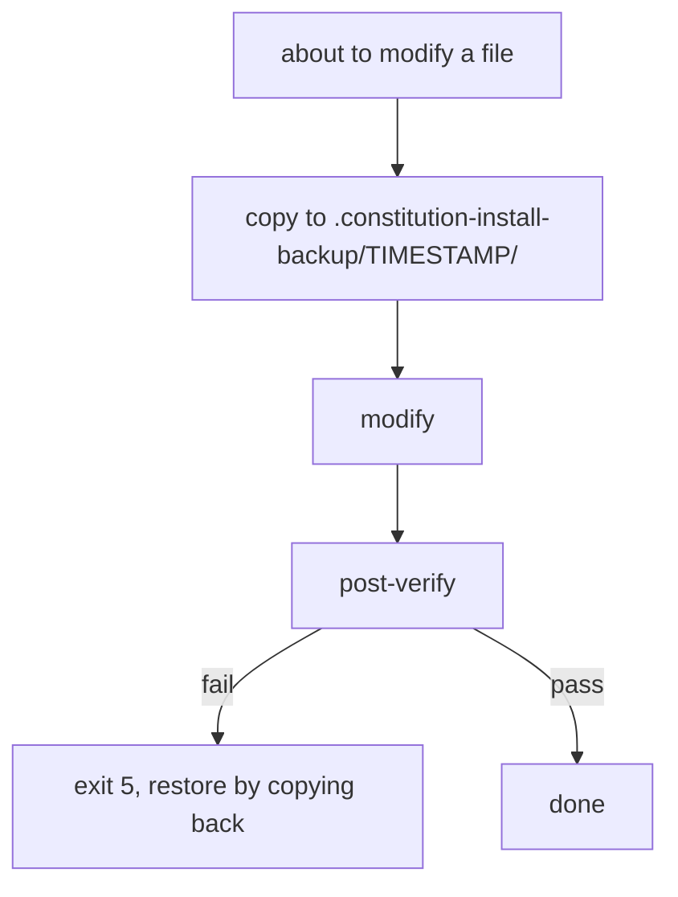
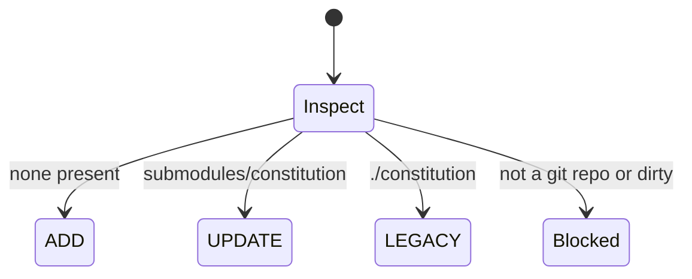

# Installer Manual - flags, exit codes, environment, files

| Field | Value |
|---|---|
| Revision | 5 |
| Created | 2026-10-29 |
| Last modified | 2026-10-31T11:30:00Z |
| Status | draft |
| Status summary | Reference for the installer and updater. Reconciled with the scripts (--help and source) on 2026-10-29 (R4: unrestricted-agent flag, deny list, no-push check, report fields); not verified by a live end-to-end install. |
| Authority | Tool documentation for `scripts/install_constitution.sh` and `scripts/update_constitution.sh`; no new anchor. §11.4.18, §11.4.257, §11.4.212 govern. |
| Scope | Operators and CI authors. |
| Issues | none |
| Generated twins | .html / .pdf / .docx not generated (Markdown-only policy). |

## Synopsis

```text
install_constitution.sh [--project-root DIR] [--upstream KEY] [--upstream-url URL]... [--ssh] [--ref REF]
    [--agent ID|none] [--model M] [--effort E] [--max-budget-usd N] [--timeout-sec N]
    [--followups on|off] [--decision-layer off|shadow|enforce]
    [--edit-agent-docs on|off] [--register-hooks on|off] [--run-setup on|off] [--commit on|off]
    [--not-constitution-repo] [--allow-insecure-url] [--allow-unrestricted-agent] [--git-init] [--dry-run] [--non-interactive] [--yes] [--report-json FILE]
    [--restore DIR] [--detect-agents [--json]] [--detect-layout] [--print-snippets]
    [--version] [--help]
```

Requires bash 4.4 or newer and git (exit 3 otherwise). Version of the script documented here: `install_constitution.sh 1.0.0` (`--version`).

## Flags

| Flag | Default | Meaning |
|---|---|---|
| `--project-root DIR` | current directory | project to install into |
| `--upstream KEY` | `github` (unreachable upstreams fall back to the next one in the table) | clone source: `github`, `gitlab`, `gitlab-vasic`, `gitflic`, `gitverse`, `github-vasic` |
| `--upstream-url URL` | none | explicit clone URL (repeatable, tried in order, replaces the table); https/ssh/file URLs, `user@host:path` or an absolute path; `http://` and `git://` are refused (exit 2) unless `--allow-insecure-url`; a URL carrying a password or a token query is never used |
| `--allow-insecure-url` | off | accept `http://` and `git://` upstream URLs (unauthenticated transport) |
| `--allow-unrestricted-agent` | off | required to run `kimi`, `opencode` or `pi`: those agents run with THEIR OWN default permissions (shell commands, file edits and network access in the project directory) because the installer has no verified option to restrict them. Without the flag `--non-interactive` refuses them (exit 3); interactively a separate question asks (default no). The report records the choice (`consent.unrestricted_agent`, `agent_permissions: agent-default`). `claude`, `claudeN` and provider aliases do not need it |
| `--ssh` | off (HTTPS) | use the SSH clone URLs from the table |
| `--ref REF` | newest `helixconstitution-v*` tag, else `main` | tag, branch or commit to check out |
| `--agent ID\|none` | `none` | agent that runs the setup prompt: `claude`, `claudeN`, a provider alias, `kimi`, `opencode`, `pi`; interactive runs show a menu with default `none` |
| `--model M` | `sonnet` | model for the agent run; enforced for `claude`, `claudeN` and provider aliases only (refused with exit 2 for `kimi`, `opencode`, `pi`) |
| `--effort E` | `medium` | `low`, `medium`, `high`, `xhigh` or `max`; same enforcement rule as `--model` |
| `--max-budget-usd N` | `2` | TOTAL spend cap in USD, greater than 0 and at most 50: the setup run gets N, each follow-up gets what is left (from the `total_cost_usd` the agent reports). If a run reports no cost the remainder cannot be tracked and each later follow-up gets N again, so the worst case is (1 + follow-ups) x N; the installer says so |
| `--timeout-sec N` | `1800` | wall-clock limit per agent run, 1..86400; enforced for every agent |
| `--followups on\|off` | `off` | run `docs/prompts/setup/followups/*.md` in the same session after a successful main run |
| `--decision-layer off\|shadow\|enforce` | `off` | decision-layer (Jev) mode; anything but `off` runs `scripts/jev/bootstrap.sh --non-interactive` (plus `--enforce` for `enforce`) |
| `--edit-agent-docs on\|off` | `on` | write the inheritance block into `CLAUDE.md` and `AGENTS.md` (and `GEMINI.md` / `QWEN.md` if they exist) |
| `--register-hooks on\|off` | `off` | consent passed to the agent prompt to register hooks in `.claude/settings.json` |
| `--run-setup on\|off` | `on` | run `submodules/constitution/scripts/setup.sh` after ADD |
| `--commit on\|off` | `off` | commit `.gitmodules`, the submodule and written files locally; the installer never pushes |
| `--not-constitution-repo` | off | the project has its own `Constitution.md` and is NOT the constitution repository: skips only the heuristic self-checks (marker files; a shallow clone with `Constitution.md`). A repository whose history starts with the constitution's first commit, or whose remote is a known constitution upstream, is refused regardless |
| `--git-init` | off | consent to `git init` when the directory is not a git repository |
| `--dry-run` | off (interactive runs ask "Do a dry run first?", default yes) | print the full plan, write nothing |
| `--non-interactive` | off | never ask; use flags and defaults; required when no terminal is available |
| `--yes` | off | allow running as root (otherwise refused with exit 3) |
| `--report-json FILE` | none | also write the report to FILE (a copy is always kept in the backup directory on a real run) |
| `--restore DIR` | none | copy the files saved in a backup directory back into the project. DIR must be a backup directly inside `.constitution-install-backup/`, owned by you, mode 700 and not tracked by git; entries under `.git/`, `constitution/`, `submodules/constitution/`, absolute paths and `..` segments are skipped, as is anything reached through a symlink |
| `--detect-agents [--json]` | | list detected agents and exit (read-only, no LLM call) |
| `--detect-layout` | | print `none`, `standard`, `legacy`, `both`, `partial`, `inconsistent` or `constitution-repo` and exit |
| `--print-snippets` | | print the curl one-liner for every upstream that has a raw URL and exit |
| `--help`, `--version` | | informational |

## Exit codes

| Code | Meaning |
|---|---|
| 0 | success (including "already up to date, nothing to do", a dry run and a declined plan) |
| 1 | failure (git, setup.sh or commit failed) |
| 2 | usage error, no terminal without `--non-interactive`, an insecure URL, a limit the chosen agent cannot enforce, `--agent <number>`, or the project root does not exist |
| 3 | precondition blocked: bash older than 4.4, git missing or a core tool missing, a git call outside the installer's allow-list, the target is the constitution repository itself (see `--not-constitution-repo`), not a git repo (and no `--git-init`), running as root without `--yes`, less than 1 GiB free, `.gitmodules` or an agent-doc file dirty, inconsistent layout, no reachable upstream, ref not found, another installer holds the lock, `kimi`/`opencode`/`pi` without `--allow-unrestricted-agent` in `--non-interactive`, agent preflight failed (agent missing, detect-only, or neither `python3` nor `jq` to read the stream) |
| 4 | agent run failed (final `result` event had `is_error` true, no result, or timeout) |
| 5 | post-verification failed, or the no-push check found a push during the run |
| 6 | the agent ran but its success is UNVERIFIED (`opencode`, `pi`: exit code only, no result event to read); the constitution step itself is done. Review `.constitution-install-backup/<timestamp>/agent/` yourself |
| 130 / 143 | interrupted by SIGINT / SIGTERM; re-run the same command |

For the Claude family and `kimi`, success is read from the final `result` event (`is_error` false and subtype `success`), never from the process exit code. For `opencode` and `pi` there is no result event the installer can read, so a run that exits 0 ends the installer with exit 6 (UNVERIFIED, recorded as `evidence=exit-code-only`), never exit 0.

## Known limits of the CLI-agent plugin installer

The prefix installer `scripts/install_action_prefix.sh` (used by `install_cli_agent_plugins.sh`): the containment checks (settings directory resolves inside the project, hard-link count of `settings.json`, now a warning only) are check-then-write, so they are TOCTOU-narrowed, not closed; a local attacker who can swap a path component between check and use is not defended against (shell has no openat/O_NOFOLLOW chain). Fixed in this release (committed): `scripts/install_action_prefix.sh`, which `install_cli_agent_plugins.sh` runs, replaces `settings.json`, its `.bak` and the temporary file only through fresh `mktemp` inodes renamed into place (never written through); a `settings.json` with more than one hard link (for example after a `cp -al` snapshot) is NOT refused: it is replaced by a new file, the other links keep their old content, and a warning is printed; an existing `settings.json` keeps its mode (read with `stat -L`, so a symlink to a 0644 file yields 0644), a NEW `settings.json` or `.bak` gets at most 0644 (0666 & ~umask & ~022: umask 000 gives 644, 077 gives 600, 027 gives 640, 022 gives 644) and a NEW `.claude` directory is created without group/other write; when `settings.json` is a symlink it is replaced by a regular file (the link target keeps its old content) and a stderr warning naming it is printed; a `settings.json` that is a directory is refused early with a clear message (nothing written, no leftover seed file); anything other than exactly ONE JSON object (invalid JSON, empty or whitespace-only file, `null`, an array, several concatenated documents such as `{} {}`, or a malformed `hooks` / `UserPromptSubmit` structure) is REFUSED with a `REFUSED` message and rc 1, file unchanged, on both the jq and the python3 path, and the jq path verifies the merged result (one object, hook present) before the rename; and the generator is run with an ambient `HELIX_ACTION_OUT_ROOT` unset.

## Agent permissions and the no-push check

`claude`, `claudeN` and provider aliases run with `--permission-mode acceptEdits` and `--disallowedTools` carrying a deny list (printed in the plan): `WebFetch`, `WebSearch` and the `git push` forms `Bash(git push *)`, `Bash(git push)`, `Bash(git * push *)`, `Bash(git * push)`, `Bash(*git push*)`, `Bash(*git * push*)`, `Bash(env git*)`, `Bash(command git*)`, `Bash(*send-pack*)`; never `--dangerously-skip-permissions`. The report field `agent_permissions` is `accept-edits+deny-list`, `agent-default` (kimi, opencode, pi) or `no-agent`.

"The agent never pushes" rests on three things: the prompt rules, the deny list (passed as documented by `claude --help`; whether claude enforces every form was NOT checked by a live run: UNCONFIRMED) and a check after the run. That check fails the run (exit 5) on a new "update by push" reflog entry on any remote-tracking ref of the project or the constitution, on a change of the refs a configured remote advertises (the full `git ls-remote <remote>` output, every ref, before and after), and on a remote-tracking ref that is new or moved with no fetch in its reflog. Limits: somebody else's push during the run is a false positive (refused); a remote that could not be asked before the run is skipped and named, but a remote that answered before the run and cannot be asked after it fails the run; a push by URL to a remote that is not configured and updates no tracking ref is NOT detected. INT/TERM are acted on when the foreground step ends (bash defers traps while a child runs): a long git clone is cut off by its own timeout, an agent is stopped at once.

## Report JSON

Written to `<backup>/report.json` on a real run and to `--report-json FILE` (a dry run writes it only when `--report-json` is given). Top-level fields, from the source of `hi_write_report`: `installer_version`, `status`, `exit_code`, `mode`, `dry_run`, `project_root`, `submodule_path`, `upstream_key`, `upstream_url` (credentials removed), `ref`, `commit_before`, `commit_after`, `updater`, `agent`, `agent_status`, `agent_permissions`, `session_id`, `model`, `effort`, `agent_evidence`, `clone`, `limits` (`model`, `effort`, `budget_usd`, `budget_total_usd`, `budget_spent_usd`, `timeout_sec`, `timeout`; each of the first three is `enforced`, `not-enforced` or `no-agent`), `consent` (`edit_agent_docs`, `register_hooks`, `run_setup`, `commit`, `push` always `never`, `decision_layer`, `followups`, `unrestricted_agent`), `followups_run` (`file`, `status`), `verify` (one key per check plus `overall`), `written_files`, `changed_paths`, `notes`, `backup_dir`, `started_at`, `finished_at`.

## Environment variables

Names only; values are never printed.

| Name | Used by | Effect |
|---|---|---|
| `ANTHROPIC_API_KEY` | installer | removed from the agent subprocess (`env -u`) so a subscription alias is not silently billed per token |
| `CLAUDE_CONFIG_DIR` | installer | set to `~/.claude-<id>` for a native `claudeN` account |
| `CLAUDE_MULTI_ACCOUNT_ALIASES` | installer | alias file for provider aliases (default `~/.local/share/claude-multi-account/aliases.sh`) |
| `HI_DETECT_PROVIDERS` | installer | `0` skips `claude-providers list` during detection (default `1`) |
| `GIT_*` (inherited) | installer, updater | DROPPED for git calls, except config-file selection, author/committer identity, CA bundle and protocol limits; `GIT_SSH_COMMAND` is therefore not inherited (ssh is `ssh -o BatchMode=yes -o ConnectTimeout=10`; configure keys in `~/.ssh/config`) |
| `CONSTITUTION_AUTO_PROPAGATE` | installed hooks | `off`, `0`, `false` or `no` disables auto-propagation of the post-update hook (same as `git config constitution.autoPropagate false`) |
| `HELIX_INSTALLER_TTY` | installer | terminal used for questions (default `/dev/tty`); honoured only together with `HELIX_INSTALLER_TEST=1` (otherwise ignored with a warning) |
| `CONSTITUTION_JEV_HOOK` | installer to `setup.sh`; updater to `post_update_hook.sh` | `off` unless a decision layer or `--jev-hook` is requested |
| `PROJECT_ROOT`, `CONST_DIR` | installer to `setup.sh` | project root and constitution path |
| `HELIX_INSTALLER_TEST` (=`1`), `HELIX_INSTALLER_TEST_*`, `HELIX_INSTALLER_LIB_MODE`, `HELIX_INSTALLER_TEST_EUID` | tests only | `HELIX_INSTALLER_TEST=1` enables test seams (a shortened clone timeout, a pause point, `HELIX_INSTALLER_TTY`); `HELIX_INSTALLER_TTY` is ignored with a warning without it. Not for operators |

Decision-layer key variables such as `TYPESAFE_API_KEY` or `OPENROUTER_API_KEY` are read by name by the Jev bootstrap (`scripts/jev/bootstrap.sh`), not by the installer itself.

## Files touched

| Path | When |
|---|---|
| `.gitmodules`, gitlink `submodules/constitution` | ADD |
| `submodules/constitution/` | ADD, UPDATE |
| `CLAUDE.md`, `AGENTS.md`, `GEMINI.md`, `QWEN.md` (inheritance block, prepended) | ADD and UPDATE with `--edit-agent-docs on`; `GEMINI.md` / `QWEN.md` only if present; later by the agent too |
| `.mcp.json`, `.claude/settings.json` | by `setup.sh` / the agent; backed up first when present |
| `.constitution-install-backup/<timestamp>/` (excluded through `.git/info/exclude`; mode 700, agent transcripts and reports inside mode 600) | before any modification |
| `.git/helix-constitution-install.lock` | during a run; a second installer exits 3 while the owner lives; a stale lock (owner gone) is reclaimed with a warning; a lock that is not a regular file is never touched |
| `--report-json` file | when requested |

## Backups and restore

Every file the installer modifies is first copied into `.constitution-install-backup/<timestamp>/`, preserving relative paths. Each backup directory holds `files/` (the saved copies), `manifest.txt` (relative paths saved), `created.txt` (files the run created; not removed on restore), `report.json` and, with an agent, `agent/` logs. To restore: `bash install_constitution.sh --restore .constitution-install-backup/<timestamp>` (the directory must be inside the backup root; symlinked targets are skipped), then `git status` to review. The installer deletes nothing of yours.



Full diagram: [safety_backup_model](../diagrams/safety_backup_model.md).

## Safety model

- `main()` runs as the last line: a truncated download does nothing.
- Never force-push, never push at all.
- Refuses to run as root unless `--yes`; refuses with less than 1 GiB free; takes `.git/helix-constitution-install.lock`.
- Leftovers of an interrupted ADD are moved into the backup (`moved-aside/`), never deleted.
- Idempotent: a second run says it is a no-op.
- Questions are read from `/dev/tty` so `curl | bash` can still ask; without one it exits 2.
- Never prints secrets. URLs are shown with credentials removed and query values as `REDACTED`.
- git runs with a sanitised environment (see the environment table). The constitution is cloned blobless.
- Refuses to install into the constitution repository itself (exit 3).

## Mode detection



Full diagram: [mode_detection](../diagrams/mode_detection.md). Layouts: [layout_before_after](../diagrams/layout_before_after.md).

## Token and cost controls

`--agent none` costs nothing. With an agent: `--model`, `--effort`, `--max-budget-usd` and `--timeout-sec` bound the run; follow-ups and the decision layer are off unless enabled. Detection never makes LLM calls.

## Post-verification (no LLM)

Checks recorded in the report under `verify`: `submodule_registered`, `gitlink_recorded`, `submodule_head_matches_gitlink`, `submodule_clean`, `inheritance_CLAUDE`, `inheritance_AGENTS`, `claude_import` (the `@submodules/constitution/CLAUDE.md` line), `no_legacy_path_in_written` and `status_only_expected_paths`. With `--edit-agent-docs off` the inheritance checks are `skip`. The status check is strict (a failure) only when no setup, decision layer or agent step ran; otherwise it is informational. A LEGACY run without an agent skips verification.

## update_constitution.sh

```text
submodules/constitution/scripts/update_constitution.sh [--check] [--ref REF] [--dry-run] [--no-hook] [--jev-hook] [--commit] [--project-root DIR]
```

Finds the submodule in either layout (`constitution/scripts/...` works too); refuses (exit 3) on local changes or a HEAD no remote knows; fetches all remotes (exit 3 if every fetch fails); picks `--ref`, else the newest `helixconstitution-v*` tag, else `origin/main`; accepts only a fast-forward (target equal to or behind HEAD means "already up to date", diverged means exit 3; never force, reset, rebase or push); checks the target out detached; runs `scripts/post_update_hook.sh` from the project root with `CONSTITUTION_JEV_HOOK=off` unless `--jev-hook` (skipped with `--no-hook`); prints before/after SHA and the changelog delta; stages the new gitlink in the project and commits only with `--commit`. `--check` prints `UPDATE_AVAILABLE=yes` or `UPDATE_AVAILABLE=no` and changes neither the project, HEAD nor a local branch; it is NOT offline: it (and `--dry-run`) still run `git fetch --quiet --tags` per remote, which updates remote-tracking refs and tags. Pre-release tags (`-rc1`) are never chosen by default; remote tags are read with `git ls-remote --tags`, so a tag that exists only locally does not count. Exit codes: 0 updated or already up to date, 1 hook or checkout failed, 2 usage, 3 blocked (dirty, unpushed, diverged, network, not a submodule, or the root is the constitution itself). When the installer runs in UPDATE mode it delegates to this script if the installed constitution has it, otherwise it uses a built-in fast-forward updater with the same rules.

## Trust model

See [trust_model](../diagrams/trust_model.md). Summary: the installer trusts the server you fetch it from (read it first); git environment is sanitised; credentials are redacted; after install, the hooks `setup.sh` installs auto-run the new `post_update_hook.sh` only for commits reachable from the submodule's upstream default branch and not a downgrade. Opt out: `git config constitution.autoPropagate false` or `CONSTITUTION_AUTO_PROPAGATE=off`. `setup.sh --allow-global-hooks-path` is required to write into a hooks directory outside the project.

## Setup prompt

See [setup prompt versioning](../guides/setup_prompt_versioning_guide.md).

Related: [user guide](../guides/installer_user_guide.md), [FAQ](../faq/installer_faq.md).

Related: [release publishing guide](../guides/release_publishing_guide.md) (tags and the Gitea publisher).
