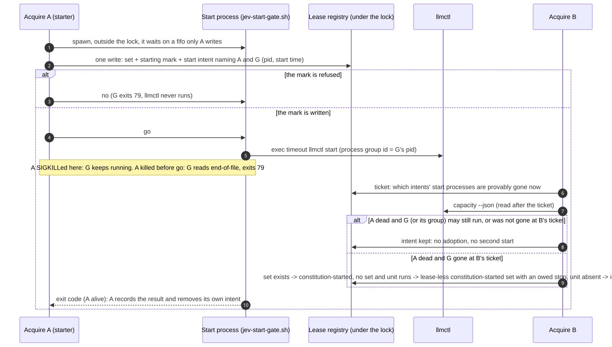

# Jev S3/S4 round 14: fixes for the review of 9442791d

| Field | Value |
|---|---|
| Items | the Jev S3/S4 item and the R12-F1 finding; their vehicle ids CON-423 to CON-428 collide with other items on `main`, so this round cites them as CON-PENDINGjev1 to CON-PENDINGjev6 (mapping: `landing/vehicle_items_before_merge.md`); the lander re-mints them through the engine |
| Review | `rev_r13` (independent review of `9442791d`), NO-GO: B1 (blocking, host-safety, source-defect), F1 to F7, N1 to N3 |
| Base | the round-13 vehicle `9442791d`, merged (merge, not rebase) onto `main` at `ebd8818c` |
| Author | a fresh structural fixer instance (§11.4.276(E)(3)); Opus; effort UNKNOWN (it cannot be read from inside this instance; whether the dispatch set it is known only from the dispatch call, §11.4.231(F.5)) |
| Evidence class | gate-logic (§11.4.289(C)(2)): a hermetic bwrap runner, the stub llmctl of `tests/jev/fixtures/bin-place`, no network. This shows that the producer DECIDES correctly; it does NOT show that a local model runs or what a real `llmctl start` does. PROVISIONAL (§11.4.290) |
| Independent review | owed (§11.4.142 / §11.4.209), for the code AND for the §11.4.291 amendment (operator decision (1)); nothing here is GO |

## Findings and what changed

| Finding | Change | Evidence |
|---|---|---|
| R13-B1 | Reproduced first (§11.4.292) with the reviewer's sweep on the round-13 head (`runs/RED_sweep_r13head.txt`: 137 passes, 2 failures, both in order X with A killed while its start is in flight). Fixed structurally: the start runs in a GATED start process named by the intent, and a dead starter's intent is judged only with an observation taken after that start process was provably gone (below). The same command is GREEN on the fixed producer (`runs/GREEN_sweep_r14_try1.txt`). The class is then swept exhaustively by `tests/jev/fixtures/sweep_s4_round14.sh` (below), and rows R14-1 to R14-5 and R14-7 of `tests/jev/test_s4_round14.sh` pin each rule | `runs/RED_sweep_r13head.txt`, `runs/GREEN_sweep_r14_try1.txt`, `runs/sweep14_*.txt`, `runs/final*_r14.txt` |
| R13-F1 | Row R14-2f (the reviewer's witness WV01: the intent names a pid that a different process now uses) | `mutants.md` (V01) |
| R13-F2 | Row R14-2g (WV02: a degraded unit under a dead starter's intent gets a constitution-started set with an owed stop) | `mutants.md` (V02) |
| R13-F3 | Row R14-2h pins the reason code of the intent refusal and that only one capacity read is made | `mutants.md` (V08) |
| R13-F4 | Dated corrections in `../round12/README.md` ("fixed in round 13" was partial) and `../round13/README.md` ("a crash between the start and its record is therefore recoverable" holds only after the bounded start returned) | the two READMEs |
| R13-F5 | The rc 75 ambiguity is in the honest limits of the round-13 correction and below; the same ambiguity applies to a starter killed before `go` | below |
| R13-F6 | Census row C2rc28: a 7660-character listing with its git line at the end (the reviewer's W35 witness) | `runs/cmut_W35*.txt` |
| R13-F7 | Census rows C2rc29 (`docs/qa/` inside the scope) and C2rc30 (`docs/qaz/`, outside it) | `runs/cmut_W27*.txt` |
| R13-N1 | The round-13 README states the reviewer's universe 1889 next to its own 1888; why it recorded 1888 is UNCONFIRMED | `../round13/README.md` |
| R13-N2 | Row C2rc23 now runs before the pyx marker check, so its fixture is checked | `tests/test_git_env_class.sh` |
| R13-N3 | Kept as a stated limit: without /proc, `kill -0` cannot tell a reused pid, so a reused pid keeps an intent live-looking (fail-safe: it blocks, it never releases a start that may run) | below |
| Operator decision (1) | The §11.4.291 refinement note in `Constitution.md` is amended (Revision 98): the consequence when the starter dies in the R12-F1 window, the round-13 start intent and the orders it is shown for, the window R13-B1 found, the round-14 rule and "gate-logic evidence only, not a claim about a real llmctl unit". The amendment owes its own independent review | `Constitution.md`, `CHANGELOG.md` |
| Operator decision (2) | A live starter's intent still never expires by age; the hazard was the dead starter's intent judged too early, which is what this round changes | below |

## The gated start process (R13-B1)

The defect: round 13 judged a start intent by its starter alone. The bounded start was a `timeout` child of the
starter; a SIGKILL of the starter left that child running. Another acquire then judged the dead starter's intent at
once, saw the unit absent, removed the intent and dropped the set, and the orphaned start brought the unit up
afterwards with no set, no lease, no owed stop and no intent.

The fix, in `scripts/jev/jev-place.sh` and the new `scripts/jev/jev-start-gate.sh`:

1. Before the registry write that holds the starting mark, outside the lease lock, the acquire creates a START PROCESS
   (`gate_open`): `jev-start-gate.sh` waits on a fifo that only the acquire holds open for writing. Without
   `/proc/self/fd` or a fifo nothing is marked and nothing is started (fail-closed).
2. `mark_start_locked` refuses unless that process exists (pid and start time read), and writes the set, the starting
   mark and the start intent in one registry write; the intent names the start process (`child: {pid, pid_start}`).
3. Only after that write does the acquire write `go` (`gate_go`). The start process writes `<out>.went` and replaces
   itself (exec, same pid) with `timeout --kill-after=2 <seconds> llmctl start <profile>`; `timeout` makes its own
   process group, whose id is that pid. A refused mark closes the gate instead (`gate_cancel`: the start process exits
   79 without running llmctl, and the acquire waits for it). A starter that dies before `go` leaves a start process
   that reads end-of-file and exits 79 without running llmctl.
4. A start process that exits after `go` without writing `<out>.went` ran no llmctl; it is recorded as a refused start
   (rc 75, row R14-5).
5. `take_ticket_locked` records, with every observation ticket, which start intents' start processes are provably gone
   at that moment (`intents_gone_now`, `child_running`). The capacity answer read after the ticket therefore describes
   the final state of those starts.
6. `intents_locked` judges a dead starter's intent only when its identity (profile, starter pid and start time, start
   process pid and start time) is in that ticket's list. Otherwise the intent is kept: it blocks adoption and a second
   start, and no set dropped meanwhile can take it along. Judged, it does what round 13 did: an existing set is made
   constitution-started; a running unit (`ok` or `degraded`) with no set gets a lease-less constitution-started set with
   an owed stop; an absent unit removes the intent.
7. Row R14-7: a start process whose start time cannot be read (an injected fault in a copy of the producer; a host
   without /proc gives the same empty value) gets no mark and no start, and its start process is cancelled.
8. `child_running` (fail-safe): a pid that is not an integer above 1 (§11.4.263) or has no recorded start time is
   running; the same pid with another start time is gone (a pid cannot be reused while it is the id of a live process
   group); the same process alive is running; a zombie or absent pid is running while its process group has a member.
   Without /proc: `kill -0` on the pid or on the group.
9. An intent written by the round-13 producer names no start process; it is judged once it is older than `MARK_TTL`.

## The sweep (the class, enumerated)

The class (§11.4.250, §11.4.276(C)): a crash (SIGKILL) of any actor at any point of the start to record sequence must
leave a state from which the constitution-started unit is eventually stopped or provably absent.

The persistent effects of an acquire are its registry writes (each between a `flock` lock and a `flock -u` unlock call
of the lease lock), the start process it creates (before the mark's lock call), the `go` it writes (after the mark's
unlock call) and the llmctl calls (outside the lock). A kill anywhere between two flock calls leaves the same persisted
state as a kill at the next flock call, except while the start runs, which is the point S. So
`tests/jev/fixtures/sweep_s4_round14.sh` (run in three heavy parts, `tests/jev/s4_round14_sweep_x_chaos_test.sh`, `_y_chaos_test.sh` and `_zd_chaos_test.sh`) kills:

- A at every one of its flock calls (lock AND unlock, 12 calls), and at S (A SIGKILLed while its start is in flight;
  the cell checks that the start process group was alive at the kill and that the start then brought the unit up);
- B at every one of its flock calls (18), with A alive;
- in order X, the diagonal: A at S and B at every flock call;

in three orders (X: B runs while A's start is in flight; Y: A's start is let go first; Z: B and C both run while A's
start is in flight), each also without a kill. The invariant at every quiescent point: a running unit is held by a
lease, owed a stop, named by an unanswered start intent, or recorded in a lease-less constitution-started set; no set is
operator-owned and nothing is adopted as operator-started; after the cleanup no unit runs and no set and no intent is
left. LOCKHELD (an llmctl call under the lease lock) is counted in every cell and must be 0.

The first run of the sweep (`runs/sweep14_p1.txt`, kept as found: 694 passes, 9 failures) failed nine cells, each at
"after the start ended" with "a unit runs and is bare": `ord=X killA=8` and the diagonal `ord=X killA=S killB=4` to
`11`. A re-run of those cells that prints the registry at that point (`runs/sweep_states_dbg.txt`, tool
`tools/sweep_states.sh.txt`, 118 passes, 0 failures) shows what the unit ran in:

| Cell | Registry when the start had ended |
|---|---|
| `ord=X killA=8` | a lease-less set marked constitution-started, with A's own stopping mark (A is dead) and no start intent: A was killed at the unlock after its no-set record write, before its own stop |
| `ord=X killA=S killB=4` to `9` | a lease-less set marked constitution-started, no marks, and A's start intent STILL KEPT (its start process ran at B's observation ticket, so B kept it) |
| `ord=X killA=S killB=10`, `11` | the same, plus B's dead stopping mark |

In every cell the check right after it (`constitution_started` true) and the cell's end (C holds the unit, the cleanup
leaves nothing) passed. The invariant had looked at the set before the intent and had no name for a lease-less
constitution-started set. That state is the one a reap of a dead holder leaves; it is never adopted as
operator-started, the next release stops it once no live stopping mark is on it (`release_locked`) and the next acquire
joins or disposes it (plan step B), §11.4.291(J). The invariant now accepts it as "ours" and keeps "bare" (a lease-less
set NOT marked constitution-started) as a violation; rows R14-6a and R14-6b show the release and the acquire recovering
such a set with a dead stopping mark. The producer was not changed for this. The second run (`runs/sweep14_p2.txt`):
703 passes, 0 failures, control needle 3 violations, LOCKHELD 0.

CONTROL NEEDLE: the same S cells (orders X and Z) run against a copy of the producer with the round-14 rule removed (a
dead starter's intent judged whatever its start process does) and must show at least one invariant violation.

## The start sequence (diagram)

Source: the mermaid block in `start_intent.md`, byte-identical to the file mermaid-cli rendered (`mmdc.log`).

## Why every kill point ends in a recoverable state (the argument the sweep tests)

The persisted state an acquire can leave is one of: nothing; a start process waiting at its gate (before the mark);
the set with its starting mark and the start intent (after the mark); the same with `go` written and the start
running or ended; the recorded set (after the record); an owed stop. Per kill point:

- before the mark's registry write: only the start process exists; it reads end-of-file when the acquire dies and exits
  79 without running llmctl. Nothing is started, nothing is recorded.
- after the mark, before `go`: the intent names a start process that exits 79 without running llmctl. Its intent is
  judged at the first observation ticket after that exit: an absent unit removes the intent, an existing set is made
  constitution-started (the R13-F5 ambiguity below).
- after `go` (the point S and every later point before the record): the start process runs llmctl; while it or any
  member of its process group runs, every ticket keeps the intent (it blocks adoption and a second start). At the first
  ticket after the group is gone the capacity answer describes the final state: a running unit gets a
  constitution-started set with an owed stop (or the existing set is made constitution-started); an absent unit
  removes the intent.
- after the record: the set is recorded; a dead holder is reaped and the lease-less constitution-started set is stopped
  by the next release or joined or disposed by the next acquire (round 13 and earlier, rows R14-6a and R14-6b).

A unit that runs is therefore always held by a lease, owed a stop, named by a kept intent, or in a lease-less
constitution-started set, and every one of those is driven to stopped or absent by the next release or acquire. The
sweep checks exactly this invariant at every quiescent point of every cell, and its control needle (the round-13 rule)
shows the invariant failing when the rule is removed.

## Honest limits (§11.4.6)

- Gate-logic evidence only (§11.4.289(C)(2)): the stub llmctl of `tests/jev/fixtures/bin-place`, one host, a hermetic
  runner. What a REAL `llmctl start` does when its `timeout` kills it, or whether a real start leaves work running
  outside the `timeout` process group (for example a systemd job it queued), is UNCONFIRMED; if it does, "the process
  group is gone" does not mean the start has ended, and the capacity read after the ticket can see the unit still
  coming up. No real llmctl unit was started and no model was loaded.
- The sweep covers one profile, three orders, every flock call of A (12) and of B (18), the point S, and the diagonal
  S x B in order X only. C and P are not killed, the start process itself is not killed, and a stop in flight is not
  gated: a stopper killed while its `llmctl stop` runs leaves its dead stopping mark, and the next release or acquire
  runs the stop again through the owed-stop path (earlier rounds), which this sweep does not re-test.
- Without `/proc/self/fd` or a fifo, `gate_open` fails and nothing is marked or started (fail-closed): a host without
  /proc gets no local start at all. No run of this round had no /proc; row R14-7 shows the second check of that rule
  (no start time, no mark) on an injected fault, and mutant M10 (the first check removed) survives because of it
  (`mutants.md`). Without /proc, `child_running` falls back to `kill -0` on the pid and its group,
  which cannot tell a reused pid (R13-N3): a reused pid keeps an intent live-looking. That blocks; it never releases a
  start that may run.
- An intent written by the round-13 producer names no start process. It is judged once it is older than `MARK_TTL`
  (the start timeout + 2 s + the record waits + 30 s), after the bounded start of that producer has ended; the
  real-llmctl caveat of the first point applies.
- R13-F5, and the same for a starter killed before `go`: such a starter leaves its set constitution-started although
  llmctl did not start the unit. If the operator started that unit meanwhile, this producer may later stop it. The
  registry cannot tell those two cases apart; this is stated, not fixed.
- Operator decision (2): a LIVE starter's intent never expires by age. A starter that hangs alive (for example a
  stopped process) keeps the profile blocked for adoption and a second start until it dies or is stopped; it never
  causes a leak. That is the intended, documented trade.
- The run time of the three heavy sweep parts depends on the host load, and at high load two of them exceed the
  full-suite runner's default per-unit limit of 900 s (`--timeout`). Measured on this host: at a load of about 12 to
  20 the parts took 404, 388 and 252 s (`runs/final1_*`) and 420, 383 and 234 s (`runs/final2_*`); at a load of
  about 41 to 49, RCTRL2 took 1080, 990 and 566 s (`runs/mut_RCTRL2_*`), and the whole sweep body of RCTRL did not
  finish within the 2400 s limit of this round's runner (636 cells passed, 0 failures, `runs/mut_RCTRL_sweep_s4_round14.txt`).
  A run of the heavy tier under such load therefore reports TIMEOUT for parts x and y (a BAD verdict, never a silent
  pass); run the heavy tier at a lower load or with `--timeout 1500`. Splitting the sweep into more parts would bound
  this, and is left to the review (a further structural change this late in the round would need its own runs).

## Runs

Every suite of the vehicle twice on the final tree (`tools/final14.sh.txt`, hermetic runner `tools/hrun.sh.txt`).
The normalized hash (`tools/norm.sh.txt`) covers each run's verdict lines with test numbers, temp paths and digits
masked; SAME means the two runs gave the same verdicts row by row.

| Suite | Run 1 | Run 2 | Normalized hashes | Same |
|---|---|---|---|---|
| r14 (`runs/final1_r14.txt`, `runs/final2_r14.txt`) | rc=0, fails=0, passes=55, 47s | rc=0, fails=0, passes=55, 51s | dbc1dde6d1b7384e / dbc1dde6d1b7384e | SAME |
| s4_round14_sweep_x_chaos_test (`runs/final1_s4_round14_sweep_x_chaos_test.txt`, `runs/final2_s4_round14_sweep_x_chaos_test.txt`) | rc=0, fails=0, passes=263, 404s | rc=0, fails=0, passes=263, 420s | 1489f62b7305bfe7 / 1489f62b7305bfe7 | SAME |
| s4_round14_sweep_y_chaos_test (`runs/final1_s4_round14_sweep_y_chaos_test.txt`, `runs/final2_s4_round14_sweep_y_chaos_test.txt`) | rc=0, fails=0, passes=263, 388s | rc=0, fails=0, passes=263, 383s | 59bddc0839833429 / 59bddc0839833429 | SAME |
| s4_round14_sweep_zd_chaos_test (`runs/final1_s4_round14_sweep_zd_chaos_test.txt`, `runs/final2_s4_round14_sweep_zd_chaos_test.txt`) | rc=0, fails=0, passes=189, 252s | rc=0, fails=0, passes=189, 234s | aa781b2271531100 / aa781b2271531100 | SAME |
| r13 (`runs/final1_r13.txt`, `runs/final2_r13.txt`) | rc=0, fails=0, passes=76, 127s | rc=0, fails=0, passes=76, 133s | 77c9bb24fc487ef9 / 77c9bb24fc487ef9 | SAME |
| r12 (`runs/final1_r12.txt`, `runs/final2_r12.txt`) | rc=0, fails=0, passes=62, 62s | rc=0, fails=0, passes=62, 66s | 9fad63f28421873a / 9fad63f28421873a | SAME |
| r12mc (`runs/final1_r12mc.txt`, `runs/final2_r12mc.txt`) | rc=0, fails=0, passes=6, 774s | rc=0, fails=0, passes=6, 706s | 3f9a9e8f44be23a1 / 3f9a9e8f44be23a1 | SAME |
| r11 (`runs/final1_r11.txt`, `runs/final2_r11.txt`) | rc=0, fails=0, passes=59, 231s | rc=0, fails=0, passes=59, 257s | 01cee5c32dc49563 / 01cee5c32dc49563 | SAME |
| r10 (`runs/final1_r10.txt`, `runs/final2_r10.txt`) | rc=0, fails=0, passes=52, 32s | rc=0, fails=0, passes=52, 36s | cd699d069898311a / cd699d069898311a | SAME |
| r9 (`runs/final1_r9.txt`, `runs/final2_r9.txt`) | rc=0, fails=0, passes=70, 41s | rc=0, fails=0, passes=70, 43s | 2969ffcee2f5fc5c / 2969ffcee2f5fc5c | SAME |
| r8 (`runs/final1_r8.txt`, `runs/final2_r8.txt`) | rc=0, fails=0, passes=47, 163s | rc=0, fails=0, passes=47, 163s | 744b675dfd416578 / 744b675dfd416578 | SAME |
| r7 (`runs/final1_r7.txt`, `runs/final2_r7.txt`) | rc=0, fails=0, passes=157, 174s | rc=0, fails=0, passes=157, 149s | f8f0a34496a7a7ce / f8f0a34496a7a7ce | SAME |
| r6 (`runs/final1_r6.txt`, `runs/final2_r6.txt`) | rc=0, fails=0, passes=183, 297s | rc=0, fails=0, passes=183, 272s | 127bf351b7adf1e7 / 127bf351b7adf1e7 | SAME |
| pl (`runs/final1_pl.txt`, `runs/final2_pl.txt`) | rc=0, fails=0, passes=266, 233s | rc=0, fails=0, passes=266, 220s | 6f4d98964cb9f4f7 / 6f4d98964cb9f4f7 | SAME |
| census (`runs/final1_census.txt`, `runs/final2_census.txt`) | rc=0, fails=0, passes=172, 134s | rc=0, fails=0, passes=172, 127s | 43109b5d29dba1e1 / 43109b5d29dba1e1 | SAME |
| mg (`runs/final1_mg.txt`, `runs/final2_mg.txt`) | rc=0, fails=0, passes=14, 87s | rc=0, fails=0, passes=14, 113s | ab590dba24848c9d / ab590dba24848c9d | SAME |

Earlier runs kept as found (all in `runs/`):

| Run | Suite | Result |
|---|---|---|
| `RED_sweep_r13head.txt` | `tests/jev/exp_r14_sweep_draft.sh` | rc=1, fails=2, passes=137, 386s |
| `GREEN_sweep_r14_try1.txt` | `tests/jev/exp_r14_sweep_draft.sh` | rc=0, fails=0, passes=139, 483s |
| `r14_try1.txt` | `tests/jev/test_s4_round14.sh` | rc=1, fails=1, passes=41, 47s |
| `dbg_3b.txt` | `dbg/r14_3b.sh` | rc=1, fails=1, passes=4, 5s |
| `r13_try1.txt` | `r13` | rc=0, fails=0, passes=76, 131s |
| `r14_try2.txt` | `tests/jev/test_s4_round14.sh` | rc=0, fails=0, passes=43, 40s |
| `sweep14_p1.txt` | `tests/jev/test_s4_round14_sweep.sh` | rc=1, fails=9, passes=694, 1110s |
| `r14_try3.txt` | `tests/jev/test_s4_round14.sh` | rc=0, fails=0, passes=51, 48s |
| `sweep14_p2.txt` | `tests/jev/test_s4_round14_sweep.sh` | rc=0, fails=0, passes=703, 1112s |
| `sweep_states_dbg.txt` | `dbg/sweep_states.sh` | rc=0, fails=0, passes=118, 127s |
| `r14_try4.txt` | `tests/jev/test_s4_round14.sh` | rc=0, fails=0, passes=55, 42s |
| `r14rowcheck_M9_mark_without_gate.txt` | `tests/jev/test_s4_round14.sh` | rc=1, fails=2, passes=53, 47s |
| `r14rowcheck_M10_gate_open_ignores_proc.txt` | `tests/jev/test_s4_round14.sh` | rc=0, fails=0, passes=55, 44s |

What the earlier runs show:

- `RED_sweep_r13head.txt` is the reproduction (§11.4.292) on the round-13 head with the reviewer's sweep (its copy:
  `tools/exp_rev_killsweep.sh.txt`, byte-identical to the review's `exp/tests/jev/exp_rev_killsweep.sh`, run here as
  `tests/jev/exp_r14_sweep_draft.sh`); `GREEN_sweep_r14_try1.txt` is the same command on the fixed producer.
- `r14_try1.txt` failed one row, R14-3b, and `dbg_3b.txt` (tool `tools/r14_3b.sh.txt`) reproduces it alone. The row's
  expectation was wrong, not the producer: the set A left at its mark still exists, so the next acquire makes it
  constitution-started, disposes of it with one stop and holds the profile until the next evaluation (§11.4.291(D)),
  exiting 5. The row now asserts that and adds the next evaluation, which starts decide-a (`r14_try2.txt`).
- `r14_try3.txt` adds rows R14-6a and R14-6b, `r14_try4.txt` adds row R14-7.
- `sweep14_p1.txt` is the first sweep run (nine cells, explained above), `sweep14_p2.txt` the second, both with the
  sweep's earlier file name `tests/jev/test_s4_round14_sweep.sh` and in one piece (before the split into parts);
  `sweep_states_dbg.txt` (tool `tools/sweep_states.sh.txt`) prints the registry in the nine cells.
- `r14rowcheck_M9_mark_without_gate.txt` and `r14rowcheck_M10_gate_open_ignores_proc.txt`: the round-14 rows against
  those two mutants, the RED check of row R14-7 (`mutants.md`).

## Mutants

45 mutant runs (`mutants.md`, raw `runs/mut_summary.txt`; chain complete): 36 killed, 8 survived, 1 without a result (RCTRL (timeout)).

Survived: M10_gate_open_ignores_proc, V10_recover_after_observe, V20_finish_drops_start_half, W22_mention_lookbehind_digit, W24_ls_perm_any, W33_mention_ascii, W36_splitlines, RCTRL2. RCTRL and RCTRL2 are the control (no change), expected to survive (RCTRL's sweep was cut by the
runner's timeout and RCTRL2 re-ran it; `mutants.md`); every other survivor has its argument in `mutants.md`.

## Gates

The gates are `tools/gates.sh.txt` and the extra checks it lists: index fresh, ledger ratchet, propagation 279 to 286 and
291, `--verify-manifest`, engine validate and diff, `--sync-guide` leaves the guide unchanged, no generate drift, the
progressive split reproducible, the git-env census, and the tracked working tree after the gates.

Runs 1 and 2 (identical output, every check rc=0) ran on the code tree before this pack was committed, while the pack was
still untracked. Run 3 ran on the pack commit c67876a4 and the git-env census failed (rc=1, with unscrubbed=0): the pack
held the diagram source as `start_intent.mmd`, and the census is closed-world over tracked files, with no `.mmd` type
(neither code nor in its data list). The repository keeps diagrams as mermaid blocks in Markdown (no `.mmd` file is
tracked on origin/main; 36 `.md` files carry a mermaid block), so the fix is in the pack, not in the census: the source
is now `start_intent.md`, its mermaid block byte-identical to the rendered file (sha256 de55c98d7eae98ea...).

Run 3 also showed a defect of `tools/gates.sh`: its census step kept only lines containing `unscrubbed=` (its other
pattern never matched, since every census line starts with the tool name), so the FAIL reason line was dropped and only
the exit code showed the failure. The step now prints every verdict line of the census (`census_step_on_c67876a4.txt`:
on c67876a4 it prints the reason). On a passing tree it prints the same single line as before, so the outputs of runs 1
and 2 stay comparable. The lesson, kept for later rounds: gates count as evidence only on a committed tree that holds
the evidence pack.

Runs 4 and 5 ran on the fix commit 5af9e126 (the tree with this pack, the diagram source as Markdown): their outputs are
identical to each other and to run 1, every check rc=0 (116 s and 118 s). The commit that adds them changes only this
README, SHA256SUMS and the two run files; a further run on that commit is reported with the hand-back, not in this pack
(it could not hold its own output).

Gate outputs in this pack (copied verbatim):

- `runs/gates_final1.txt`: run 1, code tree before the pack was committed
- `runs/gates_final2.txt`: run 2, the same tree
- `runs/gates_run3_c67876a4.txt`: run 3, commit c67876a4 (the pack commit): the census FAIL
- `runs/census_step_on_c67876a4.txt`: the fixed census step on c67876a4: it names the reason
- `runs/gates_final4.txt`: run 4, the fix commit
- `runs/gates_final5.txt`: run 5, the fix commit

## Open questions (for the operator and the reviewer)

1. Does a real `llmctl start` leave work running outside its `timeout` process group (for example a systemd job it
   queued) when it is killed? If yes, the round-14 rule needs a second signal (the unit's own state settling) before a
   dead starter's intent is judged. Answering it needs a live run on a real llmctl (§11.4.289), which this round could
   not do.
2. R13-F5: should llmctl record who started a unit, so the producer can tell its own refused or never-started start
   from an operator's start of the same profile? Until then the ambiguity is stated, not fixed.
3. The §11.4.291 amendment in `Constitution.md` (operator decision (1)) owes its own independent review, separate from
   the code review.
