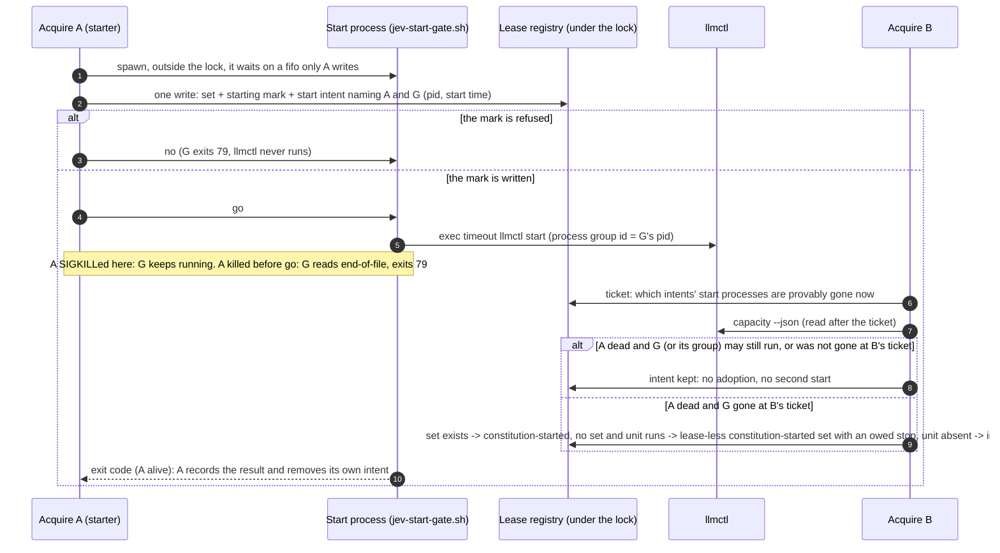

# Start sequence of an acquire with the gated start process (diagram source)

This is the Mermaid source of `start_intent.svg`. It is kept as a fenced block in Markdown, the form the repository
uses for diagrams, because the git-env census accepts only a closed list of file types. The block below is
byte-identical to the file that mermaid-cli rendered (`mmdc.log`); its sha256 is `de55c98d7eae98eab1101b4c1f0d40e7117497c43bfd201b593dcb33de103cfc`.

