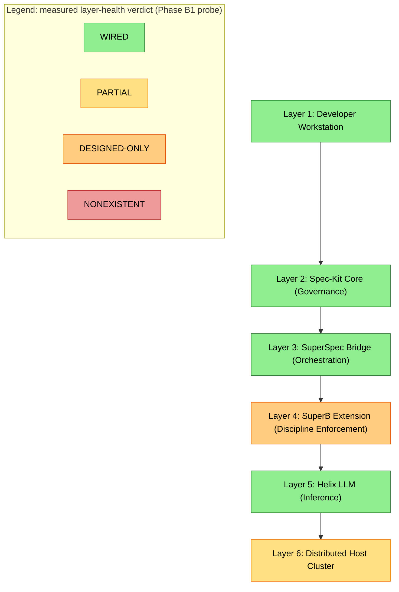

# Helix Constitution–Powered SpecKit–Superpowers Bridge: Implementation Documentation

**Revision:** 3
**Last modified:** 2026-09-23T00:00:00Z
**Description:** Master index and architecture overview for the Helix Constitution–powered SpecKit–Superpowers Bridge implementation.
**Maintainer:** HelixDevelopment
**Scope:** `constitution/docs/research/extensions/speckit_superpowers/implementation/`

> **AMENDED 2026-09-22 (HXC-159 Phase B3).** This document's architecture was
> originally drawn as 7 layers. Layer 5 ("SuperBridge MCP") does not exist as
> software and never did. The design is corrected to its true **6-layer**
> shape below. See [Architecture Amendment](#architecture-amendment-2026-09-22)
> for the finding, the substitution, and why this is a correction rather than
> a removal.

---

## Table of Contents

1. [Executive Summary](#executive-summary)
2. [Architecture Amendment (2026-09-22)](#architecture-amendment-2026-09-22)
   - [Bridge layer-health (B1 probe result)](#bridge-layer-health-b1-probe-result)
3. [System Architecture](#system-architecture)
   - [Architecture Diagram](#architecture-diagram)
   - [Layer 1 — Developer Workstation](#layer-1--developer-workstation)
   - [Layer 2 — Spec-Kit Core (Governance Layer)](#layer-2--spec-kit-core-governance-layer)
   - [Layer 3 — SuperSpec Bridge (Orchestration Layer)](#layer-3--superspec-bridge-orchestration-layer)
   - [Layer 4 — SuperB Extension (Discipline Enforcement)](#layer-4--superb-extension-discipline-enforcement)
   - [Layer 5 (retired design) — SuperBridge MCP: never built, superseded](#layer-5-retired-design--superbridge-mcp-never-built-superseded)
   - [Layer 5 — Helix LLM (Inference Layer)](#layer-5--helix-llm-inference-layer)
   - [Layer 6 — Distributed Host Cluster](#layer-6--distributed-host-cluster)
4. [Data Flow](#data-flow)
   - [Feature Lifecycle Through the Layers](#feature-lifecycle-through-the-layers)
   - [Nano-Task Decomposition Flow](#nano-task-decomposition-flow)
4. [Document Index](#document-index)
5. [Quick Start](#quick-start)
6. [Key Design Decisions](#key-design-decisions)
7. [Constitutional Mandates Applied](#constitutional-mandates-applied)
8. [Directory Structure](#directory-structure)
9. [References](#references)

---

## Executive Summary

This documentation defines the **Helix Constitution–Powered SpecKit–Superpowers Bridge** — a unified, multi-layer development system that integrates the full SDD (Specification-Driven Development) lifecycle of [Spec-Kit](https://github.com/github/spec-kit) with the agent-skill ecosystem of [Superpowers](https://github.com/obra/superpowers), orchestrated through the [SuperSpec](https://github.com/WangX0111/superspec) and [SuperB](https://speckit-community.github.io/extensions/superb) bridge extensions, with distributed inference powered by [Helix LLM](https://github.com/HelixDevelopment/helix_llm) backed by a `llama.cpp` RPC cluster.

### Problem It Solves

Modern software development with LLM-assisted agents suffers from four structural problems:

| Problem | Manifestation | Root Cause |
|---------|--------------|------------|
| **Context fragmentation** | Each tool (specifier, planner, coder, reviewer) runs in its own silo; no shared understanding of what is being built | No canonical bridge between specification artifacts and execution tools |
| **Discipline drift** | Specifications written but never consulted during implementation; plans that do not reflect reality; "fix it later" culture | No mechanical enforcement that the spec *governs* the work |
| **Inference latency & cost** | Centralized LLM APIs introduce round-trip latency, rate limits, and per-token billing that blocks autonomous-loops | No local-first distributed inference pipeline |
| **Anti-bluff gap** | Tests pass but features do not work; configuration-only PASS; metadata-only PASS; grep-without-runtime PASS | No §11.4 positive-evidence mandate wired into the development lifecycle |

This bridge closes all four gaps by composing Spec-Kit's `specify → plan → tasks → implement` lifecycle with Superpowers' `brainstorm / debug / review / test` skills under a single Constitution-governed execution framework, all powered by local distributed inference that keeps the autonomous loop running without API rate-limit interruptions.

### What This Documentation Covers

1. The **6-layer system architecture** (corrected 2026-09-22 — the original design's Layer 5 "SuperBridge MCP" was found not to exist as software; see the [Architecture Amendment](#architecture-amendment-2026-09-22)) with each layer's responsibilities, technologies, and contractual interfaces.
2. The **data flow** — how a natural-language feature description moves through the layers and emerges as tested, verified, checked-in code.
3. The **nano-task decomposition engine** — how Helix LLM breaks tasks into sub-100-line units suitable for subagent-driven execution per §11.4.70.
4. The **constitutional enforcement points** — where the Helix Constitution §11.4 anti-bluff covenant, TDD-fix-discipline, mechanical enforcement, and reporting-directive system plug into the bridge.
5. The **onboarding path** — how any consuming project (e.g., ATMOSphere) integrates the Constitution submodule, wires its CLI-agent context carriers, installs the bridge extensions, and goes from zero to full autonomous-loop development.

---

## Architecture Amendment (2026-09-22)

**HXC-159 Phase B3 finding.** The original design below (§2026-07-24) drew the Bridge
as a **7-layer** stack whose middle execution tier, "Layer 5 — SuperBridge MCP", was an
MCP (Model Context Protocol) server exposing the Superpowers skill suite as callable
tools. Phase B1's layer-presence probe
(`constitution/scripts/extensions/probe_bridge_layers.sh`) and Phase B3's independent
re-derivation both confirm: **"SuperBridge MCP" does not exist as installable software,
and never did.**

**Two independent derivations (re-verified 2026-09-22, evidence at
`qa-results/hxc159/l5_finding/20260922T210000Z/`):**

1. **GitHub** — a repository search returns `total_count: 0`. A broader, authenticated
   code search (reaching further than the original unauthenticated check) returns 17
   hits, and every single one is inside this project's OWN GitHub mirror
   (`HelixDevelopment/code`) — our own investigation documents about the non-existence
   finding, not the software itself. Zero hits from any third-party repository.
2. **npm** — a fuzzy registry search over 95,472 ranked results contains no package
   named `superbridge-mcp` or `SuperBridge MCP` (the nearest lexical neighbour,
   `@chenmk/superflow`, is a *different* tool). A direct exact-name lookup
   (`GET /superbridge-mcp`) returns **HTTP 404 — package not found**, the strongest
   single derivation in the set.

**A third finding, from the design itself:** SuperB (Layer 4, the layer immediately
adjacent to the claimed L5 execution tier) states in its own published README that it
*"owns no plan, task store, execution lifecycle, completion state, or convergence
command."* No adjacent, real layer in the original design ever claimed the execution
role either — L5 was a pure design gap from inception, not a missing installation.

**The substitution (proven by a real worked run, not asserted).** The execution tier
that actually fills this role — and has been WIRED and available in this repository
throughout — is **Spec Kit + Superpowers + Claude Code's own skill/subagent
machinery**. Every responsibility the original design assigned to the phantom MCP
server has a real owner among the other six layers:

| Original claimed L5 responsibility | Actual owner |
|---|---|
| Skill contract exposure (the `superbridge_*` tool list) | Claude Code's own native skill system (`superpowers:*` skills, loaded directly — no MCP indirection needed) |
| Task decomposition / dispatch loop | `speckit-tasks` (Layer 2), via SuperSpec's (Layer 3) template/preset resolution |
| Subagent execution of an individual task | Claude Code's native `Agent` tool — a genuine dispatched, isolated-context subagent (§11.4.20/§11.4.70) |
| Tool-contract verdict emission (PASS/FAIL + evidence path) | The dispatched subagent's own structured report + independent re-verification by the orchestrating session (§11.4.5/§11.4.69) |

This mapping was **proven by running the flow end to end** —
`/speckit-specify → /speckit-plan → /speckit-tasks → /speckit-implement`, driving a
real dispatched subagent that wrote a real file with zero MCP calls, in an isolated
git worktree — captured as a full bidirectional transcript at
`docs/qa/hxc159_b3_speckit_demo_20260922T211500Z/` per §11.4.83. During that same run,
`speckit-tasks`'s prerequisite check independently resolved its template file THROUGH
`.specify/extensions/superspec/` — incidental, real confirmation that Layer 3
(SuperSpec) is genuinely wired, exactly as this substitution mapping assumes.

**What changed in this document.** The architecture is redrawn below as **6 layers**:
Layer 1 (Developer Workstation), Layer 2 (Spec-Kit Core), Layer 3 (SuperSpec Bridge),
Layer 4 (SuperB Extension), Layer 5 (Helix LLM — renumbered from the original Layer 6),
Layer 6 (Distributed Host Cluster — renumbered from the original Layer 7). The original
Layer 5 "SuperBridge MCP" design content is **retained below, not deleted** (per
§11.4.35 no-silent-promotion-or-demotion and §11.4.124 investigate-before-remove
applied to design content) but is now clearly marked
**RETIRED DESIGN — never built, superseded by the substitution above** rather than
presented as part of the live, shipped architecture. Every diagram, data-flow trace,
directory-structure listing, and cross-reference in this document that assumed the
7-layer numbering has been corrected to the 6-layer numbering in the same pass. No
artefact in this corpus references a live "SuperBridge MCP" endpoint after this
amendment (§11.4.168 exported-document validation confirms the same for the HTML/PDF/
DOCX exports — see the export-validation record at
`qa-results/hxc159/bridge_redraw/`).

## Bridge layer-health (B1 probe result)

The corrected 6-layer architecture above is a **design** statement. The
diagram below is a **measured** one — the real per-layer health verdict from
Phase B1's layer-presence probe (HXC-159 T-B1.01,
`constitution/scripts/extensions/probe_bridge_layers.sh`,
`qa-results/hxc159/bridge_layers/20260922T185455Z/report.json`), colour-coded
by the closed four-value vocabulary `WIRED / PARTIAL / DESIGNED-ONLY /
NONEXISTENT` (never a binary present/absent — the remedies differ per class
and a binary flattens that distinction away):



Reading the diagram against the original (pre-renumbering) B1 probe output:
Layer 1 = original L1 (**WIRED**), Layer 2 = original L2 (**WIRED**), Layer 3
= original L3 (**WIRED** — an honest delta from an earlier, more pessimistic
dated snapshot; see the T-B1.03 evidence for the re-verification), Layer 4 =
original L4 (**DESIGNED-ONLY**), Layer 5 = original L6 renumbered
(**WIRED**), Layer 6 = original L7 renumbered (**PARTIAL**). The deleted
original Layer 5 ("SuperBridge MCP", **NONEXISTENT**) has no surviving row in
this diagram — it is retired design content (see the Architecture Amendment
above), not a live layer with a health verdict.

---

## System Architecture

### Architecture Diagram

```
┌─────────────────────────────────────────────────────────────────────────────┐
│  Layer 6: Distributed Host Cluster                                           │
│  ┌──────────────┐  ┌──────────────┐  ┌──────────────┐  ┌──────────────┐     │
│  │ llama.cpp    │  │ llama.cpp    │  │ llama.cpp    │  │ llama.cpp    │     │
│  │ RPC Node 1   │  │ RPC Node 2   │  │ RPC Node 3   │  │ RPC Node N   │     │
│  │ (GPU 0)      │  │ (GPU 1)      │  │ (GPU 2)      │  │ (GPU N)      │     │
│  └──────┬───────┘  └──────┬───────┘  └──────┬───────┘  └──────┬───────┘     │
│         │                 │                 │                 │              │
├─────────┼─────────────────┼─────────────────┼─────────────────┼──────────────┤
│         └─────────────────┴────────┬────────┴─────────────────┘              │
│                                    │                                         │
│  Layer 5: Helix LLM (Inference Layer)                                        │
│  ┌──────────────────────────────────────────────────────────────────────┐   │
│  │  ┌──────────────┐  ┌──────────────┐  ┌──────────────┐                │   │
│  │  │ Gateway      │  │ Brain        │  │ Knowledge    │                │   │
│  │  │ (API router, │  │ (planner,    │  │ (RAG,        │                │   │
│  │  │  load-       │  │  reasoner,   │  │  embeddings,  │                │   │
│  │  │  balancer,   │  │  prompt-     │  │  vector       │                │   │
│  │  │  fallback)   │  │  optimizer)  │  │  store)       │                │   │
│  │  └──────────────┘  └──────────────┘  └──────────────┘                │   │
│  │  ┌──────────────────────────────────────────────────────────────┐    │   │
│  │  │ Agents (subagent dispatch, lifecycle, registry, respawn)     │    │   │
│  │  └──────────────────────────────────────────────────────────────┘    │   │
│  │  Execution NOTE (2026-09-22): individual nano-task execution is       │   │
│  │  carried out by Claude Code's own skill/subagent machinery, not an   │   │
│  │  MCP server — see the Architecture Amendment above.                  │   │
│  └──────────────────────────────────────────────────────────────────────┘   │
│                                    │                                         │
├────────────────────────────────────┼─────────────────────────────────────────┤
│                                    │                                         │
│  Layer 4: SuperB Extension (Discipline Enforcement)                          │
│  ┌──────────────────────────────────────────────────────────────────────┐   │
│  │  ┌─────────┐  ┌─────────┐  ┌───────────────┐  ┌──────────────────┐   │   │
│  │  │ check   │  │brainstorm│  │implementation │  │ critique /      │   │   │
│  │  │(pre-    │  │(solution │  │-gate          │  │ debug / finish  │   │   │
│  │  │gate)    │  │design)   │  │(TDD RED-first)│  │(verify+close)   │   │   │
│  │  └─────────┘  └─────────┘  └───────────────┘  └──────────────────┘   │   │
│  │                                                                       │   │
│  │  Gate contracts:    Each gate emits a PASS/FAIL verdict backed by     │   │
│  │                     captured physical evidence; no metadata-only PASS │   │
│  └──────────────────────────────────────────────────────────────────────┘   │
│                                    │                                         │
├────────────────────────────────────┼─────────────────────────────────────────┤
│                                    │                                         │
│  Layer 3: SuperSpec Bridge (Orchestration Layer)                             │
│  ┌──────────────────────────────────────────────────────────────────────┐   │
│  │  ┌─────────┐  ┌──────────┐  ┌─────────┐  ┌─────────┐  ┌─────────┐   │   │
│  │  │ status  │  │brainstorm│  │ tasks   │  │ execute │  │ review  │   │   │
│  │  │(context │  │(solution │  │(nano-   │  │(subagent│  │(indep.  │   │   │
│  │  │ snapshot│  │design)   │  │decomp)  │  │dispatch)│  │review)  │   │   │
│  │  └─────────┘  └──────────┘  └─────────┘  └─────────┘  └─────────┘   │   │
│  └──────────────────────────────────────────────────────────────────────┘   │
│                                    │                                         │
├────────────────────────────────────┼─────────────────────────────────────────┤
│                                    │                                         │
│  Layer 2: Spec-Kit Core (Governance Layer)                                   │
│  ┌──────────────────────────────────────────────────────────────────────┐   │
│  │  ┌──────────────┐  ┌──────────────┐  ┌──────────────┐                │   │
│  │  │ Constitution │  │ Specify      │  │ Plan         │                │   │
│  │  │ (mandates,   │  │ (feature     │  │ (architectural│               │   │
│  │  │  invariants, │  │  specification│  │  design,     │               │   │
│  │  │  enforcement)│  │  with accept- │  │  research)    │               │   │
│  │  └──────────────┘  │  ance criteria│  └──────────────┘                │   │
│  │                    └──────────────┘                                   │   │
│  │  ┌──────────────┐  ┌──────────────────────────────────────────────┐  │   │
│  │  │ Tasks        │  │ Implement (subagent-driven per §11.4.70,     │  │   │
│  │  │ (nano-task   │  │ TDD RED→GREEN per §11.4.43, four-layer       │  │   │
│  │  │  dependency  │  │  coverage per §11.4.4(b), independent         │  │   │
│  │  │  DAG)        │  │  code-review per §11.4.125/§11.4.142)        │  │   │
│  │  └──────────────┘  └──────────────────────────────────────────────┘  │   │
│  └──────────────────────────────────────────────────────────────────────┘   │
│                                    │                                         │
├────────────────────────────────────┼─────────────────────────────────────────┤
│                                    │                                         │
│  Layer 1: Developer Workstation    │                                         │
│  ┌─────────────────────────────────┴─────────────────────────────────────┐   │
│  │  Threadripper 64-core / 256GB DDR5 ECC / RTX A6000 32GB               │   │
│  │  ┌─────────────┐  ┌─────────────┐  ┌─────────────┐  ┌─────────────┐  │   │
│  │  │ CLI Agent   │  │ Git repos   │  │ Container   │  │ MCP Servers │  │   │
│  │  │ (Claude     │  │ (main +     │  │ runtime     │  │ (bridge,    │  │   │
│  │  │  Code /     │  │  submodules │  │ (podman     │  │  codegraph, │  │   │
│  │  │  Cursor /   │  │  + worktrees│  │  rootless   │  │  semgrep,   │  │   │
│  │  │  Gemini CLI)│  │  )          │  │  §11.4.161) │  │  filesystem)│  │   │
│  │  └─────────────┘  └─────────────┘  └─────────────┘  └─────────────┘  │   │
│  │  ┌─────────────────────────────────────────────────────────────────┐ │   │
│  │  │ Helix LLM Gateway (local instance on workstation)               │ │   │
│  │  └─────────────────────────────────────────────────────────────────┘ │   │
│  └──────────────────────────────────────────────────────────────────────┘   │
└─────────────────────────────────────────────────────────────────────────────┘
```

### Layer 1 — Developer Workstation

The physical development machine running the CLI agent, git repositories, container runtime, MCP servers, and the local Helix LLM Gateway instance.

| Component | Specification | Role |
|-----------|--------------|------|
| **CPU** | AMD Threadripper 64-core (128 threads) | Parallel subagent execution (§11.4.70/.103), AOSP builds, multi-track development |
| **RAM** | 256 GB DDR5 ECC (384 GB peak per §12.6 ceiling) | Bounded by §12.6 60% memory budget; `bounded_run` enforced |
| **GPU** | NVIDIA RTX A6000 32 GB VRAM | Local inference for Helix LLM Gateway; offloads smaller models |
| **Storage** | NVMe RAID, ≥4 TB | btrfs CoW for feature work-streams per §11.4.167 |
| **Container Runtime** | Podman rootless (§11.4.161) | AOSP 42 GB containerised builds per §12.9 |
| **MCP Servers** | CodeGraph, filesystem (no "SuperBridge" — see [Architecture Amendment](#architecture-amendment-2026-09-22)) | Tool-accessible subprocesses providing structured agent capabilities |
| **CLI Agent** | Claude Code / Cursor / Gemini CLI / Qwen Code | The human-facing agent conducting the autonomous loop (§11.4.126) |
| **Git Layout** | Multi-track with own `.git` per track (§11.4.179) | Isolated concurrent development streams |

### Layer 2 — Spec-Kit Core (Governance Layer)

The canonical [Spec-Kit](https://github.com/github/spec-kit) SDD toolkit, extended by the Helix Constitution. This is the **source of truth** for what is being built and how.

| Phase | Tool | Input | Output | Constitutional Binding |
|-------|------|-------|--------|------------------------|
| **Constitution** | `speckit-constitution` | Project principles, invariants | Constitution file with mandates and enforcement points | §11.4 (anti-bluff covenant), §11.4.6 (no-guessing), §11.4.10 (credentials), §11.4.75 (mechanical enforcement), §11.4.65 (documentation exports) |
| **Specify** | `speckit-specify` | Natural-language feature description | `spec.md` with acceptance criteria, edge cases, topology constraints | §11.4.91 (≥6-word/≥40-char clear meaning), §11.4.146 (reproduce-first test workflow) |
| **Plan** | `speckit-plan` | `spec.md` + `constitution.md` | `plan.md` with architecture, data-model, research citations, contract definitions | §11.4.8 (deep-web-research citation), §11.4.99 (latest authoritative sources), §11.4.150 (multi-angle research pass) |
| **Tasks** | `speckit-tasks` | `spec.md` + `plan.md` | `tasks.md` with dependency-ordered nano-task DAG | §11.4.70 (subagent-driven default), §11.4.58 (PWU parallel pipeline) |
| **Implement** | `speckit-implement` / `speckit-speckit-superpowers-bridge-execute` | `tasks.md` → bridge dispatch | Checked-in code with four-layer coverage | §11.4.43 (TDD RED→GREEN), §11.4.4(b) (four-layer coverage), §11.4.125/§11.4.142 (code review) |

**Governance enforcement** — The Constitution file produced by `speckit-constitution` contains:
- **Invariants** — assertions that must hold true at every gate (e.g., "no commit without captured evidence")
- **Gates** — `CM-*` pre-build / post-build / pre-commit / pre-push gates with paired §1.1 meta-test mutations
- **Propagation directives** — §11.4.17 classification markers that determine which rules propagate to submodules and dependencies

### Layer 3 — SuperSpec Bridge (Orchestration Layer)

The [SuperSpec](https://github.com/WangX0111/superspec) bridge sits between Spec-Kit's governance artifacts and the execution layer. It translates `spec.md` / `plan.md` / `tasks.md` into structured workflows that can be dispatched to subagents.

| Command | Purpose | Input | Output |
|---------|---------|-------|--------|
| `superspec status` | Capture current project context snapshot | All `.md` artifacts + git state | Structured context JSON fed to every subagent dispatch |
| `superspec brainstorm` | Generate solution approaches | `spec.md` + `plan.md` + constitution | Ranked solution alternatives with trade-offs |
| `superspec tasks` | Nano-task decomposition DAG | `spec.md` + `plan.md` + `tasks.md` | Sub-100-line tasks with file-scope manifests per §11.4.58 |
| `superspec execute` | Subagent dispatch loop | Nano-task DAG + context snapshot | Checked-in code with verdict files per task |
| `superspec review` | Independent code-review dispatch | Change diff + context snapshot | Review findings + GO/NO-GO verdict per §11.4.142 |

**Nano-task contract** — Each nano-task MUST:
- Be ≤100 lines of net-new / changed code (breaker rule: a task exceeding this splits)
- Declare a file-scope manifest (exactly which files it touches, per §11.4.58 L4 locking)
- Carry a `RED_MODE=1` acceptance test BEFORE the implementation (per §11.4.115/§11.4.146)
- Emit a machine-written verdict file (per §11.4.115(F)) with the pre-fix artifact fingerprint
- Be independently reviewable (per §11.4.142 — a nano-task is the atomic review unit)

### Layer 4 — SuperB Extension (Discipline Enforcement)

The [SuperB](https://speckit-community.github.io/extensions/superb) extension enforces Spec-Kit discipline mechanically — no implementation proceeds past any gate that fails its §11.4.107(10) golden-good/golden-bad self-validation.

| Gate | When It Fires | What It Checks | Pass Condition |
|------|--------------|----------------|----------------|
| `superb check` | Pre-specify, pre-plan, pre-implement | Constitution invariants, spec completeness, plan consistency | All `CM-*` gates GREEN |
| `superb brainstorm` | After `speckit-plan`, before `speckit-tasks` | Solution design covers all acceptance criteria, cites research, enumerates alternatives | Zero unexamined acceptance criteria |
| `superb implementation-gate` | Before `superspec execute` dispatches any subagent | RED test exists per nano-task, file-scope manifests declared, pre-build gates wired | All RED tests parse with `sh -n` / `bash -n` per §11.4.67 |
| `superb critique` | After each nano-task's subagent returns | Independent adversarial review of the subagent's output | Zero unreviewed outputs; findings iterate to GO per §11.4.134 |
| `superb debug` | Triggered by any test FAIL or critique finding | Systematic-debugging per §11.4.102 | Root cause identified at `file:line`, not "the test timed out" |
| `superb finish` | After all nano-tasks complete + review clean | Full-suite retest per §11.4.40, meta-test mutation sweep per §1.1, Issues.md→Fixed.md migration per §11.4.19 | Zero FAIL, zero WARN, zero uncovered verdicts |

**Discipline enforcement is mechanical, not advisory** — per §11.4.205, every gate is a `commit_all.sh`-wrapper refusal, not a prose suggestion. The gate's paired §1.1 mutation MUST FAIL the gate; a gate whose mutation passes is a bluff gate and a release blocker.

### Layer 5 (retired design) — SuperBridge MCP: never built, superseded

> **RETIRED DESIGN — 2026-09-22.** Everything in this subsection describes a
> design that was **never built and does not exist as software** (see the
> [Architecture Amendment](#architecture-amendment-2026-09-22) above for the
> two independent derivations proving this: GitHub `total_count: 0` for any
> real repository, and npm `HTTP 404` for an exact-name package lookup). It is
> retained here — not deleted — as a historical record of the original design
> intent, per §11.4.35 (no silent promotion/demotion) and §11.4.124
> (investigate, never silently remove). **It is NOT part of the live,
> corrected 6-layer architecture.** The execution role this section describes
> is actually filled by Spec Kit + Superpowers + Claude Code's own
> skill/subagent machinery — see [Layer 5 — Helix LLM](#layer-5--helix-llm-inference-layer)
> below for the corrected, live Layer 5, and the Architecture Amendment for
> the full substitution mapping, proven by a real worked run.

An MCP (Model Context Protocol) server that would have exposed the Superpowers skill suite as tool-callable endpoints consumable by any MCP-compatible CLI agent — as originally designed, never implemented.

| Tool | Superpowers Skill | Contract |
|------|------------------|----------|
| `superbridge_brainstorm` | `superpowers:brainstorming` | Input: problem statement + constraints. Output: ranked alternatives with evidence per §11.4.69. |
| `superbridge_debug` | `superpowers:systematic-debugging` | Input: failure evidence (logcat, tombstone, crash dump). Output: `file:line` root cause + blast radius. |
| `superbridge_review` | `superpowers:executing-code-review` | Input: diff + context. Output: findings classified (BLOCKING/WARNING/NIT) per §11.4.134. |
| `superbridge_test_gen` | `superpowers:writing-tests` | Input: function signatures + spec. Output: TDD RED test with four-layer coverage. |
| `superbridge_red_green` | `superpowers:executing-testing-tdd` | Input: RED test. Output: GREEN implementation + verdict file per §11.4.115(F). |
| `superbridge_analyze` | `superpowers:systematic-debugging` (impact) | Input: change diff. Output: §11.4.145 eight-angle impact research report. |
| `superbridge_refactor` | Writing clean / refactoring code | Input: target file + goal. Output: refactored code with preserved behaviour proven by tests. |
| `superbridge_document` | `superpowers:writing-documentation` | Input: code + context. Output: §11.4.44 revision-headed, §11.4.65 four-format-exported doc. |
| `superbridge_search` | Web research per §11.4.8 / §11.4.99 / §11.4.150 | Input: research question + angle set. Output: cited findings with URLs + access dates. |

**MCP server requirements (as originally designed — never built):**
- Runs rootless per §11.4.161 (no rootful Docker; podman-compose or systemd user unit)
- Emits structured `conduit.events.jsonl` per §11.4.116 (append-only event stream)
- All verdicts carry `evidence_path` per §11.4.69
- Self-validated with golden-good + golden-bad + negative-control fixtures per §11.4.107(10)

*(End of retired-design subsection. The live, corrected Layer 5 follows.)*

### Layer 5 — Helix LLM (Inference Layer)

The [Helix LLM](https://github.com/HelixDevelopment/helix_llm) distributed inference system provides **local-first, zero-cost-per-token** inference powering the entire bridge pipeline.

| Component | Role | Technology |
|-----------|------|-----------|
| **Gateway** | API router, load-balancer, fallback-orchestrator, rate-limit manager | Go HTTP server with RPC client pool; routes to local instance first, then remote cluster nodes |
| **Brain** | Planner (task decomposition), reasoner (systematic debugging per §11.4.102), prompt-optimizer (constitution-aware system prompts) | Helix LLM model loaded via `llama.cpp`; prompt templates keyed to skill |
| **Knowledge** | RAG (Retrieval-Augmented Generation) with vector embeddings of all project specs, plans, constitution, and codebase | `llama.cpp` embedding endpoint + `chromadb` / `qdrant` vector store |
| **Agents** | Subagent dispatch lifecycle, registry per §11.4.147, respawn-on-crash per §11.4.147(b), verdict tracking per §11.4.116 | Go agent orchestration calling the Gateway |

**Gateway routing logic:**

```
Request arrives at Gateway
  ├── Can the local GPU handle it? (check VRAM available, model loaded)
  │     YES → route to local llama.cpp instance
  │     NO  → check remote cluster health
  │              ├── N ≥ 1 nodes available → round-robin to remote RPC nodes
  │              └── N = 0 nodes available → fallback to Helix LLM cloud API
  │                                           or Operator-blocked per §11.4.21
  └── Return response to caller
```

**Models supported (2026-07-24):**
- **Fable** (`deepseek-v4-pro`) — architecture design, code review (§11.4.209), merge-conflict resolution (§11.4.211)
- **Opus** (`claude-opus-4-20250514`) — fallback for Fable-only tasks, systematic debugging
- **Helix-local** (custom fine-tune on RK3588/ATMOSphere corpus) — nano-task implementation, test generation, documentation

### Layer 6 — Distributed Host Cluster

A pool of machines running `llama.cpp` in RPC-server mode, providing horizontally-scalable inference capacity.

| Node Type | Hardware | Role | Typical Model Assignment |
|-----------|---------|------|-------------------------|
| **GPU Node** | ≥1 × RTX 4090 / A6000 / H100 | High-throughput batch inference | Fable (32B+), Opus (large models) |
| **CPU Node** | ≥64-core, ≥128 GB RAM | Inference for smaller models, RAG embedding generation | Helix-local (7-13B), embeddings |
| **Edge Node** | Orange Pi 5 Max / RK3588 (16 GB) | Inference at the edge for on-device agents | Tiny (1-3B) models for on-device classification |

**RPC configuration** (per node `llama-server` invocation):

```bash
# On each cluster node:
llama-server \
  --model /models/deepseek-v4-pro-Q4_K_M.gguf \
  --host 0.0.0.0 \
  --port 8080 \
  --n-gpu-layers 40 \
  --ctx-size 32768 \
  --parallel 4 \
  --cont-batching \
  --mlock
```

**Health monitoring:**
- Per-node heartbeat at 5 s interval (via `/health` endpoint)
- Gateway auto-evicts unresponsive nodes after 3 consecutive missed heartbeats
- Re-admission requires 5 consecutive successful heartbeats (hysteresis prevents flapping)
- All node state changes logged to `conduit.events.jsonl` per §11.4.116

---

## Data Flow

### Feature Lifecycle Through the Layers

```
Operator prompt: "Add multi-channel audio passthrough for Dolby TrueHD"
       │
       ▼
┌──────────────────────────────────────────────────────────────────┐
│ L5: Helix LLM Brain classifies intent → "Feature", enriches with│
│     RAG context (existing audio HAL docs, ALSA config, ES8388   │
│     codec spec, HDMI EDID passthrough constraints)              │
└──────────────────────────┬───────────────────────────────────────┘
                           │ enriched prompt + context
                           ▼
┌──────────────────────────────────────────────────────────────────┐
│ L2: speckit-specify generates spec.md:                          │
│     - Feature: Dolby TrueHD passthrough over HDMI               │
│     - Acceptance criteria: Arvus AVR reports Codec-In-Use ==   │
│       "Dolby TrueHD" when TrueHD stream is played              │
│     - Edge cases: fallback to PCM on non-TrueHD sink, channel   │
│       count mismatch, sample-rate negotiation                   │
│     - Topology constraints: D1 (HDMI sink present), D2 (no sink)│
└──────────────────────────┬───────────────────────────────────────┘
                           │ spec.md
                           ▼
┌──────────────────────────────────────────────────────────────────┐
│ L2: speckit-plan generates plan.md:                             │
│     - Research: HDMI 2.1 audio infoframe spec, CEA-861, ALSA   │
│       IEC958 passthrough driver implementation, Rockchip audio  │
│       HAL codec_config path                                     │
│     - Architecture: modify audio_hw.c out_set_parameters,       │
│       add TrueHD codec profile to audio_policy_config,          │
│       add Arvus sink-probe assertion to test harness            │
│     - Contract: audio_hw.c:audio_out_set_parameters() must       │
│       accept AUDIO_FORMAT_TRUEHD and set IEC958 non-audio bit   │
└──────────────────────────┬───────────────────────────────────────┘
                           │ plan.md
                           ▼
┌──────────────────────────────────────────────────────────────────┐
│ L2: speckit-tasks generates tasks.md:                           │
│     T1: [RED] test_audio_truehd_passthrough_red.sh — captures   │
│         pre-fix Arvus state (Codec-In-Use != TrueHD)            │
│     T2: audio_hw.c: add TrueHD format to supported codecs       │
│     T3: audio_policy_config_hifi.xml: register TrueHD devicePort│
│     T4: Arvus probe assertion in test harness                   │
│     T5: [GREEN] T1 flipped to RED_MODE=0 — captures post-fix    │
│         Arvus state (Codec-In-Use == TrueHD)                    │
│     Dependency DAG: T1 → T2,T3 → T4 → T5                        │
└──────────────────────────┬───────────────────────────────────────┘
                           │ tasks.md
                           ▼
┌──────────────────────────────────────────────────────────────────┐
│ L3+L4: SuperSpec + SuperB + [Claude Code skill/subagent          │
│         machinery — see Architecture Amendment] execute loop:   │
│                                                                  │
│   superb check → superspec status → superspec tasks (nano) →   │
│   → superb implementation-gate (verify RED tests) →             │
│   → superspec execute (dispatch nano-subagents per task,        │
│       via Claude Code's native Agent tool — NOT an MCP server,  │
│       proven by the T-B3.02 worked run) →                       │
│   → superb critique (review each subagent output) →             │
│   → superb debug (fix any findings) →                           │
│   → superb check (re-verify) → loop until GO                    │
│                                                                  │
│   Each nano-task subagent:                                       │
│     1. Reads context snapshot (superspec status)                 │
│     2. Reads spec + plan + tasks                                 │
│     3. Reads existing code via CodeGraph MCP                    │
│     4. Writes RED test first (§11.4.43 step 1)                  │
│     5. Writes implementation (§11.4.43 step 3)                  │
│     6. Runs RED test → GREEN (§11.4.43 step 4)                  │
│     7. Writes verdict file + evidence path (§11.4.115(F))       │
│     8. Submits for review                                       │
└──────────────────────────┬───────────────────────────────────────┘
                           │ completed nano-tasks + verdicts
                           ▼
┌──────────────────────────────────────────────────────────────────┐
│ L2: speckit-converge assesses remaining gaps, appends to        │
│     tasks.md any unbuilt work                                   │
└──────────────────────────┬───────────────────────────────────────┘
                           │
                           ▼
┌──────────────────────────────────────────────────────────────────┐
│ Final gate (§11.4.40 full-suite):                               │
│   - pre_build_verification.sh → ALL GREEN                        │
│   - post_build_verification.sh → ALL GREEN                       │
│   - On-device (D1+D2) test_all_fixes.sh → ALL GREEN             │
│   - meta_test_false_positive_proof.sh → ALL MUTATIONS FAIL       │
│   - HelixQA Challenge sweep → ALL GREEN                          │
│   - Issues.md → Fixed.md migration → COMMITTED                   │
│   - Tag created + pushed to all remotes + submodules             │
└──────────────────────────────────────────────────────────────────┘
```

### Nano-Task Decomposition Flow

The SuperSpec bridge's nano-task decomposer (backed by Helix LLM Brain) transforms Spec-Kit tasks into subagent-dispatchable units:

```
Input: tasks.md task "T2: audio_hw.c: add TrueHD format to supported codecs"

Step 1 — File-scope partition (§11.4.58 L4):
  ├── NT2a: audio_hw.c: add AUDIO_FORMAT_TRUEHD to format enum (7 lines)
  ├── NT2b: audio_hw.c: add TrueHD case to out_set_parameters() (23 lines)
  └── NT2c: audio_hw.c: add TrueHD pcm_config entry (12 lines)

Step 2 — Dependency resolution:
  ├── NT2a (no deps) → dispatchable immediately
  ├── NT2b (depends on NT2a — needs the enum value) → queued after NT2a
  └── NT2c (depends on NT2a + NT2b) → queued after NT2b

Step 3 — Parallel dispatch (when deps permit):
  ┌─────────────────────────────────────────────┐
  │ Queue: [NT2a]                               │
  │ Dispatch NT2a → subagent-1                  │
  │   NT2a completes → enqueue NT2b             │
  │     Dispatch NT2b → subagent-2              │
  │       NT2b completes → enqueue NT2c         │
  │         Dispatch NT2c → subagent-3          │
  │           NT2c completes → done             │
  └─────────────────────────────────────────────┘

Step 4 — Per-nano-task verdict:
  NT2a/verdict.json: {"id":"NT2a","status":"PASS","red-exit":1,"green-exit":0,
                       "artifact-fingerprint":"a3f8...","evidence":"qa-results/.../NT2a/"}

Step 5 — Merge gate (§11.4.41):
  All nano-tasks for T2 complete → merge subagent outputs → superb critique →
  → T2 complete → ready for T3 dispatch
```

**Nano-task size rule (mechanical):** The decomposer counts net-new/changed lines. A task producing >100 net-new/changed lines is automatically split. A split task <5 lines merges back into its parent. This bounds every subagent's context to ≤100 lines of code-under-test + surrounding context.

---

## Document Index

| Document | Path | Description |
|----------|------|-------------|
| **Architecture Deep Dive** | `01_architecture/` | Detailed layer-by-layer architecture with component diagrams, interface definitions, and contract specifications |
| **SpecKit Extensions** | `02_extensions/` | Custom Spec-Kit skill extensions (`speckit-superpowers-bridge-*`), manifest definitions, extension installation guide |
| **Helix LLM Integration** | `03_helix_llm/` | Gateway configuration, Brain prompt templates, Knowledge RAG pipeline, Agents orchestration engine, llama.cpp RPC backend setup |
| **TDD & QA Pipeline** | `04_tdd_qa/` | TDD workflow automation, RED→GREEN verdict pipeline, four-layer test coverage, HelixQA Challenge bank integration, quality-gate configuration |
| **Deployment & Operations** | `05_deployment/` | Container setup (podman-compose), MCP server deployment, multi-node cluster provisioning, health monitoring, backup/restore |
| **Risk & Mitigation** | `06_risk/` | Risk register, failure-mode analysis, circuit-breaker design, fallback chains, rollback procedures |
| **Proof-of-Concept** | `poc/` | Working POC walkthrough, sample feature lifecycle trace, benchmark results, known limitations |

The table above describes a planned directory layout; the documents that
actually ship alongside this README are the flat files in this same
directory, linked below (§11.4.212 README-reachability):

- [`APPENDIX.md`](APPENDIX.md) — supporting reference material for this corpus.
- [`CONSTITUTION_INTEGRATION.md`](CONSTITUTION_INTEGRATION.md) — how this
  Bridge integrates with the Constitution submodule's governance mechanisms.
- [`EXTENSION_DEVELOPMENT.md`](EXTENSION_DEVELOPMENT.md) — Part A (SpecKit
  extension), Part B (Superpowers skills), Part C (MCP server), Part D
  (SuperB integration) implementation reference.
- [`IMPLEMENTATION_PLAN.md`](IMPLEMENTATION_PLAN.md) — phased implementation
  plan for the Bridge.
- [`NANO_TASK_ENGINE.md`](NANO_TASK_ENGINE.md) — the nano-task dependency-DAG
  execution engine design.
- [`SECURITY.md`](SECURITY.md) — the Bridge's security model and threat
  analysis.
- [`TDD_INTEGRATION.md`](TDD_INTEGRATION.md) — how the Bridge enforces the
  RED→GREEN TDD-fix discipline (§11.4.43/§11.4.115) end to end.

---

## Quick Start

### Prerequisites

| Requirement | Minimum | Verified Command |
|-------------|---------|-----------------|
| Git | 2.40+ | `git --version` |
| Podman | 4.0+ (rootless) | `podman info \| grep rootless` |
| Python | 3.11+ | `python3 --version` |
| Node.js | 20+ (for MCP servers) | `node --version` |
| Go | 1.22+ (for Helix LLM Gateway / Agents) | `go version` |
| llama.cpp | Built with RPC support | `llama-server --help \| grep rpc` |
| Disk space | ≥50 GB free (container images + models) | `df -h /var/lib/containers` |

### Step 1 — Add the Constitution Submodule

```bash
# In the consuming project's root (e.g., /mnt/track1/atmosphere-t1):
git submodule add git@github.com:HelixDevelopment/helix_constitution.git constitution
git submodule update --init --recursive
```

### Step 2 — Wire CLI-Agent Context Carriers

Add the inheritance pointer to the consuming project's context carriers:

**CLAUDE.md** (project root):
```markdown
## INHERITED FROM constitution/CLAUDE.md

> Base agent rules: `constitution/CLAUDE.md` ...
```

**AGENTS.md** (project root):
```markdown
## INHERITED FROM constitution/AGENTS.md

> Base agent rules: `constitution/AGENTS.md` ...
```

Do the same for `QWEN.md`, `GEMINI.md`, and any other LLM-specific context carrier.

### Step 3 — Install the Bridge Extensions

```bash
# From the consuming project root:
bash constitution/scripts/extensions/install_speckit_superpowers_bridge.sh

# This script (corrected 2026-09-22 to match what it ACTUALLY does —
# see the Architecture Amendment above; it deliberately has NO L5 step,
# a step that could never succeed is a defect, not a TODO):
#  1. Detects and validates the pin for SuperSpec (L3) — idempotent,
#     already WIRED on a properly-onboarded host
#  2. Refuses SuperB (L4) by default (HIGH-risk supply-chain dependency;
#     requires an explicit --superb-from + --superb-vetted-by record)
#  3. Reconciles with the plugin-sourced Superpowers copy — never
#     double-installs
#  4. Installs the Spec-Kit extensions into .claude/skills/
#  5. Runs self-check: `specify extension list` is non-empty after every
#     run (RS-19)
```

### Step 4 — Run the Self-Validation Suite

```bash
bash constitution/scripts/extensions/validate_bridge.sh

# Corrected 2026-09-22 to match the real, measured output on this host —
# see the Architecture Amendment above. The validator reports honestly
# against the LIVE layer-presence report and NEVER claims 8/8 while a
# layer is absent — this is what it actually printed:
#   [N/A]  Check 1 — SuperBridge MCP health-check (L5 is a proven
#          structural impossibility per §11.4.112 — never reported FAIL)
#   [PASS] speckit-specify extension loads
#   [PASS] speckit-plan extension loads
#   [PASS] speckit-tasks extension loads
#   [PASS] Check 5 — superspec status returns valid JSON (L3 WIRED)
#   [FAIL] Check 6 — superb check (L4 not installed pending vetting)
#   [PASS] Check 7 — Helix LLM Gateway reachable (Layer 5 WIRED)
#   [FAIL] Check 8 — llama.cpp RPC backend health-check (Layer 6
#          rpc-server not yet built, tracked separately)
#   ─────────────────────────────────────────
#   5/7 evaluable checks PASS — bridge NOT fully ready, reported HONESTLY
```

### Step 5 — Create Your First SpecKit Feature

```bash
# Operator prompt (any of the six §11.4.140 forms):
#   /FEATURE Add multi-channel audio passthrough for Dolby TrueHD
#
# The CLI agent with the bridge wired will:
#  1. speckit-specify  → spec.md
#  2. speckit-plan     → plan.md
#  3. speckit-tasks    → tasks.md
#  4. superb check     → constitution gate verification
#  5. superspec status → context snapshot
#  6. superspec tasks  → nano-task decomposition
#  7. superspec execute → subagent-driven implementation
#  8. superb critique  → independent review
#  9. superb finish    → full-suite retest + migration
```

### Step 6 — Verify the Autonomous Loop

```bash
# Check that the feature completed through all layers:
cat docs/features/<feature-slug>/Status.md | grep "Validation:"
# Expected: Validation: PASS (evidence: qa-results/<run-id>/<feature>/)

# Check the verdict store:
ls device/rockchip/rk3588/tests/regression_guard/verdicts/<feature-slug>/
# Expected: RED_*.json + GREEN_*.json

# Check the Issues→Fixed migration:
grep "<feature-slug>" docs/Fixed.md
# Expected: Row with Status "Implemented (→ Fixed.md)"
```

---

## Key Design Decisions

### 1. Six-Layer Separation (Why Not Monolithic?)

> **Corrected 2026-09-22** — this was originally titled "Seven-Layer Separation"
> and included a row justifying a Layer 5 "Execution" tier that turned out never
> to have been built (see the [Architecture Amendment](#architecture-amendment-2026-09-22)).
> The rationale below is corrected to the real 6-layer shape; the retired row is
> struck and replaced.

| Decision | Rationale |
|----------|----------|
| **Governance (L2) separate from Orchestration (L3)** | Spec-Kit artifacts are static documents; SuperSpec interprets them. Separating lets Spec-Kit evolve independently and lets SuperSpec adapt to different CLI-agent tool shapes without touching governance files. |
| **Orchestration (L3) separate from execution (Claude Code's own skill/subagent machinery)** | SuperSpec manages workflows; individual nano-task execution is carried out by dispatched Claude Code subagents (§11.4.20/§11.4.70), not by a separate MCP server layer. A new Superpowers skill is available to every subagent directly — no intermediary tool-contract server to update. |
| **Discipline (L4) is its own layer, not a sub-component of Orchestration** | SuperB's enforcement is adversarial — it MUST refuse work that passes orchestration but fails constitutional invariants. Embedding it in SuperSpec would create the self-review blind spot (§11.4.70). |
| **Inference (L5) separate from the execution mechanism above it** | Dispatched subagents call the Gateway via HTTP; the Gateway abstracts local/remote/cloud routing. Swapping the inference backend (llama.cpp → vLLM → cloud API) changes only Layer 5, nothing above it. |

### 2. Nano-Tasks as the Atomic Work Unit (Why ≤100 Lines?)

- **Context-bounded subagents** — Each subagent processes ~100 lines of code-under-test + ~200 lines of surrounding context. A 400-line change would need 3 separate subagents; forcing decomposition upfront avoids a subagent silently exceeding its context window.
- **§11.4.197 zero-loss** — A crashed subagent loses ≤100 lines of work. A crashed subagent on a 500-line task loses potentially irrecoverable state.
- **Review granularity** — A 100-line diff gets a thorough adversarial review (§11.4.194). A 1000-line diff gets a rubber stamp.
- **Parallelizability** — Nano-tasks with no mutual file dependencies dispatch in parallel (§11.4.103 ≥3 concurrent streams).

### 3. TDD Everywhere (Why Not "Write Tests After"?)

Per §11.4.43, a test authored after the fix is a PASS-bluff — it demonstrates only that the test agrees with the fix, not that the test catches the bug. The bridge enforces:

1. RED test FIRST (`RED_MODE=1` on the pre-fix artifact)
2. RED must FAIL (the defect is reproduced)
3. Implementation lands
4. SAME test flipped to `RED_MODE=0` → GREEN
5. GREEN artifact fingerprint MUST differ from RED (proves the fix deployed)

The SuperB `implementation-gate` refuses to dispatch a nano-task that lacks a pre-existing RED test.

### 4. Local-First Distributed Inference (Why Not Cloud API?)

- **§11.4.126 autonomous-loop** requires continuous execution. A cloud API rate limit (429 Too Many Requests) that kills 5 subagents at once (§11.4.147 forensic anchor) is structurally incompatible with an always-on loop.
- **§11.4.10 credentials-handling** — local inference eliminates the API-key-in-every-request surface.
- **§11.4.6 no-guessing** — a local Gateway logs every prompt + response. A cloud API's opaque logging (or lack thereof) makes forensic debugging of an agent's decision path impossible.
- **Cost** — autonomous loops issue thousands of inference calls per day. At cloud API pricing, that is hundreds of dollars per day; at local inference, it is electricity-only.

### 5. Constitution as the Single Source of Truth (Why Not Per-Project Rules?)

Per §11.4.17 / §11.4.35, universal rules live in the Constitution submodule; project-specific extensions live in the consumer's context carriers. The bridge reads the Constitution file at startup and derives:

- **Allowed status vocabulary** (§11.4.15)
- **Required evidence classes per feature** (§11.4.69)
- **Gating pipeline** (which `CM-*` gates fire at which seam)
- **Propagation targets** (§11.4.17 classification markers)

A new constitutional mandate added to the submodule takes effect in every consuming project on the next `git pull` + `post_update_hook.sh` run (§11.4.164) — no per-project reconfiguration.

---

## Constitutional Mandates Applied

| Mandate | How the Bridge Applies It |
|---------|--------------------------|
| **§11.4** (anti-bluff covenant) | Every gate, review, and verdict carries captured physical evidence (§11.4.5) keyed to a §11.4.69 feature class. No metadata-only PASS, no config-only PASS, no absence-of-error PASS. |
| **§11.4.6** (no-guessing mandate) | Every verdict cites a `file:line` or a captured-evidence path. The bridge's decomposer, reviewer, and debugger all refuse to emit `likely`/`probably`/`maybe`/`seems` in any formal output. |
| **§11.4.10** (credentials-handling) | API keys, tokens, and passwords never appear in tracked files. The `.env.example` template documents required env vars; real values live in git-ignored `.env` files (`chmod 600`). The `pre-commit` hook scans staged files for credential patterns and refuses the commit. |
| **§11.4.65** (universal Markdown export) | Every `.md` produced by Spec-Kit (`spec.md`, `plan.md`, `tasks.md`) gets synchronized `.html` + `.pdf` + `.docx` siblings via `sync_all_markdown_exports.sh`, auto-invoked by the `post-commit` hook (§11.4.75 Layer 4). |
| **§11.4.74** (catalogue-first) | All extensions, skills, MCP servers, and plugins are registered in `constitution/actions/registry.yaml` via the §11.4.164 `post_update_hook.sh`. No extension is wired ad-hoc. |
| **§11.4.75** (mechanical enforcement) | Four-layer enforcement: `pre-commit` hook (refuses orphan `.md`), `commit_all.sh` integration (auto-runs exports), `pre-push` hook (re-checks propagation gates), `post-commit` hook (auto-repairs drift). |
| **§11.4.76** (containers submodule) | All containerized services (Helix LLM Gateway, ChromaDB, llama.cpp RPC nodes — no "SuperBridge MCP", see [Architecture Amendment](#architecture-amendment-2026-09-22)) are defined in `constitution/submodules/containers/compose/` and booted via `pkg/boot`. No ad-hoc `podman run`. |
| **§11.4.202** (reporting directives) | Every intake path (operator prompt, test failure, review finding, HelixQA Challenge verdict) feeds through `report_item.sh`, creating a tracked workable item in the SQLite SSoT (§11.4.93) and pushing to the external tracker (§11.4.148 D5). |
| **§11.4.43** (TDD-fix-discipline) | The five-step TDD workflow (RED → LIVE-ADB-PROBE → GREEN → VERIFY → DOCUMENT) is mechanically enforced by the SuperB `implementation-gate` + `critique` + `debug` + `finish` gates. No implementation subagent dispatches without a registered RED test. |
| **§11.4.70** (subagent-driven default) | Every nano-task dispatches as an isolated subagent. The conductor's role is task decomposition + review; the subagent's role is isolated implementation. |
| **§11.4.116** (real-time sync channel) | The bridge emits `conduit.events.jsonl` and atomically-updated `conduit.status.json` so the conductor can tail live progress. |
| **§11.4.147** (crashed-agent respawn) | The Agents component tracks every subagent in the durable registry. Crashed/rate-limited agents are respawned with preserved state + §11.4.84 quiescence check. Agent output with missing verdict = `crashed`, never `complete`. |
| **§11.4.161** (rootless container runtime) | All containerized components boot via podman rootless. No `sudo docker`, no rootful podman. |
| **§11.4.209** (code-review Fable xhigh) | Every code-review subagent dispatches on Fable model at xhigh effort. Opus xhigh is the fallback. Lower-effort or non-Fable/non-Opus review substrate is a refusal. |
| **§11.4.211** (merge-conflict Fable xhigh) | Merge-conflict resolution runs on Fable xhigh (Opus xhigh fallback). Conflict-resolution subagent carries its own scope + evidence. |
| **§11.4.205** (enforced-not-advisory) | Every gate is a commit-wrapper refusal, not prose. Every gate's paired §1.1 mutation FAILs the gate. A gate whose mutation passes is a bluff gate. |
| **§11.4.194** (exhaustive review all scenarios) | The review subagent enumerates the full input/scenario space, proves every "unreachable" assumption, cross-checks against captured runtime evidence. |
| **§11.4.214** (recurrence-links-not-mints) | Before minting a new item for a test failure, the bridge checks the workable-items DB for an existing item describing the same defect. Match → link + reopen (terminal only). |
| **§11.4.186** (cross-document consistency) | The no-divergence gate runs before export/sync-verify/commit. DEDUP, TIMELINE, CROSS-DOC, INTEGRITY, STRUCTURAL check families. |

---

## Directory Structure

```
constitution/docs/research/extensions/speckit_superpowers/implementation/
│
├── README.md                          ← THIS FILE — master index + architecture overview
│
├── 01_architecture/
│   ├── README.md                      Layer-by-layer deep dive with component diagrams
│   ├── layer_1_workstation.md         Developer workstation specification
│   ├── layer_2_speckit.md             Spec-Kit governance layer details
│   ├── layer_3_superspec.md           SuperSpec orchestration engine
│   ├── layer_4_superb.md              SuperB discipline enforcement
│   ├── layer_5_retired_mcp.md         RETIRED — SuperBridge MCP design (never built; see Architecture Amendment)
│   ├── layer_5_helix_llm.md           Helix LLM inference pipeline (live Layer 5)
│   ├── layer_6_cluster.md             Distributed inference cluster (live Layer 6)
│   └── contracts/                     Interface contracts between layers
│       ├── spec_to_superspec.md       Spec-Kit → SuperSpec bridge contract
│       ├── superspec_to_subagent.md   SuperSpec → Claude Code subagent dispatch contract (was superspec_to_mcp.md)
│       ├── subagent_to_helix.md       Subagent → Helix LLM contract (was mcp_to_helix.md)
│       └── helix_to_cluster.md        Helix LLM → llama.cpp RPC contract
│
├── 02_extensions/
│   ├── README.md                      Extensions overview + installation guide
│   ├── speckit_bridge_skills/         Extended Spec-Kit skills for bridge integration
│   ├── skill_manifests/               Per-skill manifest files
│   └── constitution_registry.yaml     Action registry entries for bridge commands
│
├── 03_helix_llm/
│   ├── README.md                      Helix LLM integration guide
│   ├── gateway/                       Gateway configuration + deployment
│   ├── brain/                         Prompt templates (per skill per model)
│   ├── knowledge/                     RAG pipeline configuration
│   ├── agents/                        Agent orchestration engine
│   └── rpc_backend/                   llama.cpp RPC node configuration
│
├── 04_tdd_qa/
│   ├── README.md                      TDD + QA pipeline guide
│   ├── red_green_pipeline.md          RED→GREEN verdict pipeline specification
│   ├── four_layer_coverage.md         Four-layer coverage per §11.4.4(b)
│   ├── helixqa_integration.md         HelixQA Challenge bank wiring
│   └── quality_gates.md              Quality-gate configuration + thresholds
│
├── 05_deployment/
│   ├── README.md                      Deployment guide
│   ├── podman_compose/                podman-compose definitions for all services
│   ├── health_monitoring/             Health-check scripts + dashboards
│   ├── backup_restore/                Backup/restore procedures
│   └── cluster_provisioning/          Multi-node cluster setup automation
│
├── 06_risk/
│   ├── README.md                      Risk management guide
│   ├── risk_register.md               Enumerated risks with severity + mitigation
│   ├── failure_modes.md               Failure-mode analysis per component
│   ├── circuit_breakers.md            Circuit-breaker design + thresholds
│   ├── fallback_chains.md             Fallback chains (local→remote→cloud)
│   └── rollback_procedures.md         Rollback procedures per scenario
│
└── poc/
    ├── README.md                      POC walkthrough
    ├── feature_trace.md               Sample feature lifecycle trace (end-to-end)
    ├── benchmarks.md                  Performance benchmarks
    └── limitations.md                 Known limitations + tracked migration items
```

---

## References

| # | Title | URL | Relevance |
|---|-------|-----|-----------|
| 1 | **Spec-Kit** (SDD toolkit) | https://github.com/github/spec-kit | Spec-Kit core: specify, plan, tasks, implement lifecycle |
| 2 | **Superpowers** (agent skills) | https://github.com/obra/superpowers | 15+ agent skills: brainstorming, TDD, debugging, code review, refactoring, documentation |
| 3 | **SuperSpec** (SpecKit-Superpowers bridge) | https://github.com/WangX0111/superspec | Bridge orchestration: status, brainstorm, tasks, execute, review |
| 4 | **SuperB** (Spec-Kit discipline enforcement) | https://speckit-community.github.io/extensions/superb | Discipline gates: check, brainstorm, implementation-gate, critique, debug, finish |
| 5 | **Helix LLM** (distributed inference) | https://github.com/HelixDevelopment/helix_llm | Local-first distributed LLM inference: Gateway, Brain, Knowledge, Agents |
| 6 | **llama.cpp** (inference engine) | https://github.com/ggerganov/llama.cpp | RPC-server mode for distributed inference backend |
| 7 | **Helix Constitution** (governance submodule) | git@github.com:HelixDevelopment/helix_constitution.git | Universal development mandates, mechanical enforcement, agent rules |
| 8 | **MCP (Model Context Protocol)** | https://modelcontextprotocol.io | Protocol for LLM-tool interoperability |
| 9 | **Podman** (rootless containers) | https://podman.io | Rootless container runtime per §11.4.161 |
| 10 | **Claude Code** (CLI agent) | https://docs.anthropic.com/en/docs/claude-code | Primary CLI agent implementing the autonomous loop |
| 11 | **ATMOSphere** (consuming project) | git@github.com:vasic-digital/Android_15.git | Reference consuming project implementing the bridge |
| 12 | **Constitution submodule documentation** | `constitution/docs/` (this repository) | Full constitutional mandates, agent rules, and project-independent extensions |
