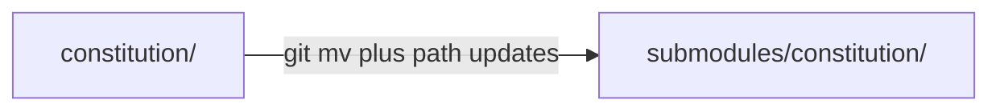

# Tutorial 02 - Migrate a project that uses ./constitution

| Field | Value |
|---|---|
| Revision | 3 |
| Created | 2026-10-29 |
| Last modified | 2026-10-31T11:30:00Z |
| Status | draft |
| Status summary | Legacy layout migration. Reconciled with the final scripts (--help and source) on 2026-10-29; not verified by a live end-to-end install. |
| Authority | Tool documentation for `scripts/install_constitution.sh` and `scripts/update_constitution.sh`; no new anchor. §11.4.18, §11.4.257, §11.4.212 govern. |
| Scope | Step-by-step tutorial for the installer. |
| Issues | none |
| Generated twins | .html / .pdf / .docx not generated (Markdown-only policy). |

The legacy layout is supported by the scripts (the layout suites under `tests/layout/run_all.sh` cover both layouts; a review run reported 16 suites run, 0 failed: that count is relayed, not re-measured here); migrate when convenient.

1. Make sure the tree is clean: `git status`.
2. Run the installer; it detects LEGACY and explains.

```bash
curl -fsSL https://raw.githubusercontent.com/HelixDevelopment/HelixConstitution/main/scripts/install_constitution.sh | bash -s -- --dry-run
```

3. Choose: pass `--agent` so the setup prompt performs the migration (with backups in `.constitution-install-backup/<timestamp>/`), or follow the printed manual steps: `git mv constitution submodules/constitution`, `git submodule sync -- submodules/constitution`, change the `@constitution/...` pointers in `CLAUDE.md` / `AGENTS.md` / `GEMINI.md` / `QWEN.md` to `@submodules/constitution/...`, then commit. The installer itself never moves it; `bash install_constitution.sh --detect-layout` prints `legacy`.
4. Verify: `git submodule status`, grep your files for stray `./constitution` references, run `bash submodules/constitution/scripts/setup.sh`.
5. Commit.



See [layout_before_after](../diagrams/layout_before_after.md). Back: [FAQ](../faq/installer_faq.md).
