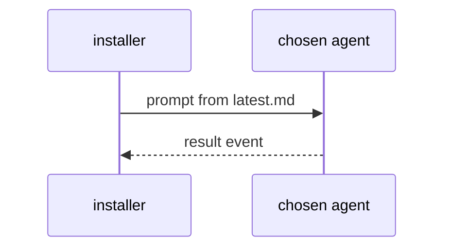

# Tutorial 05 - Choosing agents and aliases

| Field | Value |
|---|---|
| Revision | 3 |
| Created | 2026-10-29 |
| Last modified | 2026-10-30T09:00:00Z |
| Status | draft |
| Status summary | Selecting the agent and model for the setup run. Reconciled with the final scripts (--help and source) on 2026-10-29; not verified by a live end-to-end install. |
| Authority | Tool documentation for `scripts/install_constitution.sh` and `scripts/update_constitution.sh`; no new anchor. §11.4.18, §11.4.257, §11.4.212 govern. |
| Scope | Step-by-step tutorial for the installer. |
| Issues | none |
| Generated twins | .html / .pdf / .docx not generated (Markdown-only policy). |

1. See what is available: `bash install_constitution.sh --detect-agents` (it calls `claude-list-accounts` and `claude-providers list` when present, no LLM calls); the interactive menu shows the same.
2. Prefer a healthy native account (`claude1..N`) before a provider alias; check limits with `claude-providers quota --json`.
3. Pick by flag: `--agent claude2 --model sonnet --effort medium`.
4. Bound the cost: `--max-budget-usd 2 --timeout-sec 1800`.
5. Other drivable agents (they run with their own default permissions; non-interactive runs need `--allow-unrestricted-agent`, otherwise exit 3): `kimi`, `opencode`, `pi` (UNCONFIRMED against a live run; for `opencode` and `pi` success is judged by exit code plus output only). Others are detect-only and are refused. List what is detected with `bash install_constitution.sh --detect-agents`.
6. Decision layer: leave `--decision-layer off` unless you want it; `shadow` only logs.

Full diagram: [agent_selection_sequence](../diagrams/agent_selection_sequence.md). Back: [FAQ](../faq/installer_faq.md).
